# DataSpeakAI: Complete Production-Grade EERD

This diagram provides a 100% comprehensive view of the DataSpeakAI data architecture, including infrastructure, AI processing, multi-tenancy, and business intelligence.

```mermaid
erDiagram
    %% --- MULTI-TENANCY & IDENTITY ---
    TENANTS ||--o{ MEMBERSHIPS : "has"
    TENANTS ||--|| SUBSCRIPTIONS : "owns"
    TENANTS ||--|| TENANT_SETTINGS : "customizes"
    USERS ||--o{ MEMBERSHIPS : "belongs to"
    MEMBERSHIPS ||--|| ROLES : "assigned"
    ROLES ||--o{ PERMISSIONS : "includes"
    
    %% --- INFRASTRUCTURE & METADATA ---
    TENANTS ||--o{ DATABASE_CONNECTIONS : "manages"
    DATABASE_CONNECTIONS ||--|| SECRETS : "protects"
    DATABASE_CONNECTIONS ||--o{ DATABASE_SCHEMAS : "contains"
    DATABASE_SCHEMAS ||--o{ TABLE_METADATA : "describes"
    TABLE_METADATA ||--o{ COLUMN_METADATA : "indexes"
    TENANTS ||--o{ QUERY_TEMPLATES : "defines"
    
    %% --- AI ENGINE & CONVERSATION ---
    TENANTS ||--|| CHATBOT_CONFIGS : "configures"
    TENANTS ||--o{ CONVERSATIONS : "hosts"
    CONVERSATIONS ||--o{ MESSAGES : "contains"
    MESSAGES ||--o{ INTENTS : "analyzed as"
    MESSAGES ||--o{ EXECUTED_QUERIES : "runs"
    EXECUTED_QUERIES ||--o{ QUERY_SAFETY_LOGS : "validated by"
    
    %% --- KNOWLEDGE BASE (RAG) ---
    TENANTS ||--o{ DOCUMENTS : "uploads"
    DOCUMENTS ||--o{ DOCUMENT_CHUNKS : "chunked into"
    DOCUMENT_CHUNKS ||--|| VECTOR_RECORDS : "embedded in"
    VECTOR_RECORDS ||--|| COLLECTIONS : "organized in"
    
    %% --- BUSINESS INTELLIGENCE & ANALYTICS ---
    TENANTS ||--o{ GENERATED_INSIGHTS : "receives"
    GENERATED_INSIGHTS ||--o{ RECOMMENDATIONS : "provides"
    TENANTS ||--o{ DASHBOARDS : "configures"
    DASHBOARDS ||--o{ WIDGETS : "displays"
    
    %% --- BILLING & USAGE ---
    SUBSCRIPTIONS ||--o{ INVOICES : "generates"
    INVOICES ||--|| PAYMENTS : "reconciles"
    TENANTS ||--o{ METERED_USAGE : "tracks"
    TENANTS ||--o{ RATE_LIMITS : "enforces"
    
    %% --- SECURITY & AUDIT ---
    TENANTS ||--o{ API_KEYS : "issues"
    TENANTS ||--o{ AUDIT_LOGS : "records"
    TENANTS ||--o{ SECURITY_POLICIES : "enforces"
    DATABASE_CONNECTIONS ||--o{ SYSTEM_METRICS : "monitors"

    %% --- ENTITY DEFINITIONS ---

    TENANTS {
        int id PK
        string org_id UK
        string name
        string industry
        string logo_url
        datetime created_at
    }

    USERS {
        int id PK
        string email UK
        string password_hash
        string mfa_secret
        boolean is_verified
    }

    MEMBERSHIPS {
        int id PK
        int user_id FK
        int tenant_id FK
        int role_id FK
        boolean is_owner
    }

    DATABASE_CONNECTIONS {
        int id PK
        int tenant_id FK
        string engine "Postgres, MySQL, Snowflake"
        string host
        int port
        string db_name
        string status "Healthy, Error"
    }

    TABLE_METADATA {
        int id PK
        int schema_id FK
        string table_name
        string semantic_description
        boolean is_fact_table
        json relationships_metadata
    }

    COLUMN_METADATA {
        int id PK
        int table_id FK
        string column_name
        string data_type
        boolean is_pii
        string sample_data
        string unit_type "Currency, Date, Count"
    }

    CONVERSATIONS {
        int id PK
        int tenant_id FK
        string session_token UK
        string platform "Web, iOS, SDK"
        datetime last_activity
    }

    MESSAGES {
        int id PK
        int conversation_id FK
        string sender_role "User, AI, System"
        text raw_content
        text sanitized_content
        json context_snapshot
    }

    EXECUTED_QUERIES {
        int id PK
        int message_id FK
        int connection_id FK
        text sql_generated
        float execution_ms
        int rows_returned
        string result_cache_key
    }

    DOCUMENTS {
        int id PK
        int tenant_id FK
        string file_name
        string storage_path
        string mime_type
        int total_tokens
    }

    DOCUMENT_CHUNKS {
        int id PK
        int document_id FK
        text content
        int overlap_chars
    }

    GENERATED_INSIGHTS {
        int id PK
        int tenant_id FK
        string category "Financial, Operational"
        text summary
        float impact_score
        datetime expires_at
    }

    SUBSCRIPTIONS {
        int id PK
        int tenant_id FK
        string stripe_id UK
        string plan_tier "Starter, Growth, Scale"
        string status "Active, Past_Due"
    }

    METERED_USAGE {
        int id PK
        int tenant_id FK
        string feature "RAG_Query, SQL_Gen, Storage"
        int quantity
        datetime recorded_at
    }

    API_KEYS {
        int id PK
        int tenant_id FK
        string hashed_key UK
        string scopes "readonly, readwrite"
        datetime expires_at
    }

    CHATBOT_CONFIGS {
        int id PK
        int tenant_id FK
        string widget_title
        string theme_color
        string position
        boolean sound_enabled
    }

    QUERY_TEMPLATES {
        int id PK
        int tenant_id FK
        string name
        text sql_template
        json parameters_schema
    }

    RATE_LIMITS {
        int id PK
        int tenant_id FK
        string endpoint_group
        int max_requests_per_min
    }

    SYSTEM_METRICS {
        int id PK
        int connection_id FK
        float cpu_usage
        float memory_usage
        int active_connections
        datetime timestamp
    }

    SECURITY_POLICIES {
        int id PK
        int tenant_id FK
        boolean enforce_2fa
        string allowed_ip_ranges
        json pii_redaction_rules
    }
```

## Architectural Deep-Dive

### 1. Multi-Tenant Foundation (Modules 1-2)
The `Memberships` bridge table separates Identity (Users) from Access (Tenants), allowing a single user to belong to multiple organizations with different roles.

### 2. AI Semantic Layer (Modules 11-13)
Instead of just connecting to a DB, we store `semantic_description` and `unit_type` in `Column_Metadata`. This allows the AI to understand that a column named `amt` actually refers to `Net Transaction Amount in USD`.

### 3. Query Safety & Audit (Modules 9, 14, 16)
Every AI-generated query is linked to a `Query_Safety_Log` and an `Executed_Query` record. This ensures that even if an AI generates a destructive query, our safety validation layer catches it and logs the incident in `Security_Policies`.

### 4. RAG Intelligence (Module 17)
Documents are not just stored; they are decomposed into `Document_Chunks` with overlap tracking, which are then mapped to `Vector_Records` in a specific `Collection` for high-speed semantic retrieval.

### 5. Insight-to-Action Pipeline (Module 18)
`Generated_Insights` are not static reports. They link to `Recommendations`, which can be tracked and converted into tasks within the platform.

### 6. Metered Economics (Modules 3, 20)
The `Metered_Usage` table tracks high-resolution events (tokens, queries, megabytes), allowing the billing engine to generate accurate `Invoices` based on real-time platform consumption.
