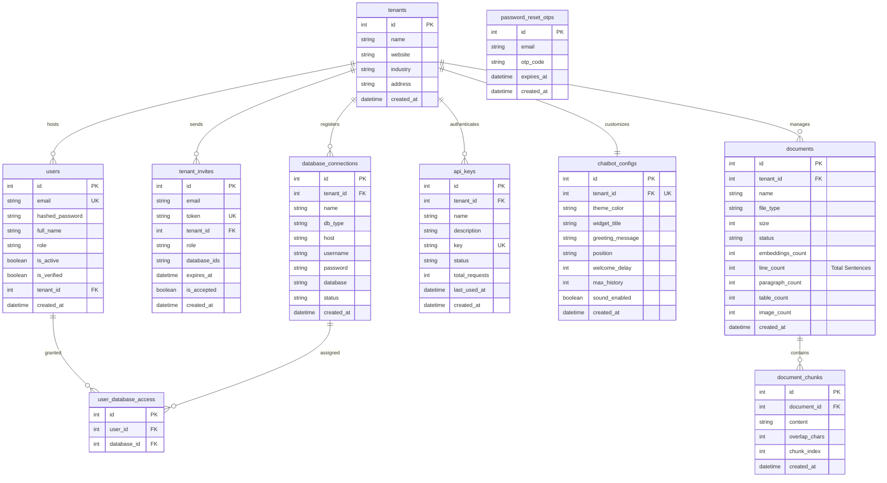

# 🗄️ DataSpeakAI Database Entity-Relationship Diagram (ERD)

This document provides a 100% comprehensive, thesis-ready specification of the **DataSpeakAI Relational Database Schema**. It details the entity relationships, fields, data types, constraints, and multi-tenant partitioning design.

---

## 🗺️ Interactive Crow's Foot ERD (Mermaid.js)

The following diagram represents the standard logical schema of the application, utilizing **Crow's Foot notation** to denote structural cardinality (one-to-one, one-to-many, many-to-many):

---

## 🗂️ Complete Data Dictionary

### 1. `tenants`
Stores the corporate/organizational accounts. The platform is designed around **multi-tenant partitioning**, meaning all downstream customer records are segregated by a `tenant_id` foreign key.

| Column | Data Type | Constraints | Description |
| :--- | :--- | :--- | :--- |
| `id` | INTEGER | PRIMARY KEY, AUTOINCREMENT | Unique tenant identifier. |
| `name` | VARCHAR | NOT NULL | Name of the corporate organization. |
| `website` | VARCHAR | NULLABLE | Tenant company homepage URL. |
| `industry` | VARCHAR | NULLABLE | Industry sector. |
| `address` | VARCHAR | NULLABLE | Physical address of the organization. |
| `created_at` | DATETIME | DEFAULT current_timestamp | Date and time of registration. |

---

### 2. `users`
Represents the users registered on the platform. Users belong to a specific tenant and hold standard authorization roles.

| Column | Data Type | Constraints | Description |
| :--- | :--- | :--- | :--- |
| `id` | INTEGER | PRIMARY KEY, AUTOINCREMENT | Unique user identifier. |
| `email` | VARCHAR | UNIQUE, NOT NULL | User's business email (login credential). |
| `hashed_password` | VARCHAR | NOT NULL | Salted and hashed password string (Bcrypt). |
| `full_name` | VARCHAR | NULLABLE | User's display name. |
| `role` | VARCHAR | DEFAULT "Admin" | RBAC Role (Admin, Business Owner, Developer). |
| `is_active` | BOOLEAN | DEFAULT TRUE | Active status flag. |
| `is_verified` | BOOLEAN | DEFAULT FALSE | Verified OTP email verification flag. |
| `tenant_id` | INTEGER | FOREIGN KEY (`tenants.id`) | Links user to their company partition. |
| `created_at` | DATETIME | DEFAULT current_timestamp | Account registration timestamp. |

---

### 3. `user_database_access`
A join table facilitating **many-to-many relationships** mapping specific dashboard users to specific registered relational data connectors.

| Column | Data Type | Constraints | Description |
| :--- | :--- | :--- | :--- |
| `id` | INTEGER | PRIMARY KEY, AUTOINCREMENT | Unique join row identifier. |
| `user_id` | INTEGER | FOREIGN KEY (`users.id`), NOT NULL | Connected user. |
| `database_id` | INTEGER | FOREIGN KEY (`database_connections.id`), NOT NULL | Assigned database connection. |

---

### 4. `tenant_invites`
Stores pending team-member invitations sent by administrators.

| Column | Data Type | Constraints | Description |
| :--- | :--- | :--- | :--- |
| `id` | INTEGER | PRIMARY KEY, AUTOINCREMENT | Unique invitation identifier. |
| `email` | VARCHAR | NOT NULL | Invited email address. |
| `token` | VARCHAR | UNIQUE, NOT NULL | Secure invite token sent in email. |
| `tenant_id` | INTEGER | FOREIGN KEY (`tenants.id`), NOT NULL | Tenant company the user will join. |
| `role` | VARCHAR | DEFAULT "Team Member" | Default role to assign upon registration. |
| `database_ids` | VARCHAR | NULLABLE | Comma-separated list of database IDs granted. |
| `expires_at` | DATETIME | NOT NULL | Invite token expiration date. |
| `is_accepted` | BOOLEAN | DEFAULT FALSE | Accepted status flag. |
| `created_at` | DATETIME | DEFAULT current_timestamp | Date the invitation was generated. |

---

### 5. `database_connections`
Stores the metadata for database connections added by tenants.

| Column | Data Type | Constraints | Description |
| :--- | :--- | :--- | :--- |
| `id` | INTEGER | PRIMARY KEY, AUTOINCREMENT | Unique database connector identifier. |
| `tenant_id` | INTEGER | FOREIGN KEY (`tenants.id`), NOT NULL | Owner of the connection. |
| `name` | VARCHAR | NOT NULL | Friendly display name. |
| `db_type` | VARCHAR | NOT NULL | Engine type (PostgreSQL, MySQL, SQLite). |
| `host` | VARCHAR | NOT NULL | Host IP address or domain pointer. |
| `username` | VARCHAR | NOT NULL | Access username. |
| `password` | VARCHAR | NOT NULL | Encrypted connection password. |
| `database` | VARCHAR | NOT NULL | Database name to query. |
| `status` | VARCHAR | DEFAULT "connected" | Connector health status (connected, failed). |
| `created_at` | DATETIME | DEFAULT current_timestamp | Connection addition date. |

---

### 6. `api_keys`
Stores the corporate keys generated by developers to programmatically fetch agent query responses.

| Column | Data Type | Constraints | Description |
| :--- | :--- | :--- | :--- |
| `id` | INTEGER | PRIMARY KEY, AUTOINCREMENT | Unique key row identifier. |
| `tenant_id` | INTEGER | FOREIGN KEY (`tenants.id`), NOT NULL | Owner of the API Key. |
| `name` | VARCHAR | NOT NULL | Display name of the key. |
| `description` | VARCHAR | NULLABLE | Purpose details of the integration. |
| `key` | VARCHAR | UNIQUE, NOT NULL | Hashed or secure randomized key token. |
| `status` | VARCHAR | DEFAULT "active" | Active state flag (active, revoked). |
| `total_requests` | INTEGER | DEFAULT 0 | Historical API usage counter. |
| `last_used_at` | DATETIME | NULLABLE | Last invocation timestamp. |
| `created_at` | DATETIME | DEFAULT current_timestamp | Key generation date. |

---

### 7. `chatbot_configs`
Stores customization parameters for the tenant-branded floating AI chat widget.

| Column | Data Type | Constraints | Description |
| :--- | :--- | :--- | :--- |
| `id` | INTEGER | PRIMARY KEY, AUTOINCREMENT | Unique config identifier. |
| `tenant_id` | INTEGER | FOREIGN KEY (`tenants.id`), UNIQUE | Unique one-to-one link per tenant. |
| `theme_color` | VARCHAR | DEFAULT "#3b82f6" | Hex widget background primary color. |
| `widget_title` | VARCHAR | DEFAULT "AI Assistant" | Header text of the chatbot. |
| `greeting_message` | VARCHAR | DEFAULT "Hi! I'm..." | Introductory welcome bubble message. |
| `position` | VARCHAR | DEFAULT "bottom-right" | Floating alignment coordinate option. |
| `welcome_delay` | INTEGER | DEFAULT 3 | Seconds before floating bubble appears. |
| `max_history` | INTEGER | DEFAULT 10 | Max message pairs retained in session cache. |
| `sound_enabled` | BOOLEAN | DEFAULT TRUE | Typing sound toggling. |
| `created_at` | DATETIME | DEFAULT current_timestamp | Configuration generation date. |

---

### 8. `documents`
Stores document metadata for RAG processing.

| Column | Data Type | Constraints | Description |
| :--- | :--- | :--- | :--- |
| `id` | INTEGER | PRIMARY KEY, AUTOINCREMENT | Unique document tracking identifier. |
| `tenant_id` | INTEGER | FOREIGN KEY (`tenants.id`), NOT NULL | Owner of the file. |
| `name` | VARCHAR | NOT NULL | Original filename. |
| `file_type` | VARCHAR | NOT NULL | Extension type (PDF, TXT, DOCX). |
| `size` | INTEGER | DEFAULT 0 | Raw file size in bytes. |
| `status` | VARCHAR | DEFAULT "Processing" | Ingestion state (Completed, Processing, Failed). |
| `embeddings_count` | INTEGER | DEFAULT 0 | Total vector indexes saved inside FAISS. |
| `line_count` | INTEGER | DEFAULT 0 | **Total grammatical sentences** extracted. |
| `paragraph_count` | INTEGER | DEFAULT 0 | Total paragraphs detected. |
| `table_count` | INTEGER | DEFAULT 0 | Total tables extracted via `pdfplumber`. |
| `image_count` | INTEGER | DEFAULT 0 | Total visual assets parsed via Gemini. |
| `created_at` | DATETIME | DEFAULT current_timestamp | Document upload timestamp. |

---

### 9. `document_chunks`
Stores the textual contents of chunks extracted during PDF parsing.

| Column | Data Type | Constraints | Description |
| :--- | :--- | :--- | :--- |
| `id` | INTEGER | PRIMARY KEY, AUTOINCREMENT | Unique chunk identifier. |
| `document_id` | INTEGER | FOREIGN KEY (`documents.id`), NOT NULL | Parent source document. |
| `content` | VARCHAR | NOT NULL | Raw text segment contents. |
| `overlap_chars` | INTEGER | DEFAULT 0 | Standard character parsing overlap value. |
| `chunk_index` | INTEGER | NOT NULL | Chunk placement order (for reconstruction). |
| `created_at` | DATETIME | DEFAULT current_timestamp | Ingestion date. |

---

### 10. `password_reset_otps`
Stores transient, short-lived One-Time Passwords (OTPs) for the secure email login verification workflow.

| Column | Data Type | Constraints | Description |
| :--- | :--- | :--- | :--- |
| `id` | INTEGER | PRIMARY KEY, AUTOINCREMENT | Unique token identifier. |
| `email` | VARCHAR | NOT NULL | Target email address. |
| `otp_code` | VARCHAR | NOT NULL | Highly secure randomized OTP string. |
| `expires_at` | DATETIME | NOT NULL | Expiration timestamp. |
| `created_at` | DATETIME | DEFAULT current_timestamp | Code generation date. |
