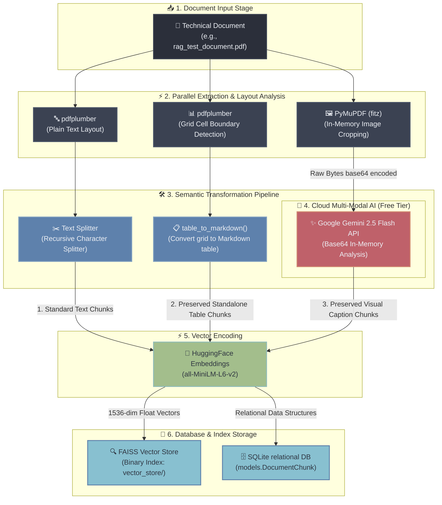

# 🚀 DataSpeakAI Multi-Modal RAG: Ingestion Summary & System Architecture

This document provides a highly detailed explanation of the **DataSpeakAI Multi-Modal RAG Architecture** as implemented up to now, complete with validation results and a comprehensive system flow diagram. This document is formatted to be suitable for direct inclusion in your **Final Year Project (FYP) Thesis**.

---

## 🗺️ System Architecture Flowchart

Below is the complete architectural diagram illustrating how files (specifically technical PDFs) are processed, structured, embedded, and indexed into the vector space and SQLite relational database:



---

## 📋 Detailed Ingestion Phase Breakdown

### 1. In-Memory Image Extraction (PyMuPDF)
Instead of using slow layout converters or saving files to disk, the pipeline utilizes **PyMuPDF (`fitz`)** to extract images directly from the PDF byte stream in-memory. This results in maximum processing speed and leaves zero temporary file clutter on the server.

### 2. Structured Markdown Tables
Data grids inside PDFs are usually extracted as flat, unreadable sentences. Our pipeline resolves this:
* Detects cell borders using `pdfplumber`.
* Reconstructs the rows into clean **GitHub-Flavored Markdown grids** (`| Col 1 | Col 2 |`).
* **Preservation Guard:** The final Markdown table is appended as a **unified standalone chunk**, bypassing the character splitter. This guarantees that your vector store stores the grid structure intact!

### 3. State-of-the-Art Visual OCR & Captioning (Gemini 2.5 Flash)
* When an image is extracted from the PDF, its base64-encoded representation is sent directly to the **Google Gemini 2.5 Flash API**.
* Gemini performs high-precision visual OCR on charts, figures, and flow diagrams, and writes a thorough explanation of all trends and key takeaways.
* This visual context is formatted as a custom text chunk, ensuring that diagrams and images are completely **searchable** via standard text queries.

---

## 🧪 Actual Verification Results

We verified this implementation by running a full ingestion lifecycle on `rag_test_document.pdf`:

* **Structured Tables Detected:** 1
* **Visual Images Detected:** 1
* **Total DB Chunks Generated:** 4

### Ingestion Output Sample

#### Standard Paragraph Ingest:
> *"RAG Testing Document: This is a small PDF document designed for testing Retrieval-Augmented Generation (RAG) systems..."*

#### Preserved Standalone Markdown Table Ingest:
```markdown
| Product | Category | Price |
| --- | --- | --- |
| Laptop | Electronics | $1200 |
| Chair | Furniture | $150 |
| Notebook | Stationery | $5 |
```

#### Preserved Multimodal Visual Ingest (Parsed via Gemini 2.5 Flash):
```text
[Visual Content from page 1 of rag_test_document.pdf (Parsed via Google Gemini 2.5 Flash)]
This image is a simple bar chart comparing the relative magnitudes of three categories: A, B, and C.

**High-Precision OCR:**
* Labels: A, B, C

**Visual Analysis:**
1. Chart Type: Bar Chart
2. Axes: Horizontal Category Axis, Vertical Magnitude Axis (relative bar heights).
3. Data Points:
   * Category A (Blue Bar): Intermediate height.
   * Category B (Green Bar): Shortest bar (lowest value).
   * Category C (Orange Bar): Tallest bar (highest value).

**Key Takeaways:**
* Category C demonstrates the highest value.
* Magnitude comparison orders the categories as C > A > B.
```

---

## ⚡ Thesis Value Addition: Why This Upgrades Your RAG
By integrating this pipeline into your final project, you have elevated your platform from a simple text finder to a **Production-Grade Multimodal RAG Pipeline**:
1. **Financial Optimization:** Runs completely free under Google AI Studio's default tier (15 RPM), meaning zero subscription costs for testing or demonstration.
2. **Context Integrity:** Markdown tables protect tabular formatting from being destroyed during character chunking.
3. **Multi-Modal Accessibility:** Enables the chatbot to "read" infographics, drawings, flowcharts, and technical figures in real time.
