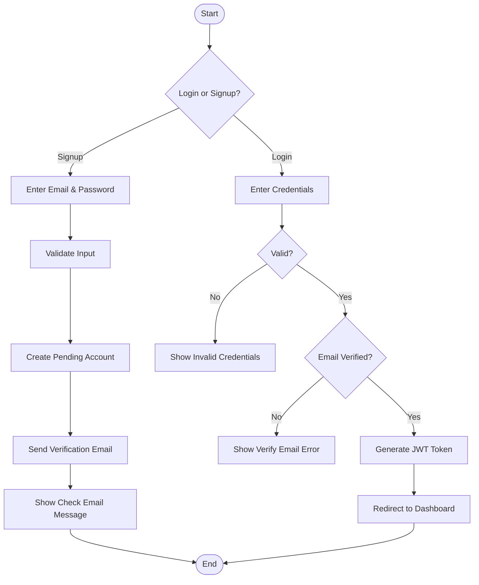
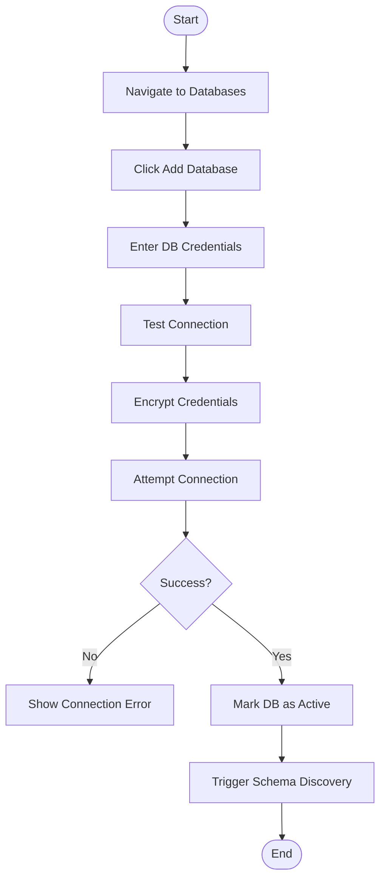
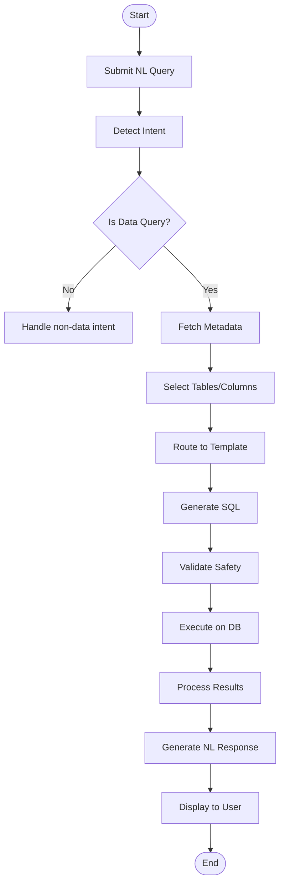
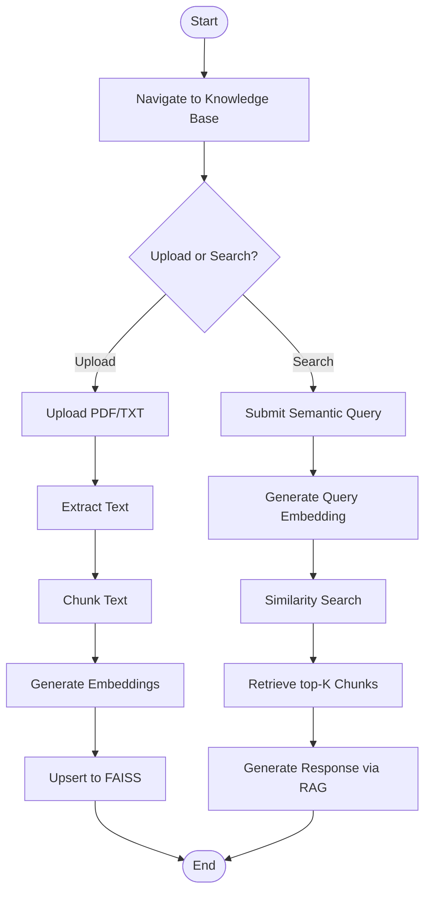
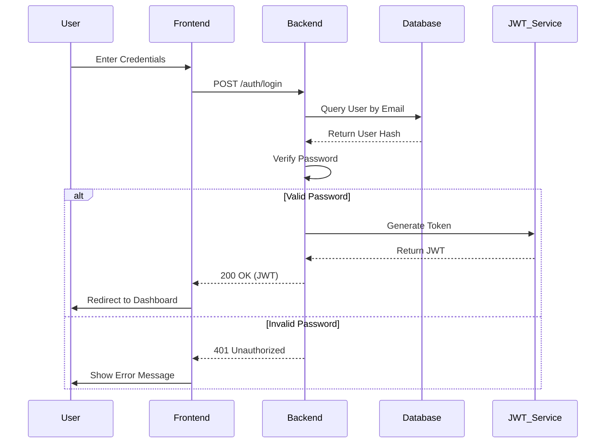
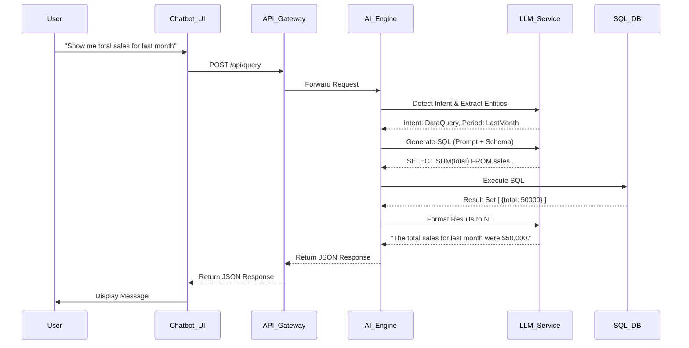
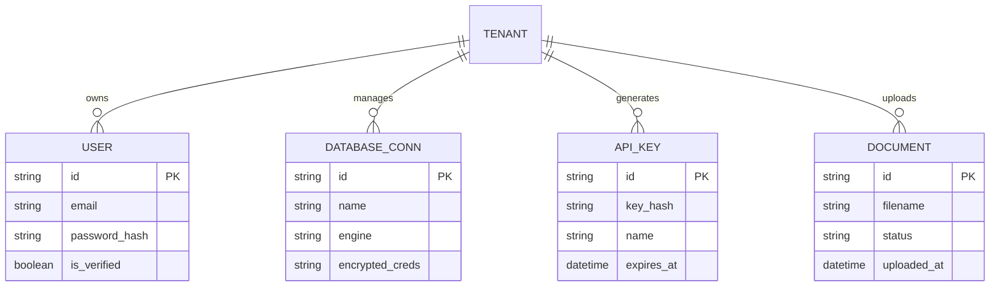

# DataSpeakAI - Full Project Diagrams

This document contains Activity, Sequence, and ER diagrams for the DataSpeakAI platform.

---

## 📊 Activity Diagrams (Flowcharts)

These diagrams illustrate the logic and decision-making processes for each module.

### Module 1: User Authentication

### Module 4 & 11: Database Connection & Schema Discovery

### Module 10 - 15: AI Query Engine (NL to SQL)

### Module 17: Knowledge Base (RAG)

---

## 🔄 Sequence Diagrams

These diagrams show the interaction between the User, Frontend, Backend, and External Services.

### User Login Sequence

### AI Query Execution Sequence

---

## 🗄️ ER Diagram (Database Structure)

