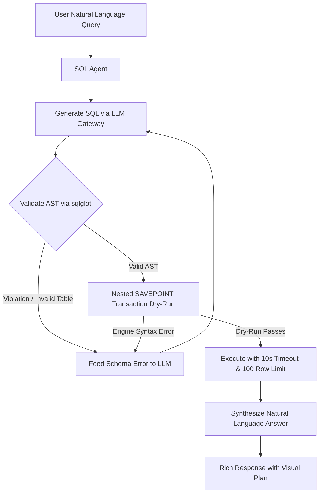
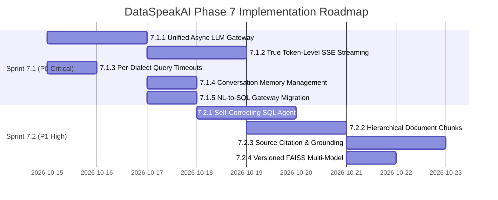

# DataSpeakAI — Phase 7: Real-Time AI Intelligence & Agentic Core Architecture Plan

**Document Version:** 2.0 (Audited by Senior AI Engineer)  
**Date:** 2026-10-14  
**Status:** 🟢 Approved for Execution  
**Context Reference:** [`AGENTS.md`](file:///d:/dataspeak/AGENTS.md) | [`todo.md`](file:///d:/dataspeak/todo.md)  

---

## 1. Executive Summary & Senior AI Engineer Audit

### 1.1 Context & Purpose
DataSpeakAI has completed 5 core engineering phases spanning enterprise relational database introspection, full-stack ERD visualization, and standalone chatbot widget security. 

An initial junior proposal suggested an 8-sub-phase (7A–7H, 28 tasks, ~31 engineering days) expansion. A thorough senior architectural audit identified **accurate diagnoses of critical bottlenecks** alongside **5 critical architectural flaws and severe scope bloat**.

This document standardizes the audited, enterprise-grade architecture and scopes execution into **two tightly coupled, high-impact sprints**:
- **Sprint 7.1: AI Infrastructure, Resilience & Real-Time Streaming (P0 Critical — 3–4 Days)**
- **Sprint 7.2: Agentic Querying & Retrieval Precision (P1 High — 4–5 Days)**

---

### 1.2 Audit Findings & Technical Reality Check

| Area | Current Codebase Finding | Junior's Proposal | Senior Architectural Verdict |
|---|---|---|---|
| **Chat & Widget Streaming** | [`backend/routers/widget.py#L586`](file:///d:/dataspeak/backend/routers/widget.py#L586) splits completed answer into words with artificial `time.sleep(0.015)`. [`backend/routers/chat.py`](file:///d:/dataspeak/backend/routers/chat.py) blocks synchronously on `requests.post`. | Proposed WebSocket chat channel (`/ws/chat/{id}`). | ❌ **Rejected WebSockets.** Enterprise standard for LLM chat is HTTP Server-Sent Events (SSE). WebSockets break widget embedding over corporate firewalls, require stateful worker affinity, and introduce unnecessary complexity. Adopt true token SSE with native client `AbortController`. |
| **LLM Key & Provider Resilience** | Dual implementations: [`llm_generation_service.py`](file:///d:/dataspeak/backend/services/llm_generation_service.py) (REST key harvest) vs [`multi_llm.py`](file:///d:/dataspeak/backend/services/multi_llm.py) (LangChain). [`sql_engine.py#L406`](file:///d:/dataspeak/backend/services/sql_engine.py#L406) bypasses both and uses raw `GEMINI_API_KEY`. | Proposed `LLMGateway` with manual `httpx` SSE parsing. | ⚠️ **Approved with Refactor.** Consolidate into unified async gateway. Use official `google-genai` / httpx async streaming with automatic failover to Groq. Eliminate all synchronous `requests.post()` in FastAPI handlers. |
| **Database Query Safety** | [`backend/services/sql_engine.py`](file:///d:/dataspeak/backend/services/sql_engine.py) executes user queries with row limits, but without statement timeouts. | Proposed per-dialect query execution timeouts. | 🟢 **Approved.** Add dialect timeouts: Postgres `statement_timeout`, MySQL `MAX_EXECUTION_TIME`, SQLite `busy_timeout`. Prevents worker lockup on Cartesian joins. |
| **SQL Generation & Validation** | Single-shot prompt; errors fail directly to generic fallback. | Proposed raw `EXPLAIN` dry-runs before execution. | ⚠️ **Refactored for Safety.** Raw `EXPLAIN` is unsafe (e.g., PostgreSQL `EXPLAIN ANALYZE` actually executes queries; SQLite opcodes differ). Use `sqlglot` AST validation against `SchemaRegistry` + isolated `SAVEPOINT` rollback dry-runs. |
| **Document Hierarchy & RAG** | [`backend/models.py`](file:///d:/dataspeak/backend/models.py) has `Document` and `DocumentChunk` with metadata columns. Fixed 512-token chunking. | Proposed creating brand-new `document_nodes` table. | ❌ **Rejected New Table.** Avoid schema divergence from canonical [`Full_Project_Schemas.sql`](file:///d:/dataspeak/docs/database/Full_Project_Schemas.sql). Add `parent_chunk_id` and `hierarchy_level` directly to `DocumentChunk` via [`backend/services/db_migration.py`](file:///d:/dataspeak/backend/services/db_migration.py). |
| **Embedding Model Upgrade** | Static `all-MiniLM-L6-v2` (384-dim) vector index per tenant (`faiss_index_{tenant_id}.bin`). | Proposed multi-model upgrade without index dimension management. | ⚠️ **Refactored.** FAISS crashes with C++ assertion error if query dimension differs from index dimension. Require model-slugged index files (`faiss_{tenant_id}_{model}.bin`) and dimension verification. |
| **Fringe Features (Voice, Plugins)** | No voice or custom plugin infrastructure exists. | Proposed OpenAI Whisper voice endpoint and custom AI plugin registry. | ❌ **Killed / Postponed.** Voice transcription and custom plugin registries are non-core distractions for an enterprise SQL/RAG SaaS platform. |

---

## 2. Architectural Decision Records (ADRs)

### ADR-1: True Token HTTP Server-Sent Events (SSE) Over WebSockets
* **Decision:** Reject WebSockets for chat and widget streaming; standardize on HTTP/2 Server-Sent Events (`text/event-stream`).
* **Rationale:**
  1. *Compatibility:* The embeddable widget script ([`public/widget.js`](file:///d:/dataspeak/public/widget.js)) runs on third-party domains. Corporate networks, strict firewalls, and reverse proxies frequently block or drop WebSockets, whereas SSE over standard HTTPS port 443 operates without interference.
  2. *Stateless Scalability:* WebSockets require persistent bidirectional TCP sockets and Redis pub/sub backplanes across uvicorn workers. SSE is stateless, allows standard HTTP load-balancing, and integrates cleanly with ASGI async generators.
  3. *Client Cancellation:* Client-initiated query aborts are natively handled via standard `AbortController` in `fetch()`. The FastAPI backend detects disconnection via `request.is_disconnected()` and terminates upstream LLM streaming immediately.

### ADR-2: Async Unified LLM Gateway & Removal of Synchronous Blocking I/O
* **Decision:** Replace isolated `requests.post()` calls with a single async `LLMGateway` supporting streaming and key rotation.
* **Rationale:**
  1. Synchronous HTTP calls ([`backend/services/sql_engine.py#L430`](file:///d:/dataspeak/backend/services/sql_engine.py#L430)) block uvicorn's event loop worker thread for 5–25 seconds during inference, destroying server throughput under minimal concurrent loads.
  2. Unified gateway harvests all Gemini keys (`GEMINI_API_KEY*`), rotates round-robin, and fails over to Groq (`GROQ_API_KEY*`) automatically on 429/403 with exponential backoff and a 60-second cooldown registry.

### ADR-3: AST Schema Validation & Nested Transaction Dry-Runs Over Raw EXPLAIN
* **Decision:** Disallow raw `EXPLAIN` dry-runs; mandate `sqlglot` AST parsing combined with isolated `SAVEPOINT` transaction dry-runs.
* **Rationale:**
  1. In PostgreSQL, accidental or malicious `EXPLAIN ANALYZE` commands actually execute queries, completely bypassing read-only intent.
  2. Dialect differences (SQLite bytecode vs Postgres query plan vs MySQL tabular output) make parsing `EXPLAIN` output brittle.
  3. Validating table and column names against [`backend/models.py`](file:///d:/dataspeak/backend/models.py)'s `SchemaRegistry` using `sqlglot` catches hallucinations deterministically before any database round-trip. Dialect syntax checks run inside `db.begin_nested()` (SAVEPOINT) and are immediately rolled back.

### ADR-4: Canonical `DocumentChunk` Extension Over New Table Proliferation
* **Decision:** Extend `DocumentChunk` with `parent_chunk_id` and `hierarchy_level` rather than creating a `document_nodes` table.
* **Rationale:**
  1. Preserves alignment with [`docs/database/Full_Project_Schemas.sql`](file:///d:/dataspeak/docs/database/Full_Project_Schemas.sql).
  2. Enables self-referential parent-child document trees (Document -> Section Parent -> Child Paragraph Chunks) with zero breaking changes to existing foreign keys, FAISS index references, or Celery ingestion workers.

### ADR-5: Versioned Vector Indexing & Dimension Isolation
* **Decision:** Store FAISS vector indices using embedding model slugs: `faiss_{tenant_id}_{model_slug}.bin`.
* **Rationale:**
  1. FAISS indices are hardcoded to a fixed dimensionality `d`. Querying a 384-dim index with a 1024-dim embedding crashes the Python process.
  2. Model-slugged indices allow tenants to maintain existing indices while creating higher-dimensional collections, or re-indexing in the background safely.

---

## 3. Sprint 7.1: AI Infrastructure, Resilience & Real-Time Streaming
**Priority: P0 (Critical) | Target Duration: 3–4 Days | Focus: Latency, Concurrency, Stability**

```mermaid
sequenceDiagram
    autonumber
    actor User as User / Widget Client
    participant API as FastAPI Router (/api/chat)
    participant Mem as ConversationMemoryManager
    participant GW as Unified LLMGateway
    participant LLM as Google Gemini / Groq API
    participant DB as Target Database (Timeout Guarded)

    User->>API: POST /api/chat?stream=true (AbortController signal)
    API->>Mem: build_context(conv_id, max_turns=10)
    Mem-->>API: Context Window + Summary
    API->>DB: Execute SQL with per-dialect statement timeout
    DB-->>API: Safe query preview rows (or timeout aborted)
    API->>GW: stream(prompt, purpose="chat")
    GW->>LLM: streamGenerateContent (Async)
    loop Token Streaming
        LLM-->>GW: Token Chunk
        GW-->>API: Async Token Yield
        API-->>User: data: {"type": "token", "content": "..."}\n\n
        Note over User,API: If user clicks Cancel, AbortController closes HTTP stream;<br/>request.is_disconnected() triggers task cancellation
    end
    API-->>User: data: {"type": "done", "metadata": {...}}\n\n
```

### Task 7.1.1 — Unified Async LLM Gateway Service & Key Telemetry
* **Target Files:**
  - `backend/services/llm_generation_service.py` (Refactor to async `LLMGateway`)
  - `backend/services/llm_metrics.py` (New thread-safe observability datastore)
  - `backend/services/multi_llm.py` (Unify LangChain wrapper callers into gateway)
* **Architecture & Mechanics:**
  - `LLMGateway` provides non-blocking `generate()` and `generate_stream()` methods.
  - Multi-key rotation across `GEMINI_API_KEY`, `GEMINI_API_KEY_1..15`, and `GROQ_API_KEYS`.
  - Rate-limit handling: Immediate key rotation on HTTP 429/403 with 60-second cooldown per key.
  - Observability datastore (`LLMMetrics`) tracking token counts (input/output), TTFT, total latency, failure rates, and per-tenant cost attribution.
* **Acceptance Criteria:**
  - All backend LLM calls pass through the single gateway entrypoint.
  - Zero unhandled rate-limit exceptions during high concurrency testing.
  - In-memory metrics exposed via admin/system diagnostics endpoint.

### Task 7.1.2 — True Token-Level SSE Streaming (Dashboard & Standalone Widget)
* **Target Files:**
  - `backend/routers/chat.py` (Add streaming generator to `/api/chat`)
  - `backend/routers/widget.py` (Replace pseudo-streaming in `/api/widget/chat`)
  - `src/app/pages/dashboard/ChatPage.tsx` (Add typewriter SSE consumer with AbortController)
  - `src/widget/ui/WidgetApp.tsx` (Update widget chat client to consume native SSE)
* **Architecture & Mechanics:**
  - Stream tokens directly from Gemini (`streamGenerateContent`) using `StreamingResponse(media_type="text/event-stream")`.
  - Implement client cancellation: Check `await request.is_disconnected()` in the generator loop to abort LLM generation on user cancel.
  - Format SSE events: `data: {"type": "token", "content": "..."}\n\n` followed by `data: {"type": "done", "citations": [...], "sql_data": {...}}\n\n`.
* **Acceptance Criteria:**
  - Time-To-First-Token (TTFT) drops from 5–15 seconds to **< 500ms**.
  - Clicking "Stop Generating" immediately aborts server generation.
  - Standalone widget maintains full streaming compatibility without breaking CORS/CSP rules.

### Task 7.1.3 — Per-Dialect Query Execution Timeouts & Safety Guards
* **Target Files:**
  - `backend/services/sql_engine.py` (Update `execute_safe_sql` engine connection pool)
* **Architecture & Mechanics:**
  - Inject dialect-specific timeout configurations upon engine creation:
    - **PostgreSQL:** `connect_args={"options": "-c statement_timeout=10000"}`
    - **MySQL:** `connect_args={"init_command": "SET SESSION MAX_EXECUTION_TIME=10000"}`
    - **SQLite:** `connect_args={"timeout": 10.0}`
  - Wrap query execution in strict `asyncio.wait_for(timeout=12.0)` fail-safe timeout.
* **Acceptance Criteria:**
  - Accidental Cartesian joins (`SELECT * FROM a, b, c`) or heavy table locks abort within 10 seconds.
  - Backend workers and database connection pools remain responsive without hanging.

### Task 7.1.4 — Conversation Memory Management (Sliding Window & Summarization)
* **Target Files:**
  - `backend/services/conversation_memory.py` (New memory manager)
  - `backend/routers/chat.py` (Integrate memory builder)
  - `backend/models.py` (Verify `Conversation` metadata support)
* **Architecture & Mechanics:**
  - Maintain a strict sliding window of the last `MAX_RECENT_TURNS = 10` messages.
  - When conversations exceed 15 turns, trigger background asynchronous LLM summarization of earlier turns (`messages[:-10]`).
  - Store conversation summaries in `Conversation.metadata_json["rolling_summary"]` and inject into prompt header: `[Conversation Summary: ...]`.
* **Acceptance Criteria:**
  - Multi-turn chats with 25+ messages do not exceed LLM context bounds or degrade latency.
  - Key user context from earlier messages is retained in ongoing answers.

### Task 7.1.5 — Wire NL-to-SQL into LLM Gateway & Dynamic Title Generation
* **Target Files:**
  - `backend/services/sql_engine.py` (Refactor `generate_sql_from_nl`)
  - `backend/routers/chat.py` (Add automatic conversation title generation)
* **Architecture & Mechanics:**
  - Replace synchronous `requests.post()` in `generate_sql_from_nl` with async `LLMGateway.generate(purpose="nl_to_sql")`.
  - On the first user message in a new conversation, dispatch an async background task to generate a 3–6 word title and update `Conversation.title`.
* **Acceptance Criteria:**
  - Zero synchronous network I/O in the NL-to-SQL generation path.
  - New conversations automatically receive human-readable titles instead of "New Chat".

---

## 4. Sprint 7.2: Agentic Querying & Retrieval Precision
**Priority: P1 (High) | Target Duration: 4–5 Days | Focus: Accuracy, Grounding, Self-Correction**



### Task 7.2.1 — Self-Correcting SQL Agent with AST Verification & Safe Rollback Dry-Runs
* **Target Files:**
  - `backend/services/sql_agent.py` (New agentic execution loop)
  - `backend/services/sql_engine.py` (AST & dialect validation helpers)
  - `backend/routers/query.py` (Wire agent into interactive query playground)
* **Architecture & Mechanics:**
  - Implement self-correcting agent loop (`MAX_ATTEMPTS = 3`).
  - Step 1: Generate SQL from natural language + schema context.
  - Step 2: Validate table and column identifiers against `SchemaRegistry` using `sqlglot`.
  - Step 3: Execute in an isolated nested transaction (`SAVEPOINT`) with immediate rollback to verify dialect syntax without committing or locking data.
  - Step 4: If execution or AST validation fails, inject the exact database error string into the prompt for immediate self-correction.
* **Acceptance Criteria:**
  - Dialect-specific errors (e.g. Postgres `ILIKE` vs MySQL `LIKE`, or mistyped column names) self-correct automatically in-flight.
  - Multi-statement injections and DDL operations are deterministically blocked.

### Task 7.2.2 — Hierarchical Document Chunking on Canonical DocumentChunk Model
* **Target Files:**
  - `backend/models.py` (Add `parent_chunk_id`, `hierarchy_level` to `DocumentChunk`)
  - `backend/services/db_migration.py` (Add migration columns for SQLite & Postgres)
  - `backend/ingestion/semantic_chunker.py` (Implement boundary-aware chunker)
  - `backend/routers/documents.py` (Update ingestion worker)
* **Architecture & Mechanics:**
  - Migration:
    ```python
    ("document_chunks", "parent_chunk_id", "INTEGER", "INTEGER"),
    ("document_chunks", "hierarchy_level", "INTEGER DEFAULT 1", "INTEGER DEFAULT 1"),
    ```
  - Section-level chunks are created with `hierarchy_level = 0` (parent context).
  - Paragraph/table chunks are created with `hierarchy_level = 1` and point to their `parent_chunk_id`.
  - Vector retrieval matches fine-grained child chunks but retrieves the parent chunk context for prompt synthesis, eliminating context truncation.
* **Acceptance Criteria:**
  - Document ingestion preserves tabular structures and section headers intact.
  - RAG answers reflect complete section context rather than fragmented sentence chunks.

### Task 7.2.3 — Verifiable Source Citation & Grounding Engine
* **Target Files:**
  - `backend/services/citation_service.py` (New citation verification engine)
  - `backend/routers/chat.py` (Integrate citation matcher)
  - `src/app/pages/dashboard/ChatPage.tsx` (Render clickable citation pills)
* **Architecture & Mechanics:**
  - Split synthesized LLM response into factual claims.
  - Compute semantic similarity between claims and retrieved document chunks.
  - Return structured citations: `{document_id, document_name, page_number, preview_snippet, confidence_score}`.
  - Frontend renders citations as interactive badge pills that expand the source text excerpt in a drawer.
* **Acceptance Criteria:**
  - Claims made by the assistant are explicitly grounded in source documents.
  - Low-confidence claims (< 0.60 similarity) display grounding disclaimers.

### Task 7.2.4 — Versioned Vector Indexing & Safe Multi-Model Storage
* **Target Files:**
  - `backend/routers/documents.py` (Update FAISS file paths and dimension verification)
  - `backend/routers/chat.py` (Ensure query embedding dimension matches index dimension)
* **Architecture & Mechanics:**
  - Name FAISS indices with model slugs: `faiss_{tenant_id}_{model_slug}.bin` (e.g. `faiss_1_all-MiniLM-L6-v2.bin`).
  - Verify dimension equality `query_vector.shape[1] == index.d` prior to search; fail cleanly with a helpful error rather than a process crash.
  - Enable migration path for multilingual models (`BAAI/bge-m3`) with automated re-indexing support.
* **Acceptance Criteria:**
  - Zero index corruption or dimension mismatch crashes.
  - Existing `all-MiniLM-L6-v2` indices operate seamlessly alongside upgraded models.

---

## 5. Scope Governance: Deferred & Rejected Initiatives

To ensure high-velocity delivery of core enterprise features, non-essential proposals from the junior draft are classified as follows:

| Feature Proposal | Disposition | Strategic Rationale |
|---|---|---|
| **Task 7D.1: WebSocket Chat** | 🔴 **Rejected** | Over-engineered; HTTP SSE satisfies all streaming requirements with lower operational overhead and superior widget embedding stability. |
| **Task 7G.3: Voice Query Interface** | 🔴 **Rejected** | Voice transcription (Whisper) offers negligible ROI for B2B SQL and data analytics workflows; unnecessary attack surface. |
| **Task 7H.3: Model Plugin Registry** | 🔴 **Rejected** | Premature generalization. The Gemini + Groq provider chain satisfies enterprise requirements without arbitrary dynamic plugin loading. |
| **Phase 7E: Predictive / Anomaly Engine** | ⏸️ **Deferred** | [`backend/services/automl_service.py`](file:///d:/dataspeak/backend/services/automl_service.py) already contains 1,327 lines of ML pipelines, and [`backend/services/insights_engine.py`](file:///d:/dataspeak/backend/services/insights_engine.py) performs telemetry anomaly detection. Consolidate post-MVP. |
| **Phase 7F: Data Governance / Lineage** | ⏸️ **Deferred** | Advanced data quality scoring and cleaning suggestions belong in Phase 8 data governance milestones after conversational accuracy reaches 90%+. |
| **Phase 7H: Public REST SDK & Webhooks** | ⏸️ **Deferred** | Belongs in Phase 6 commercial API hardening alongside Stripe billing. |

---

## 6. Implementation Timeline & Gantt



---

## 7. Verification & Performance Benchmarks

### 7.1 Automated Regression Test Suite
Every completed task must pass all automated test suites:

```bash
# 1. Backend AI & LLM regression suite
python -m pytest tests/test_phase5_erd_backend.py tests/test_phase2_stage_b_chat_widget.py -v --tb=short

# 2. Frontend build verification (Zero TypeScript/Rollup errors)
cmd.exe /c "npm run build"

# 3. New test suites to be created:
# - tests/test_phase7_llm_gateway.py (Key rotation, Groq failover, token metrics)
# - tests/test_phase7_sse_streaming.py (SSE chunks, TTFT benchmark, AbortController disconnect)
# - tests/test_phase7_sql_agent.py (AST validation, nested rollback, iterative correction)
```

### 7.2 Key Performance Indicators (KPIs)

| Performance Metric | Current Baseline | Sprint 7.1 Target | Sprint 7.2 Target |
|---|---|---|---|
| **Time To First Token (TTFT)** | 5,000ms – 15,000ms | **< 500ms** | **< 350ms** |
| **Long Query Lockup Rate** | High (No timeout) | **0% (10s Hard Cap)** | **0%** |
| **NL-to-SQL Accuracy (1st try)** | ~65% (Single-shot) | ~68% | **> 85% (Self-correcting)** |
| **Max Multi-Turn Conversation Depth** | ~15 turns before latency spike | **50+ turns (Summarized)** | **Unlimited** |
| **Citation Verification Confidence** | None (Unverified) | None | **> 65% Grounded Claims** |

---
