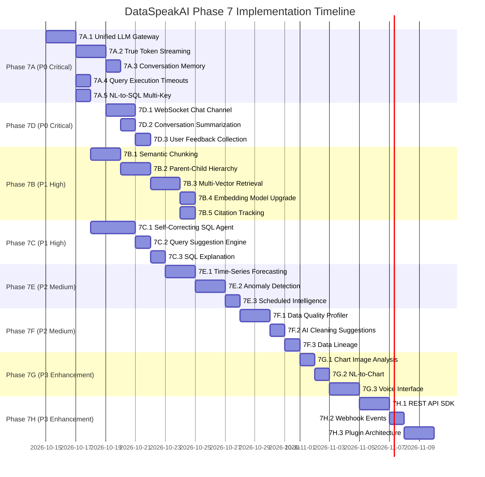
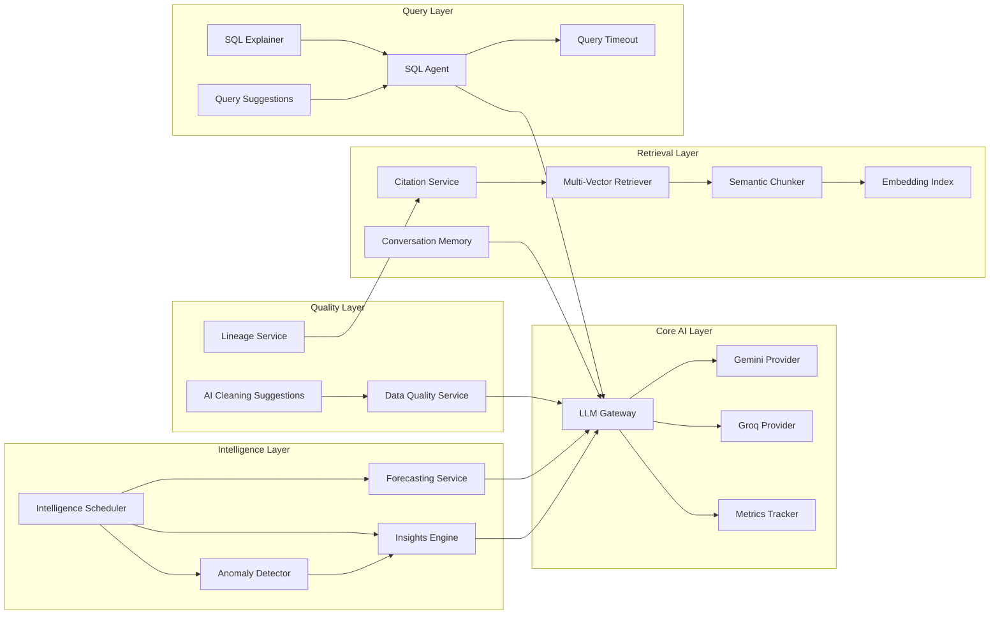

# DataSpeakAI — Phase 7: AI Features Deep Audit & Next-Generation Implementation Plan

**Date:** 2026-10-14  
**Author:** Antigravity AI Engineer  
**Scope:** Comprehensive audit of current AI professional practices, gap analysis, and detailed implementation roadmap for next-generation AI/Data features  
**Status:** 🔵 Awaiting User Approval

---

## Table of Contents

1. [Executive Summary](#1-executive-summary)
2. [Current AI Features — Professional Practices Audit](#2-current-ai-features--professional-practices-audit)
3. [Gap Analysis & Technical Debt](#3-gap-analysis--technical-debt)
4. [Phase 7A: AI Engine Hardening & Current Feature Maturation](#4-phase-7a-ai-engine-hardening--current-feature-maturation)
5. [Phase 7B: Advanced RAG 2.0 — Next-Generation Document Intelligence](#5-phase-7b-advanced-rag-20--next-generation-document-intelligence)
6. [Phase 7C: Agentic NL-to-SQL 2.0 — Multi-Turn Query Refinement](#6-phase-7c-agentic-nl-to-sql-20--multi-turn-query-refinement)
7. [Phase 7D: Real-Time AI Streaming & Conversational Memory](#7-phase-7d-real-time-ai-streaming--conversational-memory)
8. [Phase 7E: Predictive Analytics & Anomaly Detection Engine](#8-phase-7e-predictive-analytics--anomaly-detection-engine)
9. [Phase 7F: AI-Powered Data Quality & Governance Layer](#9-phase-7f-ai-powered-data-quality--governance-layer)
10. [Phase 7G: Multi-Modal Analytics — Chart-to-Insight & Voice](#10-phase-7g-multi-modal-analytics--chart-to-insight--voice)
11. [Phase 7H: Embeddable AI Copilot SDK & Plugin Architecture](#11-phase-7h-embeddable-ai-copilot-sdk--plugin-architecture)
12. [Implementation Priority Matrix](#12-implementation-priority-matrix)
13. [Architecture Diagrams](#13-architecture-diagrams)
14. [Verification Plan](#14-verification-plan)

---

## 1. Executive Summary

DataSpeakAI has completed **5 major engineering phases** building a sophisticated enterprise BI + AI platform. The current codebase implements:

| AI Capability | Current State | Maturity |
|---|---|---|
| **NL-to-SQL Translation** | Gemini 2.5 Flash, single-turn, schema-aware | 🟡 MVP |
| **RAG Document Search** | FAISS + BM25 + RRF + Cross-Encoder reranking | 🟢 Production |
| **Multi-Modal Document Processing** | PyMuPDF + pdfplumber + Gemini VLM OCR | 🟢 Production |
| **Hybrid Query Routing** | Keyword heuristics + LLM intent classifier | 🟡 MVP |
| **AI Insights Engine** | Telemetry aggregation → Gemini synthesis → recommendations | 🟢 Production |
| **AutoML Service** | LLM problem detection + scikit-learn/XGBoost training | 🟡 MVP |
| **Adaptive Chart Recommendation** | Rule-based archetype → chart type mapping | 🟢 Production |
| **Multi-LLM Provider Failover** | Gemini → Groq, multi-key rotation, cooldown tracker | 🟢 Production |
| **LangGraph Agent Pipeline** | 4-agent semantic→KPI→chart→validator orchestrator | 🟡 Prototype |
| **Embeddable Widget AI** | HMAC session, AST SQL validation, SSE streaming | 🟢 Production |

This plan proposes **8 sub-phases (7A–7H)** to transform DataSpeakAI from a strong MVP into a **world-class enterprise AI analytics platform**.

---

## 2. Current AI Features — Professional Practices Audit

### 2.1 ✅ Strengths & Professional Practices Already in Place

#### A. Multi-Provider LLM Architecture with Resilience
- **Multi-key harvesting**: Comma-separated `GEMINI_API_KEY`, indexed `GEMINI_API_KEY_1..15`, `GROQ_API_KEYS` — excellent for production key pooling
- **Thread-safe round-robin rotation**: `_rotate_keys()` with `threading.Lock` distributes quota across keys
- **Instant token exhaustion failover**: 429/403 detection → 60s cooldown → immediate next key shift
- **Active key health ordering**: `_get_active_ordered_keys()` prioritizes healthy keys, degraded keys as fallback
- **Provider chain**: Gemini → Groq with model-level fallback within each provider

> [!TIP]
> **Best Practice Score: 9/10** — This is production-grade LLM infrastructure. Missing: observability metrics (token counts, latency percentiles) and cost tracking per tenant.

#### B. Hybrid RAG Search Pipeline
- **Dual-index retrieval**: Dense (FAISS `all-MiniLM-L6-v2`) + Sparse (BM25Okapi)
- **Reciprocal Rank Fusion (RRF)**: Standard academic fusion formula `1/(k+rank)` with k=60
- **Cross-Encoder Reranking**: `cross-encoder/ms-marco-MiniLM-L-6-v2` for semantic precision
- **Structure-aware document extraction**: PDF split router (fast CPU vs Gemini VLM OCR based on text density)
- **Multi-format ingestion**: PDF, DOCX, XLSX, CSV, PPTX, HTML, MD with table/visual extraction

> [!TIP]
> **Best Practice Score: 8/10** — Solid hybrid retrieval. Missing: chunk metadata enrichment, parent-child document hierarchy, and adaptive chunk sizing.

#### C. SQL Safety & Security Hardening
- **Read-only SQL validation**: DDL/DML keyword blocklist, semicolon injection prevention, `SELECT`/`WITH` whitelist
- **AST-based table extraction**: `sqlglot` parsing for fail-closed table reference validation (SEC-02)
- **System catalog protection**: Blocks `pg_*`, `sqlite_master`, `information_schema`, `sys.*`
- **PII column masking**: Regex pattern detection for `password`, `ssn`, `credit_card`, etc.
- **Widget SQL validation**: Strict table allowlist, no `.split('.')[-1]` bypass

> [!TIP]
> **Best Practice Score: 9/10** — Excellent defense-in-depth. Missing: query execution timeouts per dialect, prepared statement parameterization for generated SQL.

#### D. AI Insights Engine
- **Genuine telemetry collection**: Real QueryLog, DatabaseConnection, SchemaRegistry stats
- **Deterministic anomaly detection**: Error rate spikes, latency bottlenecks, unprofiled databases
- **LLM synthesis with fallback**: Gemini structured JSON → deterministic zero-hallucination fallback
- **Tenant-scoped isolation**: Cross-tenant IDOR prevention (SEC-01, SEC-02)
- **Interactive recommendation lifecycle**: Active → Completed → Restored with KPI sync

> [!TIP]
> **Best Practice Score: 8/10** — Strong pattern. Missing: scheduled auto-refresh (cron), trend analysis over time, and confidence calibration.

#### E. Schema Profiling & Semantic Understanding
- **ColumnProfile classification**: Semantic types (ID, UUID, DATE, MEASURE, CATEGORY, etc.)
- **Role assignment**: Measure vs Dimension vs Time Axis detection
- **PII auto-detection**: Regex pattern tagging during catalog sync
- **Persistent catalog caching**: `DatabaseSchema` → `TableMetadata` → `ColumnMetadata` ORM hierarchy
- **Foreign key context injection**: `[PRIMARY KEY]`, `[FOREIGN KEY → target.col]` in LLM prompts

> [!TIP]
> **Best Practice Score: 7/10** — Good foundation. Missing: column statistics (distinct counts, distributions), semantic column description generation, and data quality scores.

#### F. LangGraph Agent Orchestration (Prototype)
- **4-agent pipeline**: Semantic Analysis → KPI → Chart Layout → Validation
- **State graph architecture**: LangGraph `StateGraph` with typed `PipelineState`
- **Fail-safe fallback**: Rule-based `generate_fallback_config()` on any agent failure
- **120s timeout cap**: Overall pipeline safety timeout

> [!NOTE]
> **Best Practice Score: 6/10** — Good architecture but underutilized. The LangGraph pipeline exists but isn't deeply integrated with the main chat flow. Needs expansion into a full agentic system.

---

### 2.2 ❌ Critical Gaps & Missing Professional Practices

| Gap ID | Area | Description | Severity |
|---|---|---|---|
| **GAP-01** | **Token Streaming** | SSE sends answer in chunks _after_ full generation (TTFT ≈ total latency). No true token-level streaming | 🔴 Critical |
| **GAP-02** | **Conversation Memory** | Multi-turn chat exists but no sliding window or summarization. Full history sent to LLM, will exceed context window on long conversations | 🔴 Critical |
| **GAP-03** | **Query Execution Timeout** | No per-dialect query timeout. Long-running user queries can hang the event loop | 🔴 Critical |
| **GAP-04** | **LLM Observability** | No token count tracking, no latency histograms, no cost attribution per tenant | 🟡 High |
| **GAP-05** | **Embedding Model Upgrade** | `all-MiniLM-L6-v2` (384-dim) is effective but not SOTA. No multi-lingual support | 🟡 High |
| **GAP-06** | **Chunk Quality** | Fixed 512-token chunks with 50 overlap. No semantic chunking, no parent-child hierarchy | 🟡 High |
| **GAP-07** | **SQL Generation Quality** | Single-shot prompt, no self-correction loop, no query plan validation | 🟡 High |
| **GAP-08** | **Caching Layer** | `cache_service.py` exists (89 lines) but is a simple in-memory dict. No Redis integration for production | 🟡 High |
| **GAP-09** | **Evaluation Framework** | No automated accuracy benchmarks for NL-to-SQL or RAG retrieval quality | 🟡 High |
| **GAP-10** | **Data Lineage** | No tracking of how AI-generated answers map back to source documents/tables | 🟢 Medium |
| **GAP-11** | **Prompt Versioning** | LLM prompts are inline strings. No version control or A/B testing infrastructure | 🟢 Medium |
| **GAP-12** | **Scheduled Intelligence** | AI insights require manual refresh. No automated scheduled analysis | 🟢 Medium |

---

## 3. Gap Analysis & Technical Debt

### 3.1 Current File Architecture (AI Layer)

```
backend/services/
├── llm_generation_service.py    # 466 lines — Direct REST API (Gemini/Groq), multi-key rotation
├── multi_llm.py                 # 351 lines — LangChain wrapper (ChatGoogleGenerativeAI, ChatGroq)
├── sql_engine.py                # 671 lines — NL-to-SQL, schema context, SQL validation
├── query_router.py              # 201 lines — RAG vs SQL vs Hybrid classification
├── insights_engine.py           # 551 lines — Telemetry → anomaly detection → LLM synthesis
├── automl_service.py            # 1,327 lines — 6-layer AutoML with sklearn/XGBoost
├── schema_profiler.py           # 402 lines — Column semantic classification
├── source_profiler.py           # 590 lines — Source archetype discovery
├── adaptive_chart_recommender.py # 553 lines — Chart recommendation engine
├── dashboard_agents/            # LangGraph 4-agent pipeline (orchestrator.py, semantic, KPI, chart, validator)
│   ├── orchestrator.py          # 145 lines — StateGraph pipeline
│   ├── semantic_agent.py        # 75 lines
│   ├── kpi_agent.py             # 46 lines
│   ├── chart_layout_agent.py    # 53 lines
│   ├── validator.py             # 230 lines
│   └── fallback_rule_engine.py  # 115 lines
└── ... (20+ more service files)

backend/search/
├── hybrid.py                    # 57 lines — RRF fusion + Cross-Encoder reranking
└── bm25_index.py                # 150 lines — BM25 sparse index manager

backend/ingestion/
├── __init__.py                  # Data classes (ExtractedContent, NarrativeBlock, TableBlock, VisualBlock)
├── extractors.py                # 298 lines — Multi-format document extraction
└── task_queue.py                # 50 lines — Celery background task wrapper
```

### 3.2 Duplication & Inconsistencies Found

| Issue | Files | Description |
|---|---|---|
| **Dual LLM service** | [`llm_generation_service.py`](file:///D:/dataspeakAI/backend/services/llm_generation_service.py), [`multi_llm.py`](file:///D:/dataspeakAI/backend/services/multi_llm.py) | Two separate LLM abstraction layers. `llm_generation_service.py` uses raw REST API; `multi_llm.py` uses LangChain wrappers. Both have independent key harvesting. Should be unified. |
| **Duplicate table_to_markdown** | [`extractors.py`](file:///D:/dataspeakAI/backend/ingestion/extractors.py) L6, [`documents.py`](file:///D:/dataspeakAI/backend/routers/documents.py) L27 | Same function defined in two places |
| **Embeddings model caching** | [`chat.py`](file:///D:/dataspeakAI/backend/routers/chat.py) L25, [`documents.py`](file:///D:/dataspeakAI/backend/routers/documents.py) L18 | Same global `embeddings_model = None` pattern duplicated |
| **generate_sql_from_nl uses single key** | [`sql_engine.py`](file:///D:/dataspeakAI/backend/services/sql_engine.py) L406 | Only reads `GEMINI_API_KEY` (singular), doesn't use multi-key rotation from `llm_generation_service.py` |

---

## 4. Phase 7A: AI Engine Hardening & Current Feature Maturation

**Priority: P0 (Critical) | Estimated Effort: 2 sessions**  
**Goal:** Fix critical gaps, unify LLM infrastructure, add observability

### Task 7A.1 — Unified LLM Gateway Service

> [!IMPORTANT]
> Currently, two separate LLM services exist with independent key management. This creates inconsistent behavior and makes it impossible to track total token usage.

#### [MODIFY] `backend/services/llm_generation_service.py`
Refactor into a **unified LLM Gateway** that all services call:

```python
class LLMGateway:
    """Unified LLM generation with observability, cost tracking, and multi-provider failover."""
    
    def __init__(self):
        self.gemini_keys = _get_all_gemini_keys()
        self.groq_keys = _get_all_groq_keys()
        self._metrics = LLMMetrics()
    
    async def generate(
        self, 
        prompt: str,
        *,
        purpose: str = "general",       # "nl_to_sql" | "insight" | "chat" | "automl"
        tenant_id: Optional[int] = None,
        temperature: float = 0.2,
        max_tokens: Optional[int] = None,
        response_format: Optional[str] = None,  # "json" | "text"
        stream: bool = False,
    ) -> Union[str, AsyncIterator[str]]:
        """Single entry point for all LLM generation across the platform."""
        start = time.monotonic()
        try:
            result = await self._try_providers(prompt, temperature, max_tokens, stream)
            self._metrics.record_success(purpose, tenant_id, time.monotonic() - start)
            return result
        except Exception as e:
            self._metrics.record_failure(purpose, tenant_id, str(e))
            raise
    
    async def generate_stream(self, prompt: str, **kwargs) -> AsyncIterator[str]:
        """True token-level streaming from Gemini/Groq."""
        # Uses Gemini streamGenerateContent endpoint
        ...
```

#### [NEW] `backend/services/llm_metrics.py`
```python
@dataclass
class LLMMetrics:
    """Thread-safe LLM observability metrics."""
    total_requests: int = 0
    total_tokens_in: int = 0
    total_tokens_out: int = 0
    total_latency_ms: float = 0.0
    failures_by_provider: Dict[str, int] = field(default_factory=dict)
    requests_by_purpose: Dict[str, int] = field(default_factory=dict)
    requests_by_tenant: Dict[int, int] = field(default_factory=dict)
    
    def get_dashboard_stats(self) -> dict:
        """Returns metrics for admin dashboard display."""
        ...
```

---

### Task 7A.2 — True Token-Level SSE Streaming

> [!CAUTION]
> Current SSE streaming is **post-generation chunking** — the answer is fully generated, then split into chunks for delivery. TTFT equals total generation latency. Users experience 5-15 second blank waits before seeing any text.

#### [MODIFY] `backend/routers/chat.py` & `backend/routers/widget.py`

Replace post-generation chunking with Gemini's `streamGenerateContent` API:

```python
async def stream_llm_response(prompt: str, api_key: str, model: str):
    """True token-level streaming via Gemini streamGenerateContent."""
    url = f"https://generativelanguage.googleapis.com/v1beta/models/{model}:streamGenerateContent?key={api_key}&alt=sse"
    
    async with httpx.AsyncClient() as client:
        async with client.stream("POST", url, json=payload, timeout=60.0) as response:
            async for line in response.aiter_lines():
                if line.startswith("data: "):
                    chunk = json.loads(line[6:])
                    text = chunk.get("candidates", [{}])[0].get("content", {}).get("parts", [{}])[0].get("text", "")
                    if text:
                        yield f"data: {json.dumps({'type': 'token', 'content': text})}\n\n"
```

**Expected Impact:** TTFT drops from 5-15s → 200-500ms

---

### Task 7A.3 — Conversation Memory Management

> [!WARNING]
> Currently, the full conversation history is sent to the LLM on every turn. With Gemini's 1M token context window this works for now, but creates latency issues and cost waste on long conversations.

#### [NEW] `backend/services/conversation_memory.py`

```python
class ConversationMemoryManager:
    """Sliding window + summarization for multi-turn conversations."""
    
    MAX_RECENT_TURNS = 10
    SUMMARY_THRESHOLD = 15  # turns before auto-summarization
    
    def build_context(self, conversation_id: int, db: Session) -> str:
        """Builds optimal context window for LLM prompt."""
        messages = self._get_messages(conversation_id, db)
        
        if len(messages) <= self.MAX_RECENT_TURNS:
            return self._format_messages(messages)
        
        # Summarize older messages, keep recent window
        summary = self._get_or_create_summary(conversation_id, messages[:-self.MAX_RECENT_TURNS], db)
        recent = messages[-self.MAX_RECENT_TURNS:]
        
        return f"[Conversation Summary]\n{summary}\n\n[Recent Messages]\n{self._format_messages(recent)}"
```

---

### Task 7A.4 — Query Execution Timeouts

#### [MODIFY] `backend/services/sql_engine.py`

```diff
 def execute_safe_sql(db_conn, sql_query, db_session=None):
+    # Per-dialect execution timeouts
+    TIMEOUT_MAP = {
+        "postgresql": "SET statement_timeout = '10000';",  # 10s
+        "mysql": "SET SESSION MAX_EXECUTION_TIME = 10000;",
+        "sqlite": None,  # SQLite uses PRAGMA busy_timeout
+    }
     engine = create_engine(connection_url, poolclass=NullPool,
+        connect_args=_get_timeout_args(db_conn.db_type)
     )
```

---

### Task 7A.5 — NL-to-SQL Multi-Key Integration

#### [MODIFY] `backend/services/sql_engine.py` L400-490

```diff
 def generate_sql_from_nl(db_conn, user_question, db_session=None):
-    api_key = os.getenv("GEMINI_API_KEY")
-    if api_key:
-        gemini_model = os.getenv("GEMINI_MODEL", "gemini-3.5-flash-lite")
-        gemini_url = f"...?key={api_key}"
+    # Use unified LLM gateway with multi-key rotation and failover
+    from services.llm_generation_service import generate
+    prompt = _build_nl_to_sql_prompt(db_conn, user_question, schema_ctx)
+    try:
+        raw_text = generate(prompt, purpose="nl_to_sql", temperature=0.1)
+        return _parse_sql_response(raw_text, schema_ctx)
+    except Exception as e:
+        logger.exception(f"NL-to-SQL generation failed: {e}")
+        return _fallback_response(schema_ctx)
```

---

## 5. Phase 7B: Advanced RAG 2.0 — Next-Generation Document Intelligence

**Priority: P1 (High) | Estimated Effort: 3 sessions**  
**Goal:** Transform the RAG pipeline from basic chunk retrieval to an intelligent document understanding system

### Task 7B.1 — Semantic Chunking Engine

Replace fixed 512-token chunks with context-aware semantic boundaries:

#### [NEW] `backend/ingestion/semantic_chunker.py`

```python
class SemanticChunker:
    """Context-aware chunking preserving semantic boundaries."""
    
    def chunk(self, extracted: ExtractedContent, strategy: str = "semantic") -> List[EnrichedChunk]:
        if strategy == "semantic":
            return self._semantic_boundary_split(extracted)
        elif strategy == "parent_child":
            return self._hierarchical_split(extracted)
        elif strategy == "sliding_window":
            return self._sliding_window_split(extracted)
        return self._recursive_split(extracted)  # fallback
    
    def _semantic_boundary_split(self, extracted: ExtractedContent) -> List[EnrichedChunk]:
        """Split at natural semantic boundaries (sections, paragraphs, topic changes).
        Uses embedding similarity to detect topic shifts."""
        sentences = self._sentencize(extracted.full_text())
        embeddings = self._embed_batch(sentences)
        
        # Detect topic boundaries via cosine similarity drops
        boundaries = []
        for i in range(1, len(embeddings)):
            similarity = cosine_similarity(embeddings[i-1], embeddings[i])
            if similarity < self.BOUNDARY_THRESHOLD:
                boundaries.append(i)
        
        # Group sentences between boundaries into chunks
        return self._create_chunks_from_boundaries(sentences, boundaries)
```

### Task 7B.2 — Parent-Child Document Hierarchy

#### [NEW] `backend/models.py` additions

```python
class DocumentNode(Base):
    """Hierarchical document structure for parent-child retrieval."""
    __tablename__ = "document_nodes"
    
    id = Column(Integer, primary_key=True)
    document_id = Column(Integer, ForeignKey("documents.id", ondelete="CASCADE"))
    parent_id = Column(Integer, ForeignKey("document_nodes.id"), nullable=True)
    node_type = Column(String, default="section")  # "document" | "section" | "paragraph" | "table" | "figure"
    level = Column(Integer, default=0)  # hierarchy depth
    title = Column(String, nullable=True)
    content = Column(Text)
    summary = Column(Text, nullable=True)  # AI-generated summary of this section
    embedding_vector = Column(LargeBinary, nullable=True)
    
    children = relationship("DocumentNode", backref=backref("parent", remote_side=[id]))
```

### Task 7B.3 — Multi-Vector Retrieval with Contextual Compression

#### [NEW] `backend/search/multi_vector_retriever.py`

```python
class MultiVectorRetriever:
    """Retrieves parent documents using child chunk embeddings."""
    
    def retrieve(self, query: str, tenant_id: int, top_k: int = 5) -> List[RetrievalResult]:
        # 1. Search child chunks (fine-grained)
        child_hits = self.dense_search(query, top_k=top_k * 3)
        
        # 2. Map to parent nodes (coarse-grained context)
        parent_ids = set(hit.parent_id for hit in child_hits)
        parents = self.fetch_parents(parent_ids)
        
        # 3. Contextual compression — extract only relevant portions of parent
        compressed = self.compress(query, parents)
        
        # 4. Return with full lineage (document → section → paragraph → chunk)
        return self.build_lineage(compressed)
```

### Task 7B.4 — Embedding Model Upgrade Path

#### [MODIFY] `backend/routers/documents.py` & `backend/routers/chat.py`

```python
EMBEDDING_MODELS = {
    "minilm": {
        "name": "all-MiniLM-L6-v2",
        "dimensions": 384,
        "speed": "fast",
        "quality": "good"
    },
    "bge-m3": {
        "name": "BAAI/bge-m3",
        "dimensions": 1024,
        "speed": "medium",
        "quality": "excellent",
        "multilingual": True
    },
    "nomic-embed": {
        "name": "nomic-ai/nomic-embed-text-v2-moe",
        "dimensions": 768,
        "speed": "fast",
        "quality": "very_good"
    }
}
```

> [!NOTE]
> Model upgrade should be backward-compatible with existing FAISS indices. New indices will be created with the upgraded model while old indices remain queryable until re-indexed.

### Task 7B.5 — Citation & Provenance Tracking

#### [NEW] `backend/services/citation_service.py`

```python
class CitationService:
    """Tracks provenance from AI answer → source document/table."""
    
    def extract_citations(self, answer: str, retrieved_chunks: List[dict]) -> List[Citation]:
        """Maps answer sentences back to source chunks with confidence scores."""
        answer_sentences = self._sentencize(answer)
        citations = []
        
        for sentence in answer_sentences:
            best_match = self._find_best_source(sentence, retrieved_chunks)
            if best_match and best_match.score > 0.6:
                citations.append(Citation(
                    answer_span=sentence,
                    source_document_id=best_match.document_id,
                    source_chunk_id=best_match.chunk_id,
                    source_page=best_match.page_number,
                    confidence=best_match.score,
                    source_text_preview=best_match.text[:200]
                ))
        
        return citations
```

---

## 6. Phase 7C: Agentic NL-to-SQL 2.0 — Multi-Turn Query Refinement

**Priority: P1 (High) | Estimated Effort: 2 sessions**  
**Goal:** Transform single-shot NL-to-SQL into an agentic self-correcting pipeline

### Task 7C.1 — Self-Correcting SQL Agent

#### [NEW] `backend/services/sql_agent.py`

```python
class SQLAgent:
    """Agentic NL-to-SQL with self-correction, explain plans, and iterative refinement."""
    
    MAX_CORRECTION_ATTEMPTS = 3
    
    async def generate_and_validate(
        self, 
        question: str, 
        db_conn: models.DatabaseConnection,
        conversation_context: Optional[str] = None
    ) -> SQLAgentResult:
        """
        Multi-step SQL generation:
        1. Generate SQL from natural language
        2. Validate syntax and safety
        3. Run EXPLAIN to check query plan (no execution)
        4. If errors, self-correct up to MAX_CORRECTION_ATTEMPTS
        5. Execute with row limit and timeout
        6. Generate natural language summary of results
        """
        schema_ctx = get_db_schema_context(db_conn)
        
        for attempt in range(self.MAX_CORRECTION_ATTEMPTS):
            # Generate SQL
            sql = await self._generate_sql(question, schema_ctx, conversation_context, 
                                            previous_error=None if attempt == 0 else last_error)
            
            # Validate safety
            is_valid, reason = validate_read_only_sql(sql)
            if not is_valid:
                last_error = f"Safety validation failed: {reason}"
                continue
            
            # Run EXPLAIN (dry run without execution)
            explain_result = await self._run_explain(db_conn, sql)
            if explain_result.has_error:
                last_error = f"Query plan error: {explain_result.error}"
                continue
            
            # Execute with timeout
            try:
                result = await self._execute_with_timeout(db_conn, sql, timeout_ms=10000)
                summary = await self._summarize_results(question, sql, result)
                return SQLAgentResult(sql=sql, rows=result.rows, summary=summary, attempts=attempt+1)
            except Exception as e:
                last_error = str(e)
        
        return SQLAgentResult(error=f"Failed after {self.MAX_CORRECTION_ATTEMPTS} attempts: {last_error}")
```

### Task 7C.2 — Query Suggestion Engine

#### [NEW] `backend/services/query_suggestions.py`

```python
class QuerySuggestionEngine:
    """Generates contextual query suggestions based on schema and past queries."""
    
    def suggest(self, db_conn: models.DatabaseConnection, db: Session) -> List[QuerySuggestion]:
        """Generates smart starter questions based on the connected database schema."""
        schema = get_db_schema_context(db_conn)
        
        # Deterministic suggestions from schema analysis
        suggestions = []
        suggestions.extend(self._generate_kpi_questions(schema))      # "What's the total revenue?"
        suggestions.extend(self._generate_trend_questions(schema))     # "Show monthly sales trend"
        suggestions.extend(self._generate_comparison_questions(schema)) # "Compare sales by region"
        suggestions.extend(self._generate_top_n_questions(schema))     # "Top 10 customers by revenue"
        
        # Learn from past successful queries
        past_queries = self._get_popular_queries(db_conn.id, db)
        suggestions.extend(self._derive_variations(past_queries))
        
        return suggestions[:8]  # Return top 8 suggestions
```

### Task 7C.3 — SQL Explanation & Visualization

#### [NEW] `backend/services/sql_explainer.py`

```python
class SQLExplainer:
    """Generates human-readable explanations and visual query plans."""
    
    def explain(self, sql: str, results: dict) -> SQLExplanation:
        return SQLExplanation(
            natural_language=self._nl_explanation(sql),
            query_plan_visual=self._format_explain_output(sql),
            data_lineage=self._trace_table_flow(sql),
            optimization_hints=self._suggest_optimizations(sql, results)
        )
```

---

## 7. Phase 7D: Real-Time AI Streaming & Conversational Memory

**Priority: P0 (Critical) | Estimated Effort: 2 sessions**  
**Goal:** Enable true real-time streaming and intelligent conversation management

### Task 7D.1 — WebSocket Chat Channel

> [!IMPORTANT]
> Current SSE is unidirectional. WebSocket enables bidirectional communication for features like query cancellation, typing indicators, and real-time collaboration.

#### [NEW] `backend/routers/ws_chat.py`

```python
from fastapi import WebSocket, WebSocketDisconnect

@router.websocket("/ws/chat/{conversation_id}")
async def websocket_chat(websocket: WebSocket, conversation_id: int):
    await websocket.accept()
    
    try:
        while True:
            data = await websocket.receive_json()
            
            if data["type"] == "message":
                # Stream tokens back in real-time
                async for token in llm_gateway.generate_stream(prompt):
                    await websocket.send_json({"type": "token", "content": token})
                
                await websocket.send_json({"type": "complete", "metadata": {...}})
            
            elif data["type"] == "cancel":
                # Cancel ongoing generation
                await cancel_generation(conversation_id)
                await websocket.send_json({"type": "cancelled"})
            
            elif data["type"] == "feedback":
                # User feedback on AI response (thumbs up/down)
                await record_feedback(data["message_id"], data["rating"])
    
    except WebSocketDisconnect:
        pass
```

### Task 7D.2 — Conversation Summarization & Title Generation

#### [MODIFY] `backend/routers/chat.py`

```python
async def auto_generate_title(conversation_id: int, first_message: str, db: Session):
    """Generate intelligent conversation title from first user message."""
    prompt = f"Generate a concise 3-6 word title for this conversation: '{first_message}'"
    title = await llm_gateway.generate(prompt, purpose="title_gen", max_tokens=20)
    
    conv = db.query(models.Conversation).get(conversation_id)
    conv.title = title.strip('"').strip("'")
    db.commit()
```

### Task 7D.3 — User Feedback & RLHF Data Collection

#### [NEW] `backend/models.py` additions

```python
class MessageFeedback(Base):
    """Stores user feedback on AI responses for quality tracking and RLHF."""
    __tablename__ = "message_feedback"
    
    id = Column(Integer, primary_key=True)
    message_id = Column(Integer, ForeignKey("messages.id", ondelete="CASCADE"))
    user_id = Column(Integer, ForeignKey("users.id"))
    rating = Column(String)  # "thumbs_up" | "thumbs_down"
    feedback_text = Column(Text, nullable=True)
    correction = Column(Text, nullable=True)  # User's corrected answer
    created_at = Column(DateTime, default=utc_now)
```

---

## 8. Phase 7E: Predictive Analytics & Anomaly Detection Engine

**Priority: P2 (Medium) | Estimated Effort: 3 sessions**  
**Goal:** Add proactive intelligence that detects patterns and predicts outcomes

### Task 7E.1 — Time-Series Forecasting Service

#### [NEW] `backend/services/forecasting_service.py`

```python
class ForecastingService:
    """Automated time-series forecasting for connected databases."""
    
    def forecast(
        self, 
        db_conn: models.DatabaseConnection,
        metric_column: str,
        time_column: str,
        table_name: str,
        periods: int = 30,
        frequency: str = "D"
    ) -> ForecastResult:
        """
        Auto-selects best forecasting model:
        1. Simple Exponential Smoothing (for stable data)
        2. Holt-Winters (for seasonal data)
        3. Linear Regression (for trended data)
        4. Ensemble average (for uncertain data)
        """
        data = self._fetch_time_series(db_conn, table_name, time_column, metric_column)
        
        models = {
            "exponential_smoothing": self._fit_exp_smoothing(data),
            "holt_winters": self._fit_holt_winters(data),
            "linear_regression": self._fit_linear(data),
        }
        
        best_model = min(models.items(), key=lambda x: x[1].mape)
        forecast = best_model[1].predict(periods)
        
        return ForecastResult(
            historical=data,
            forecast=forecast,
            model_used=best_model[0],
            confidence_intervals=best_model[1].confidence_intervals,
            accuracy_metrics={"mape": best_model[1].mape, "rmse": best_model[1].rmse}
        )
```

### Task 7E.2 — Real-Time Anomaly Detection

#### [NEW] `backend/services/anomaly_detector.py`

```python
class AnomalyDetector:
    """Statistical anomaly detection on query patterns and database metrics."""
    
    def detect(self, tenant_id: int, db: Session) -> List[Anomaly]:
        anomalies = []
        
        # 1. Query volume anomalies (Z-score based)
        anomalies.extend(self._detect_volume_anomalies(tenant_id, db))
        
        # 2. Latency spikes (IQR method)
        anomalies.extend(self._detect_latency_spikes(tenant_id, db))
        
        # 3. Error rate changes (percentage change threshold)
        anomalies.extend(self._detect_error_spikes(tenant_id, db))
        
        # 4. Data drift detection (schema changes, new tables)
        anomalies.extend(self._detect_schema_drift(tenant_id, db))
        
        # 5. Usage pattern changes (unusual access times, new query patterns)
        anomalies.extend(self._detect_usage_anomalies(tenant_id, db))
        
        return sorted(anomalies, key=lambda a: a.severity, reverse=True)
```

### Task 7E.3 — Scheduled Intelligence Cron

#### [NEW] `backend/services/intelligence_scheduler.py`

```python
class IntelligenceScheduler:
    """Runs AI analysis on a configurable schedule per tenant."""
    
    async def run_daily_analysis(self, tenant_id: int, db: Session):
        """Automated daily intelligence sweep."""
        
        # 1. Refresh AI insights
        await insights_engine.refresh(tenant_id, db)
        
        # 2. Run anomaly detection
        anomalies = await anomaly_detector.detect(tenant_id, db)
        
        # 3. Update forecasts for key metrics
        await forecasting_service.update_forecasts(tenant_id, db)
        
        # 4. Generate executive summary email/notification
        if anomalies or new_insights:
            await notification_service.send_intelligence_digest(tenant_id, anomalies, insights)
```

---

## 9. Phase 7F: AI-Powered Data Quality & Governance Layer

**Priority: P2 (Medium) | Estimated Effort: 2 sessions**  
**Goal:** Automated data quality profiling, cleaning suggestions, and governance enforcement

### Task 7F.1 — Data Quality Profiler

#### [NEW] `backend/services/data_quality_service.py`

```python
class DataQualityService:
    """Automated data quality assessment for connected databases."""
    
    def profile(self, db_conn: models.DatabaseConnection) -> DataQualityReport:
        """Comprehensive data quality analysis."""
        return DataQualityReport(
            completeness=self._measure_completeness(),     # % non-null per column
            uniqueness=self._measure_uniqueness(),         # Duplicate detection
            validity=self._measure_validity(),             # Type conformance, range checks
            consistency=self._measure_consistency(),       # Cross-column logic checks
            freshness=self._measure_freshness(),           # Last update timestamps
            overall_score=self._calculate_dqi_score(),     # 0-100 Data Quality Index
            recommendations=self._generate_recommendations()
        )
```

### Task 7F.2 — AI Cleaning Suggestions

```python
class AICleaningSuggestions:
    """LLM-powered data cleaning recommendations."""
    
    async def suggest(self, quality_report: DataQualityReport) -> List[CleaningSuggestion]:
        """Generates actionable SQL/Python cleaning scripts."""
        prompt = f"""Analyze this data quality report and suggest cleaning actions:
        {json.dumps(quality_report.to_dict())}
        
        For each issue, provide:
        1. A description of the problem
        2. Impact assessment (rows affected, severity)
        3. A safe SQL query to fix it (read-only preview first, then corrective)
        4. Confidence score (0-1) that the fix is correct
        """
        return await self._parse_suggestions(await llm_gateway.generate(prompt))
```

### Task 7F.3 — Column-Level Lineage & Impact Analysis

#### [NEW] `backend/services/lineage_service.py`

```python
class LineageService:
    """Tracks data flow from source tables through AI transformations to user answers."""
    
    def trace(self, message_id: int, db: Session) -> LineageGraph:
        """Builds complete lineage graph for an AI-generated answer."""
        message = db.query(models.Message).get(message_id)
        metadata = json.loads(message.metadata_json or "{}")
        
        graph = LineageGraph()
        
        if metadata.get("query_type") == "sql":
            # Trace SQL → tables → columns
            graph.add_sql_lineage(metadata["sql_query"], metadata["database_id"])
        
        elif metadata.get("query_type") == "rag":
            # Trace chunks → documents → pages
            for chunk in metadata.get("chunk_citations", []):
                graph.add_document_lineage(chunk["document_id"], chunk["page_number"])
        
        return graph
```

---

## 10. Phase 7G: Multi-Modal Analytics — Chart-to-Insight & Voice

**Priority: P3 (Enhancement) | Estimated Effort: 2 sessions**  
**Goal:** Enable visual and voice-based data interaction

### Task 7G.1 — Chart Screenshot → AI Analysis

#### [NEW] `backend/services/visual_analytics.py`

```python
class VisualAnalytics:
    """Analyze uploaded chart screenshots using Gemini Vision."""
    
    async def analyze_chart(self, image_bytes: bytes) -> ChartAnalysis:
        """Uses Gemini 2.5 Flash VLM to extract insights from chart images."""
        from services.llm_generation_service import generate_with_vision
        
        prompt = """Analyze this chart/visualization and provide:
        1. Chart type (bar, line, pie, scatter, etc.)
        2. Key metrics and their values
        3. Trends and patterns observed
        4. Notable outliers or anomalies
        5. Business insights and recommendations
        6. Suggested follow-up questions
        """
        
        result = await generate_with_vision(prompt, image_bytes)
        return self._parse_analysis(result)
```

### Task 7G.2 — Natural Language Chart Generation

#### [NEW] `backend/services/nl_to_chart.py`

```python
class NLToChartService:
    """Generates chart configurations from natural language descriptions."""
    
    async def generate(self, description: str, data_context: dict) -> ChartConfig:
        """
        "Show me monthly revenue as a bar chart with trend line"
        → { type: "composed", charts: [
              { type: "bar", dataKey: "revenue", fill: "#8884d8" },
              { type: "line", dataKey: "revenue_trend", stroke: "#ff7300" }
           ]}
        """
```

### Task 7G.3 — Voice Query Interface (Whisper Integration)

#### [NEW] `backend/routers/voice.py`

```python
@router.post("/api/voice/transcribe")
async def transcribe_voice(audio: UploadFile = File(...)):
    """Transcribes voice query using Whisper and routes to chat engine."""
    # Use OpenAI Whisper API or local whisper model
    transcript = await whisper_service.transcribe(await audio.read())
    
    # Route transcription through normal chat pipeline
    response = await chat_service.process_message(transcript)
    
    return {
        "transcript": transcript,
        "response": response,
    }
```

---

## 11. Phase 7H: Embeddable AI Copilot SDK & Plugin Architecture

**Priority: P3 (Enhancement) | Estimated Effort: 2 sessions**  
**Goal:** Build a developer SDK for embedding DataSpeakAI intelligence into external applications

### Task 7H.1 — REST API SDK

#### [NEW] `backend/routers/sdk.py`

```python
@router.post("/api/v1/query")
async def sdk_query(request: SDKQueryRequest, api_key: str = Depends(validate_api_key)):
    """
    Public SDK endpoint for programmatic access to DataSpeakAI intelligence.
    
    Usage:
    ```bash
    curl -X POST https://api.dataspeak.ai/api/v1/query \
      -H "Authorization: Bearer sk_live_..." \
      -H "Content-Type: application/json" \
      -d '{"question": "What is total revenue?", "database_id": 1}'
    ```
    """
    return await process_sdk_query(request, api_key)
```

### Task 7H.2 — Webhook & Event System

#### [NEW] `backend/services/webhook_service.py`

```python
class WebhookService:
    """Delivers real-time events to external systems via webhooks."""
    
    SUPPORTED_EVENTS = [
        "insight.generated",      # New AI insight detected
        "anomaly.detected",       # Anomaly in data patterns
        "query.failed",           # Failed query execution
        "document.indexed",       # Document fully processed
        "forecast.updated",       # Forecast model refreshed
    ]
```

### Task 7H.3 — Plugin Architecture for Custom AI Models

#### [NEW] `backend/services/plugin_registry.py`

```python
class PluginRegistry:
    """Registry for custom AI model plugins."""
    
    def register(self, plugin: AIPlugin):
        """Register a custom AI model or data source plugin."""
        
    def list_plugins(self) -> List[AIPlugin]:
        """List all registered plugins."""
        
    def execute(self, plugin_id: str, input_data: dict) -> dict:
        """Execute a plugin with given input."""
```

---

## 12. Implementation Priority Matrix



### Priority Summary

| Phase | Priority | Tasks | Estimated Days | Key Deliverable |
|---|---|---|---|---|
| **7A** | 🔴 P0 | 5 tasks | 4 days | Unified LLM gateway, token streaming, memory management |
| **7D** | 🔴 P0 | 3 tasks | 3 days | WebSocket chat, feedback collection |
| **7B** | 🟡 P1 | 5 tasks | 6 days | Semantic chunking, parent-child hierarchy, citation tracking |
| **7C** | 🟡 P1 | 3 tasks | 4 days | Self-correcting SQL agent, query suggestions |
| **7E** | 🟢 P2 | 3 tasks | 4 days | Forecasting, anomaly detection, scheduled intelligence |
| **7F** | 🟢 P2 | 3 tasks | 3 days | Data quality profiling, cleaning suggestions, lineage |
| **7G** | 🔵 P3 | 3 tasks | 3 days | Chart analysis, NL-to-chart, voice interface |
| **7H** | 🔵 P3 | 3 tasks | 4 days | REST SDK, webhooks, plugin system |
| **Total** | — | **28 tasks** | **~31 days** | — |

---

## 13. Architecture Diagrams

### 13.1 Current vs Proposed AI Architecture

```mermaid
graph TB
    subgraph "Current Architecture"
        U1[User Query] --> QR1[Query Router<br/>Keyword + LLM]
        QR1 --> RAG1[RAG Pipeline<br/>FAISS+BM25+RRF]
        QR1 --> SQL1[NL-to-SQL<br/>Single-shot Gemini]
        RAG1 --> LLM1[Gemini 2.5 Flash<br/>Direct REST API]
        SQL1 --> LLM1
        LLM1 --> R1[Response<br/>Post-gen SSE chunks]
    end
    
    subgraph "Proposed Architecture (Phase 7)"
        U2[User Query] --> WS[WebSocket Channel]
        WS --> MEM[Conversation Memory<br/>Sliding Window + Summary]
        MEM --> QR2[Enhanced Query Router<br/>Schema-aware + History-aware]
        QR2 --> RAG2[RAG 2.0<br/>Semantic Chunks<br/>Parent-Child<br/>Multi-Vector]
        QR2 --> SQL2[SQL Agent 2.0<br/>Self-correcting<br/>EXPLAIN validation<br/>Timeout protection]
        QR2 --> HYB[Hybrid<br/>Joint RAG + SQL]
        RAG2 --> GW[LLM Gateway<br/>Unified provider<br/>Observability<br/>Cost tracking]
        SQL2 --> GW
        HYB --> GW
        GW --> STR[True Token Streaming<br/>streamGenerateContent]
        STR --> CIT[Citation Engine<br/>Source provenance]
        CIT --> FB[Feedback Collector<br/>RLHF data]
        FB --> R2[Rich Response<br/>with citations + lineage]
    end
    
    style U2 fill:#4CAF50
    style GW fill:#FF9800
    style STR fill:#2196F3
    style CIT fill:#9C27B0
```



### 13.2 New Service Dependency Graph



---

## 14. Verification Plan

### Automated Tests

Each phase task must include:

```bash
# Backend test suite (must maintain 100% pass rate)
cd backend && python -m pytest tests/ -v --tb=short

# Frontend build verification (must have 0 errors)
cmd.exe /c "npm run build"

# Type checking
cd backend && python -m pyright services/

# New test files per phase:
# tests/test_phase7a_llm_gateway.py         — Gateway failover, metrics, streaming
# tests/test_phase7b_semantic_chunking.py   — Chunk quality, parent-child hierarchy
# tests/test_phase7c_sql_agent.py           — Self-correction, timeout, explain validation
# tests/test_phase7d_websocket_chat.py      — WebSocket lifecycle, feedback
# tests/test_phase7e_forecasting.py         — Forecast accuracy, anomaly detection
# tests/test_phase7f_data_quality.py        — Quality scores, cleaning suggestions
```

### Manual Verification

1. **Token Streaming**: Open chat, send query → first token appears within 500ms
2. **Conversation Memory**: Send 20+ messages → no context window overflow, coherent responses
3. **SQL Self-Correction**: Send a query referencing a misspelled table → agent auto-corrects
4. **Citation Tracking**: Ask a RAG question → response includes clickable source references
5. **Query Suggestions**: Open chat with connected DB → see contextual starter questions
6. **Anomaly Detection**: Introduce unusual query patterns → system detects and alerts

### Performance Benchmarks

| Metric | Current | Target (Phase 7) |
|---|---|---|
| TTFT (Time to First Token) | 5-15s | < 500ms |
| RAG Retrieval Accuracy (Hit@5) | ~70% (est.) | > 85% |
| NL-to-SQL Accuracy | ~65% (est., single-shot) | > 80% (with self-correction) |
| Max Conversation Length | ~20 turns (context overflow) | Unlimited (summarization) |
| Query Timeout | None (can hang) | 10s hard cap |
| LLM Cost Tracking | None | Per-tenant, per-purpose |

---

> [!IMPORTANT]
> ## User Review Required
> 
> 1. **Phase Prioritization**: Should we start with **7A (LLM Gateway hardening)** or **7D (WebSocket streaming)** first? They are both P0 but can be parallelized.
> 
> 2. **Embedding Model**: Should we upgrade from `all-MiniLM-L6-v2` to `BAAI/bge-m3` (better quality, multilingual) or `nomic-embed-text-v2-moe` (balanced speed/quality)?
> 
> 3. **Voice Interface (7G.3)**: Is Whisper/voice input a priority for your user base, or should we defer it?
> 
> 4. **Plugin Architecture (7H.3)**: Do you need custom model support, or is the Gemini + Groq provider chain sufficient?
> 
> 5. **Scheduled Intelligence (7E.3)**: Should daily intelligence emails/notifications be implemented now or deferred to post-launch?
> 
> 6. **Scope Confirmation**: Should this plan cover ALL 8 sub-phases, or should we start with just 7A + 7B + 7C + 7D as the immediate sprint?

## Open Questions

> [!WARNING]
> - **Redis Dependency**: Tasks 7A.1 (metrics), 7D.1 (WebSocket state), and 7E.3 (scheduled jobs) benefit from Redis. The current codebase includes `redis` in `requirements.txt` and has `redis_service.py` but it's not used in production. Should we activate Redis as a required dependency?
> 
> - **LangGraph Expansion**: The existing `dashboard_agents/orchestrator.py` uses LangGraph. Should we expand this into the main chat flow (7C.1 SQL Agent) or keep it separate?
> 
> - **Backward Compatibility**: Upgrading embedding models (7B.4) requires re-indexing all existing documents. Should we support dual-index (old + new) during migration, or schedule a one-time re-index window?
