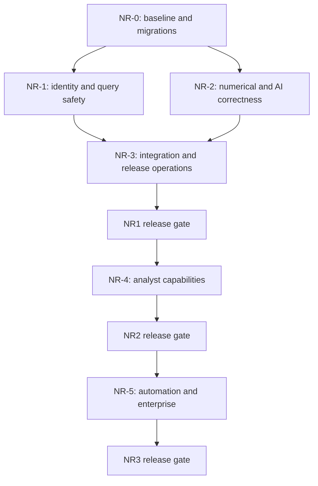

# DataSpeakAI — Next Release Implementation Pathway

**Document date:** 2026-10-15  
**Audit baseline:** Git revision `36065f2`  
**Document status:** Implementation roadmap; product tasks are planned, not completed  
**Audience:** Project owner, developers, reviewers, QA engineers, and AI coding agents  
**Planning method:** Dependency-based sprints; no promised calendar dates  
**Execution hierarchy:** Release → Phase → Milestone → Sprint → Task → Verification

> This document explains what to build, why it is needed, and how to verify it. Creating this document does not fix the identified defects or authorize deployment. At the owner's request, this documentation task creates only this file; it does not update the backlog, changelog, source code, or agent metadata. Future implementation work follows the normal repository instructions unless the owner gives a narrower instruction.

## Contents

1. [Purpose, decisions, and release boundaries](#purpose)
2. [Current system and verified baseline](#baseline)
3. [Current issues, reasons, and resolution mapping](#issues)
4. [Architecture and compatibility decisions](#decisions)
5. [How developers and agents work together](#coordination)
6. [NR1 / Phase NR-0 — Establish the foundation](#phase-nr0)
7. [NR1 / Phase NR-1 — Repair security and query safety](#phase-nr1)
8. [NR1 / Phase NR-2 — Make results trustworthy](#phase-nr2)
9. [NR1 / Phase NR-3 — Make the release operable](#phase-nr3)
10. [NR2 / Phase NR-4 — Improve the analyst experience](#phase-nr4)
11. [NR3 / Phase NR-5 — Automation and enterprise capabilities](#phase-nr5)
12. [Public interfaces and migration register](#interfaces)
13. [Verification, rollout, and rollback](#verification)
14. [Existing backlog mapping and first execution order](#backlog)
15. [Task dispatch and completion templates](#templates)
16. [Glossary and engineering references](#references)

<a id="purpose"></a>
## 1. Purpose, decisions, and release boundaries

The immediate objective is to make the existing application safe to use across unrelated organizations and reliable enough that users can trust its answers and numbers. New capabilities follow that foundation.

The project owner selected these planning defaults:

- **Staged releases:** Fix the core first, then ship analyst enhancements, then enterprise capabilities.
- **Dependency-based sprints:** A sprint is a bounded package of work with prerequisites and an exit check. Its name does not promise one or two weeks of work.
- **Private dashboard conversations:** Only the creator can read a dashboard conversation unless it is explicitly shared. A tenant administrator does not automatically gain access to private conversations.
- **Visitor isolation:** Public-widget visitors must not gain access to another visitor's history or internal dashboard conversations.
- **Complete feature coverage:** All ten proposed enhancements are included below, with implementation steps. They are not all prerequisites for the immediate release.

| Release | Intended outcome | Required phases | Release boundary |
|---|---|---|---|
| **NR1 — Secure and Reliable Core** | Existing features enforce access rules, produce honest results, and survive routine failures | NR-0, NR-1, NR-2, NR-3 | All 18 audit findings resolved or, for an unsupported capability, the unsafe path explicitly disabled and documented |
| **NR2 — Better Analyst Experience** | Users can define business meaning, inspect evidence, continue analyses, save reports, and report answer problems | NR-4 | Five analyst capabilities integrated with the NR1 controls |
| **NR3 — Automation and Enterprise Capabilities** | Governed automation, cross-table analysis, monitoring, enterprise identity, and commercial controls | NR-5 | Five additional capabilities pass their feature and operational gates |

`NR1`, `NR2`, and `NR3` are roadmap labels. They do not change the application version. The `NR-` task namespace avoids collisions with historical Phase 6/7 identifiers.

### What remains outside these releases

Do not add autonomous write access to customer databases, voice interfaces, a general plugin marketplace, or a replacement frontend framework as part of this pathway. Do not replace FAISS or the entire analytics stack solely to simplify a refactor. First correct the existing architecture and measure its limits.

### Reading the identifiers

`NR-1.1-B-T03` means Phase NR-1, Milestone 1.1, Sprint B, Task 03. Sprint steps are executable task boundaries. A task may be split further during dispatch, but its parent ID, acceptance criteria, and dependencies must remain traceable.



The diagram shows release dependencies, not a requirement to serialize all coding. Individual sprint prerequisites below determine which work may run in parallel.

<a id="baseline"></a>
## 2. Current system and verified baseline

### 2.1 How the application currently works

| Area | Current execution path | What the next release should preserve |
|---|---|---|
| Dashboard and authentication | React/Vite pages call FastAPI with user authentication; SQLAlchemy stores tenants and users | Existing onboarding, tenant management, and navigation, with corrected permissions |
| Database questions | Query routing selects a connection; SQL generation/repair and execution produce rows; an LLM can explain them | Useful natural-language queries, schema awareness, and safe previews |
| Document questions | Uploads are parsed/chunked; FAISS and BM25 retrieve evidence; an LLM synthesizes an answer | Hierarchical chunks, hybrid retrieval, and source attribution |
| Conversations | Dashboard and widget routes persist messages and stream responses; background work updates summaries/titles | Streaming, cancellation, context, and user-edited titles |
| Analytics | Database metrics, generated dashboard configuration, and file/AutoML pipelines compute separate views | Validated metric recipes and existing visualization components |
| Storage and jobs | Application SQL database, local uploads/vector indexes, and optional Redis/Celery | Existing functionality while adding durable storage and predictable job execution |

There are overlapping connection, query, and analytics implementations. Consolidating the rules they enforce is more urgent than moving code between files.

### 2.2 Audit evidence and limitations

The audit used Graft, source inspection, repository inventories, tests, and isolated reproductions. It was a broad risk-focused review, not a claim that every source/dependency/generated line received manual review. Live production configuration, real customer data, and real PostgreSQL/MySQL services were not audited.

| Check performed during the audit | Observed result | Important limitation |
|---|---|---|
| Frontend production build | Passed | Build success is not a complete TypeScript or behavioral check |
| Frontend tests | 20 passed | Mainly SSE parser and ERD utility coverage |
| Backend tests | 486 passed, 1 failed | Python 3.14; isolated working directory/database; external credentials and model downloads disabled |
| Failing backend case | Widget SSE test reached an unmocked provider and exhausted available streaming providers | This needs an isolated test provider; it is not proof that a configured live provider always fails |
| Tenant administrator API probe | A tenant Admin received two tenants from the global tenant listing | Synthetic users and an in-memory database |
| Widget ownership probe | A widget session adopted/switched to a private dashboard conversation; its history entered the LLM prompt | Synthetic messages and a mocked LLM; no real private data accessed |
| Widget generation probe | One non-streaming request called generation twice | Mocked provider call counting |
| SQL cap probes | Requested maximum 100; queries returned 200 and 250 rows | Real executor function source tested with isolated SQLite/adapters |
| Grounding failure probe | Embedding failure produced confidence 0.7 with no warning | Real citation function behavior with a failing embedding stub |
| KPI probe | Ten revenue rows of 100 produced total 1,000 and an unjustified 900% upward trend | Real KPI function source and a synthetic dataframe |

The audit inventory found 46 ORM tables, while older context documentation describes ten implemented models and a 35-table enterprise specification. Reconcile these sources before changing the schema. A documentation claim that a feature is complete is not evidence that every route enforces its intended behavior.

These results describe the audit baseline. Re-run relevant checks when implementation starts; do not copy these numbers into a future release report as new verification.

<a id="issues"></a>
## 3. Current issues, reasons, and resolution mapping

**Severity:** P0 blocks public multi-tenant deployment. P1 is a significant security, correctness, durability, or resource-control problem. P2 concerns maintainability, delivery, and performance. Severity is not an estimate of implementation effort.

**Evidence labels:** Reproduced = isolated behavior observed; Inspected = established from the implementation; Conditional = impact depends on deployment or granted permissions. Source locations refer to the audit revision and must be rechecked before editing.

| ID / priority | Current issue and reason | Impact and evidence | Resolution |
|---|---|---|---|
| **I-01 / P0** | Tenant Admin and platform administrator share the same role check | **Reproduced:** a tenant Admin can list other tenants. See [admin dependency](../backend/dependencies.py#L31), [global tenant listing](../backend/routers/analytics.py#L2057) | [NR-1.1-A](#nr-11-a) |
| **I-02 / P0** | Widget conversation selection checks tenant ownership, but not visitor ownership; request ID can override signed session ID | **Reproduced:** public widget traffic accesses private conversation context. See [session creation](../backend/routers/widget.py#L181), [chat selection](../backend/routers/widget.py#L371) | [NR-1.1-B](#nr-11-b) |
| **I-03 / P0** | Development seeding runs at startup and resets an existing administrator's credentials/status | **Inspected; production impact conditional:** known development behavior can persist in production. See [startup](../backend/main.py#L47), [seeding](../backend/scripts/seed_admin.py#L18) | [NR-1.1-A](#nr-11-a) |
| **I-04 / P0** | Legacy execution uses a denylist instead of the stronger query policy; some non-result statements are committed | **Validator behavior reproduced; write impact conditional on DB privileges:** alternate routes permit write-capable SQL/Mongo operations. See [validation](../backend/services/database_connection_service.py#L175), [execution](../backend/services/database_connection_service.py#L736) | [NR-1.2-B](#nr-12-b) |
| **I-05 / P0** | Host restrictions are feature-specific; SQLite paths lack a common approved-root boundary | **Inspected; exploit impact conditional:** a tenant-supplied connection can target internal services or server databases. See [connection builder](../backend/services/db_utils.py#L23), [ERD-only validation](../backend/services/erd_service.py#L56) | [NR-1.2-A](#nr-12-a) |
| **I-06 / P1** | Role, account-status, invitation, and database-access checks vary by endpoint | **Inspected:** restricted users can reach alternate access paths; inactive users are not consistently rejected. See [invitations](../backend/routers/tenants.py#L63), [connection query](../backend/routers/connections.py#L347), [authentication](../backend/dependencies.py#L15) | [NR-1.1-A](#nr-11-a) |
| **I-07 / P1** | Secret protection differs between password fields, connection URIs, and API keys | **Inspected:** credential-bearing URIs can be stored/returned unchanged; internal keys are recoverable and generated with non-cryptographic randomness. See [connection creation](../backend/routers/databases.py#L40), [response schemas](../backend/schemas.py#L113), [keys](../backend/routers/api_keys.py#L15) | [NR-1.2-A](#nr-12-a) |
| **I-08 / P1** | Any LIMIT suppresses the outer cap; caller timeout does not cancel running database work | **Cap bypass reproduced; cancellation risk inspected:** excessive results and abandoned work can consume memory/workers. See [SQL executor](../backend/services/sql_engine.py#L521) | [NR-1.2-B](#nr-12-b) |
| **I-09 / P1** | KPI trend compares an aggregate to a row mean; sampling and automatic deduplication change totals | **Trend reproduced; remaining behavior inspected:** misleading growth and totals. See [trend calculation](../backend/services/automl_service.py#L1152), [sampling](../backend/services/automl_service.py#L1234), [cleaning](../backend/services/automl_service.py#L1025) | [NR-2.1-A](#nr-21-a) |
| **I-10 / P1** | Preprocessing learns from data before train/test splitting | **Inspected:** evaluation leakage and optimistic model scores. See [preprocessing](../backend/services/automl_service.py#L150), [evaluation](../backend/services/automl_service.py#L295) | [NR-2.1-B](#nr-21-b) |
| **I-11 / P1** | Verification errors become a positive grounding score; similarity is treated too much like factual proof | **Failure behavior reproduced:** unverified answers can appear trustworthy. See [citation service](../backend/services/citation_service.py#L128) | [NR-2.2-A](#nr-22-a) |
| **I-12 / P1** | Index writes, chunk metadata, deletion, source retention, and task retries are not coordinated | **Inspected:** wrong citation names, lost concurrent additions, stale deleted content, and unrecoverable failed jobs. See [indexing](../backend/routers/documents.py#L197), [cleanup](../backend/routers/documents.py#L235), [deletion](../backend/routers/documents.py#L424) | [NR-2.2-B](#nr-22-b) |
| **I-13 / P1** | Tenant membership substitutes for a public publication policy during widget retrieval | **Inspected:** internal tenant documents are eligible for public-widget retrieval. See [widget RAG path](../backend/routers/widget.py#L473) | [NR-1.1-B](#nr-11-b) |
| **I-14 / P1** | Answer generation occurs before and after response-mode selection; completion errors can be swallowed | **Duplicate calls reproduced; persistence handling inspected:** extra cost/latency and apparently successful unsaved messages. See [widget generation](../backend/routers/widget.py#L505), [completion callback](../backend/services/chat_stream.py#L166) | [NR-2.3-A](#nr-23-a) |
| **I-15 / P1** | Redis errors allow traffic; quota checks race; usage is absent or estimated on some paths | **Inspected:** limits can be bypassed and usage cannot support dependable billing. See [limiter](../backend/services/widget_rate_limiter.py#L158), [quota check](../backend/routers/widget.py#L353), [token estimates](../backend/routers/query.py#L64) | [NR-3.1-B](#nr-31-b) |
| **I-16 / P1** | Connection builders differ and omit port/encoding details; unsupported execution can return example data | **Inspected:** the same connection works in one feature and fails in another; fabricated rows can be presented as results. See [URL builder](../backend/services/db_utils.py#L23), [simulated result path](../backend/services/sql_engine.py#L628) | [NR-1.2-A](#nr-12-a), [NR-1.2-B](#nr-12-b) |
| **I-17 / P1** | Production durability is not declared; schema updates happen during application startup | **Conditional deployment risk:** local SQLite/uploads/indexes may disappear or diverge across instances. See [deployment](../render.yaml), [database default](../backend/database.py#L9), [schema sync](../backend/services/db_migration.py#L103) | [NR-0.1-B](#nr-01-b), [NR-3.1-A](#nr-31-a) |
| **I-18 / P2** | CI omits tests/type checks, Python dependencies are unpinned, frontend routes are heavy, and docs are stale | **Inspected; build measured:** weak release gates and a roughly 1.66 MB main JS bundle. See [CI](../.github/workflows/ci-cd.yml), [requirements](../backend/requirements.txt), [routes](../src/app/routes.ts) | [NR-0.1-A](#nr-01-a), [NR-3.2-A](#nr-32-a), [NR-3.2-B](#nr-32-b) |

### Prevention targets beyond the immediate defects

- Treat all alternate routes as part of the same security surface; fixing only the UI's preferred endpoint is insufficient.
- Test simultaneous work: uploads, quota reservations, summaries, report runs, and webhook deliveries.
- Keep provider failures distinct from no-data results. Users must not interpret an unavailable system as an empty business dataset.
- Recheck source permissions at execution and delivery time, not only when an analysis is saved.
- Preserve provenance when prompts, models, metrics, schemas, and source documents change.
- Do not claim that a rollback-only dry-run is harmless: read-only credentials, statement/function policy, and execution budgets still apply.

<a id="decisions"></a>
## 4. Architecture and compatibility decisions

These are target decisions for future implementation, not descriptions of controls already enforced.

| Area | Target decision | Why |
|---|---|---|
| Authorization | One policy layer for platform authority, tenant membership, resource grants, and database/document access | Prevent alternate endpoints from weakening policy |
| Conversation privacy | Creator-only dashboard access by default; explicit read/share permissions; independent widget visitor ownership | Tenant membership alone does not prove permission to read a conversation |
| Public knowledge | Explicit widget publication assignments using existing collection/document concepts | Internal uploads must not become public accidentally |
| Database connections | One structured connection factory; SQLAlchemy URL objects for relational connection details | Centralize host/path validation, secrets, ports, and escaping |
| Query execution | Shared validation and bounded execution for every route, including dry-runs | Eliminate safety differences between features |
| Production database | PostgreSQL for application state; SQLite remains a local/test option | Support durable multi-worker operation and transactional coordination |
| Schema changes | Reviewed, versioned Alembic migrations executed separately from application startup | Support predictable upgrades and recovery |
| Documents and indexes | Retained source objects; immutable FAISS/BM25 generations with an atomic active-generation record | Prevent partial writes and allow rebuild/recovery |
| Background jobs | Existing Celery/Redis stack; durable job identities and independent DB sessions | Make failures and repeated delivery manageable |
| Metrics | Extend the existing structured recipes/executor; no executable user formula strings | Keep calculations reviewable and reusable |
| AI generation | Shared async gateway, one answer generation per selected mode, explicit attempt/usage records | Reduce duplicate work and make cost/failure visible |
| Grounding | Separate evidence similarity from verified/unverified support | Avoid giving failed checks a reassuring percentage |
| Rate-limit outage | Production public endpoints return a controlled unavailable response when required shared enforcement is unavailable | Avoid unlimited traffic during a Redis failure |
| Billing | Stripe integration reuses existing subscription/payment models after usage accounting is reliable | Avoid charging from incomplete estimates |

Production object storage is S3-compatible; the hosting vendor is an operational configuration choice, not permission to purchase a service. Local development can use a compatible local service. Keep FAISS for this pathway; benchmark before proposing a different vector backend.

Use additive migrations and temporary compatibility adapters where safe. Do not preserve an insecure behavior merely for compatibility. Changes such as widget session resets, secret-field removal, and private-chat filtering require explicit release notes.

<a id="coordination"></a>
## 5. How developers and agents work together

### 5.1 Sources of truth

1. Read [AGENTS.md](../AGENTS.md), [CHANGELOG.md](../CHANGELOG.md), [todo.md](../todo.md), relevant schema/architecture documentation, and current session notes before implementation.
2. Use Graft before broad source searches. Re-read the actual target span before editing; source line numbers in this document are historical pointers.
3. This document defines the delivery design. `todo.md` remains the authoritative execution tracker when the owner activates implementation tasks.
4. Old progress files may be stale. A historical `in progress` label is not proof that an agent is currently editing a file. Verify active ownership before taking over.
5. Do not mark an issue fixed because a related feature previously passed tests. Use the regression scenario for the specific issue.

### 5.2 Ownership and safe parallel work

Every dispatched task needs a task ID, owner, reviewer, baseline revision, dependencies, owned files, branch/worktree, and last progress update. Use [AI_TASK_TEMPLATE.md](templates/AI_TASK_TEMPLATE.md) to dispatch work. Actual names are assigned at dispatch; role names below do not mean an agent has already claimed the work.

| Role | Main ownership | Shared-file rule |
|---|---|---|
| Release integrator | Contracts, dependency order, integration, release gate | Serializes changes to root tracking/configuration files |
| Security/backend owner | Identity, access policies, secrets, widget boundaries | Coordinates changes to auth dependencies and router contracts |
| Data/query owner | Connection factory, query policy, metrics, schema catalog | Coordinates shared database and metric interfaces |
| AI/retrieval owner | Grounding, ingestion, indexes, gateway, memory | Coordinates changes to chat/document interfaces |
| Frontend owner | Dashboard/widget clients, evidence and error states | Implements agreed API contracts; does not invent authorization in UI alone |
| Platform owner | CI, containers, storage, workers, observability | Coordinates dependency and deployment changes |
| QA/reviewer | Adversarial cases, acceptance checks, evidence review | Can review in parallel; does not overwrite implementation work |

One integration owner must control concurrent edits to `backend/models.py`, `backend/schemas.py`, migration revisions, `backend/main.py`, dependency manifests, `todo.md`, and `CHANGELOG.md`. Request a coordinated patch or serialize these edits; do not let separate agents regenerate those files independently.

Agents may implement unrelated files in parallel after shared contracts are agreed. Read-only review may run in parallel with implementation. Re-read current files before applying a patch and preserve unrelated changes. Use isolated branches/worktrees when available; do not copy an old full file over a newer one.

### 5.3 Progress, review, and completion

For future implementation tasks, maintain agent progress and handoff metadata under `.agents/<agent>/`. Product source, tests, and public project documentation belong in their normal directories. Use session logs for architectural changes. Follow the existing backlog archival/changelog rules when a task is actually completed.

A task is complete only when its behavior, migration, tests, integration, and documentation requirements pass review. A build alone does not verify permissions, numerical truth, or recovery. The reviewer should inspect a failure case as well as a happy path.

<a id="phase-nr0"></a>
## 6. NR1 / Phase NR-0 — Establish the foundation

**Outcome:** A reproducible baseline and a safe way to change application state. These tasks prepare the release; urgent security containment does not need to wait for a full platform rebuild.

### Milestone NR-0.1 — Baseline and migration control

<a id="nr-01-a"></a>
#### Sprint NR-0.1-A — Reproduce findings and align the backlog

**Owner:** QA/backend, with release integrator review.  
**Dependencies:** None.  
**Issues:** I-18 and regression coverage for I-01 through I-17.  
**Targets:** Existing `tests/`, frontend tests, CI setup, and release tracking during future implementation.

| Task | Ordered implementation step | Required output |
|---|---|---|
| NR-0.1-A-T01 | Record the current revision, runtime versions, dependency versions, startup settings, and commands used for the baseline | Reproducible verification record |
| NR-0.1-A-T02 | Create synthetic fixtures with two tenants, multiple users in one tenant, private chats, multiple visitors, and published/unpublished documents | Reusable security fixtures with no real secrets or customer data |
| NR-0.1-A-T03 | Convert the audit's admin, widget, row-cap, grounding, duplicate-generation, and KPI probes into permanent regression tests | Cases that fail for the actual defect, without hardcoding successful outputs |
| NR-0.1-A-T04 | Mock `generate_stream` and provider usage in the widget SSE test; prevent normal tests from needing external keys or downloads | Fully isolated streaming tests |
| NR-0.1-A-T05 | Run baseline checks on Python 3.11, matching current deployment; distinguish environment failures from code failures | Production-runtime compatibility evidence |
| NR-0.1-A-T06 | Map existing Phase 6/debt items to the pathway and record frontend bundle and representative request timings | One task owner per overlap; performance comparison baseline |

**Acceptance:** Regression tests identify the intended defect; test setup cannot seed/reset the developer's real database; offline/provider-free tests run predictably. Known failing regression cases are clearly identified until their linked fix lands, rather than deleted or weakened.

**Compatibility/recovery:** This sprint changes tests and development tooling. Keep external integration tests separate and opt-in until their CI services exist.

<a id="nr-01-b"></a>
#### Sprint NR-0.1-B — Establish versioned migrations

**Owner:** Data/platform, with release integrator review.  
**Dependencies:** NR-0.1-A baseline.  
**Issues:** I-17; schema support for later work.  
**Targets:** Application models, migration tooling, canonical SQL specification, startup/deployment flow.

| Task | Ordered implementation step | Required output |
|---|---|---|
| NR-0.1-B-T01 | Compare the 46-model ORM, canonical SQL, and supported installed database layouts; list naming/type/constraint differences | Explicit reconciliation inventory |
| NR-0.1-B-T02 | Add Alembic with a reviewed initial revision and a schema preflight command | Versioned migration history and drift detection |
| NR-0.1-B-T03 | Define separate paths for a fresh database and an existing supported database | Safe baseline/upgrade procedure; no blind stamping of unknown schemas |
| NR-0.1-B-T04 | Move production schema changes out of import/startup into a deployment migration job | Application startup verifies compatibility instead of silently altering tables |
| NR-0.1-B-T05 | Add new columns/tables additively, backfill with validation, then enforce constraints only after data passes | Expand/backfill/validate migration pattern |
| NR-0.1-B-T06 | Upgrade fixture copies, compare row counts/relationships, and rehearse restore and application rollback | Migration and recovery evidence |

**Acceptance:** Fresh and upgraded installations converge to the same intended schema. Unknown layouts stop with an actionable report. No automatic deletion or renaming of unexplained columns is allowed.

**Compatibility/recovery:** Preserve existing data and audit the mapping between canonical names and actual fields. Backups are mandatory before deployment migrations; irreversible steps require a documented restore/forward-fix path. Refer to the [Alembic migration tutorial](https://alembic.sqlalchemy.org/en/latest/tutorial.html).

<a id="phase-nr1"></a>
## 7. NR1 / Phase NR-1 — Repair security and query safety

**Outcome:** Every caller receives only the resources and operations it is permitted to use. Public widget enablement and production deployment remain gated until the relevant boundary tests pass.

### Milestone NR-1.1 — Identity and resource ownership

<a id="nr-11-a"></a>
#### Sprint NR-1.1-A — Platform authority, permissions, and account lifecycle

**Owner:** Security/backend; frontend and data owners support contracts/migrations.  
**Dependencies:** NR-0.1-A; NR-0.1-B for persisted changes.  
**Issues:** I-01, I-03, I-06.  
**Targets:** Authentication dependencies, user/tenant/admin routers, conversation CRUD, permission models, login UI.

| Task | Ordered implementation step | Required output |
|---|---|---|
| NR-1.1-A-T01 | Add explicit platform-administrator authority, default false; allow assignment only through controlled operator provisioning | Public registration/invitation cannot create platform authority |
| NR-1.1-A-T02 | Define a permission matrix using existing tenant roles/memberships: administrative writes, source grants, query/read operations, key management, and sharing | Central policy functions and documented role behavior |
| NR-1.1-A-T03 | Inventory every route and apply the policy at resource resolution, including alternate connection/chat/analytics endpoints | Consistent checks; cross-tenant resources return not-found without disclosure |
| NR-1.1-A-T04 | Restrict invitation/role changes, validate role values, and verify all assigned database IDs belong to the tenant | No role escalation or foreign resource assignment |
| NR-1.1-A-T05 | Reject inactive users, enforce verification policy, and add revocable session/token versioning for disablement/password recovery | Existing tokens stop working when required by lifecycle changes |
| NR-1.1-A-T06 | Make development seeding explicit and disabled in production; never reset an existing password on startup; remove production quick-fill and credential/OTP logging | Safe bootstrap and operator account setup |
| NR-1.1-A-T07 | Enforce creator ownership on dashboard chat listing/read/update/delete; add explicit read-sharing grants with revoke behavior | Private-by-default dashboard conversations |
| NR-1.1-A-T08 | Apply a configured dashboard origin allowlist; retain separately enforced widget-origin policy | Predictable CORS without global wildcard credential behavior |
| NR-1.1-A-T09 | Update navigation, controls, and error messages for effective permissions without treating hidden buttons as security | UI and API agreement |

**Acceptance:** Tenant Admin cannot access platform telemetry/global tenants; members cannot invite or grant unauthorized roles; inactive/revoked sessions fail; creator-only chats stay private from other members and tenant Admins; sharing grants and revocation work; production startup never creates/resets development credentials.

**Migration/recovery:** Existing Admin users remain tenant Admins. Do not promote by email pattern. Backfill conversation owners only from reliable records. Unowned historic dashboard conversations remain restricted for operator-assisted ownership resolution; do not expose or arbitrarily assign them. Retire default credentials through a controlled operator process, not a blind database deletion.

<a id="nr-11-b"></a>
#### Sprint NR-1.1-B — Visitor isolation and public knowledge publication

**Owner:** Security/backend and widget frontend.  
**Dependencies:** NR-1.1-A policy contracts; NR-0.1-B migrations.  
**Issues:** I-02, I-13; session-creation abuse protection.  
**Targets:** Widget session/chat routes, widget SDK, conversation/session associations, collection/document publication.

| Task | Ordered implementation step | Required output |
|---|---|---|
| NR-1.1-B-T01 | Persist a widget/visitor ownership binding and bind signed session claims to that ownership | Tenant, key, visitor/session, and conversation are checked together |
| NR-1.1-B-T02 | Create a new conversation for a new visitor; permit resumption only with valid signed continuity proof | Conversation ID alone never grants access |
| NR-1.1-B-T03 | Reject a chat request whose conversation ID differs from the signed/authorized conversation; revalidate key status and origins | No request-body switch into another conversation |
| NR-1.1-B-T04 | Rate-limit session creation before creating records; integrate with shared production limiting from NR-3.1-B | Controlled anonymous session creation |
| NR-1.1-B-T05 | Extend existing collections with explicit document membership/publication assignments to widget keys | Empty publication assignment returns no internal documents |
| NR-1.1-B-T06 | Apply publication filtering before context enters the LLM, then revalidate selected evidence against current records | Both dense and sparse retrieval respect publication/revocation |
| NR-1.1-B-T07 | Validate widget database/table grants before SQL generation, repair, and dry-run execution | Unauthorized tables are not queried even during validation |
| NR-1.1-B-T08 | Update SDK bootstrap/renewal/reset behavior and provide tenant preview/publish/unpublish controls | Clear public-content workflow and safe client recovery |

**Acceptance:** Test two visitors using one key, two keys in one tenant, a private web chat, another tenant, a revoked key, and unpublished/deleted documents. None may cross its boundary. Removing publication stops future retrieval without requiring re-embedding.

**Migration/recovery:** Reset legacy sessions that lack sufficient ownership evidence. Retain their records privately; do not offer public adoption by numeric ID. Default existing documents to unpublished and require explicit selection. Deploy compatible backend and widget bundle together, with cache/version checks.

### Milestone NR-1.2 — Shared connection and execution policy

<a id="nr-12-a"></a>
#### Sprint NR-1.2-A — Connection factory and secret lifecycle

**Owner:** Data/query and security/backend.  
**Dependencies:** NR-0.1-B; NR-1.1-A source-permission contract.  
**Issues:** I-05, I-07, connection portion of I-16.  
**Targets:** Connection utilities/services, all consumers, credential fields, API key lifecycle, connection settings UI.

| Task | Ordered implementation step | Required output |
|---|---|---|
| NR-1.2-A-T01 | Inventory connection creation/testing/reflection/preview/query consumers and introduce a structured shared factory | No feature-specific shortcut around connection policy |
| NR-1.2-A-T02 | Validate driver, host, port, connection-string options, and resolved IPv4/IPv6 addresses on connection attempts; DNS failure denies connection | One host policy covering aliases, URI input, and refreshed connections |
| NR-1.2-A-T03 | Enforce production network egress policy as a second boundary; avoid a DNS check followed by an unrelated unrestricted resolution | Protection against rebinding/alternate address paths |
| NR-1.2-A-T04 | Disable arbitrary server-path SQLite in SaaS mode; for approved local use, resolve paths against a managed root and reject symlink/junction escapes | No access to application state or unrelated host files |
| NR-1.2-A-T05 | Build relational URLs with SQLAlchemy URL objects, honoring configured ports and literal credentials | Passwords containing special characters work without interpolation errors |
| NR-1.2-A-T06 | Use one versioned encryption envelope/key policy, require production key configuration, and encrypt full credential-bearing URIs | Predictable encryption and key rotation |
| NR-1.2-A-T07 | Replace secret-bearing response fields with redacted connection information; scrub secrets from errors/logs | Frontend never receives stored passwords/URIs |
| NR-1.2-A-T08 | Generate internal API keys with `secrets`; store a strong verifier plus identifier/prefix; show plaintext only at creation | Secure key creation, verification, listing, revocation, and rotation |
| NR-1.2-A-T09 | Migrate existing key values to verifiers, migrate known legacy ciphertext/plaintext explicitly, and remove permissive runtime decrypt fallbacks | Legacy compatibility without permanent plaintext recovery |

**Acceptance:** Test nondefault ports, reserved URI characters, IPv6, DNS failure, URI host bypasses, private addresses, prohibited SQLite roots, wrong encryption keys, and key revocation. Check every connection API response and error path for secret leakage.

**Migration/recovery:** Decrypt with an explicitly recognized old key/version before re-encrypting. Do not treat failed decryption as plaintext. Unrecoverable credentials require user re-entry. Hash existing internal keys so current callers can continue while plaintext listing disappears; allow rotation. Keep publishable widget keys distinct from secret API keys. See [SQLAlchemy URL construction](https://docs.sqlalchemy.org/en/20/core/engines.html#creating-urls-programmatically).

<a id="nr-12-b"></a>
#### Sprint NR-1.2-B — One safe query executor

**Owner:** Data/query, with security review.  
**Dependencies:** NR-1.2-A; NR-1.1-A/B access contracts.  
**Issues:** I-04, I-08, simulated-result portion of I-16.  
**Targets:** SQL engine/agent, legacy connection execution, metric execution, schema/preview consumers, Mongo query adapters.

| Task | Ordered implementation step | Required output |
|---|---|---|
| NR-1.2-B-T01 | Define a shared execution request containing authorized source scope, query purpose, parameters, row budget, deadline, and cancellation | Same policy for raw, generated, dry-run, dashboard, and widget execution |
| NR-1.2-B-T02 | Validate dialect-aware AST, allowed statement/function classes, schema identifiers, and resource grants; reject multiple/write-capable statements | Deterministic validation before database execution |
| NR-1.2-B-T03 | Apply read-only credentials and transaction settings before all execution, including agent dry-runs | Rollback is additional protection, not the sole safety mechanism |
| NR-1.2-B-T04 | Bind values and construct identifiers only from validated catalog objects with dialect quoting | No user-input string interpolation into SQL |
| NR-1.2-B-T05 | Apply an outer result cap or equivalent AST transformation regardless of inner/existing LIMIT; use bounded fetching and report truncation | No `fetchall` of an unbounded user result |
| NR-1.2-B-T06 | Implement server deadlines and driver cancellation; use SQLite progress/interrupt handling; cap executor concurrency and dispose interrupted resources | Expired requests do not accumulate running queries |
| NR-1.2-B-T07 | Validate Mongo aggregation stages recursively, reject write-capable stages, and apply result/time limits | Read-only behavior for supported non-relational paths |
| NR-1.2-B-T08 | Remove demo rows/schema from production paths and return typed unsupported/error/no-data outcomes | No fabricated success results |
| NR-1.2-B-T09 | Migrate every caller and remove/disable old bypass entrypoints after contract tests pass | One auditable execution boundary |

**Acceptance:** Reproduce and fix both 100-row cap failures. Test oversized outer limits, inner limits, CTEs, multi-statements, writable PRAGMA/REPLACE/SELECT INTO, disallowed functions, Mongo write stages, unauthorized tables, and cancellation under load. Test real supported dialects, including MariaDB separately if advertised; do not assume MySQL timeout settings work identically.

**Compatibility/recovery:** Keep result shapes compatible where safe, adding explicit truncation/status metadata. Unsupported capabilities return explicit errors instead of mock results. Stop rollout if a supported dialect cannot enforce required safety; keep that dialect disabled until verified. A Python future timeout alone is not cancellation of running work; see [executor behavior](https://docs.python.org/3/library/concurrent.futures.html) and [SQLite timeout semantics](https://docs.python.org/3/library/sqlite3.html).

<a id="phase-nr2"></a>
## 8. NR1 / Phase NR-2 — Make results trustworthy

**Outcome:** Calculations represent the intended business question, sources point to the correct evidence, and failures never become confident or fabricated success.

### Milestone NR-2.1 — Business calculations and model evaluation

<a id="nr-21-a"></a>
#### Sprint NR-2.1-A — Correct metrics across databases and files

**Owner:** Data/query and analytics frontend.  
**Dependencies:** NR-0.1-A fixtures; NR-1.2-B execution contract before integrating database queries.  
**Issues:** I-09; silent-error/no-data behavior.  
**Targets:** Existing metric recipes/executor, file analytics/AutoML KPI calculations, dashboard adapters and displays.

| Task | Ordered implementation step | Required output |
|---|---|---|
| NR-2.1-A-T01 | Define each metric's aggregation, entity/row grain, unit, source column, date field, filters, and missing-value behavior | A validated metric definition; no ambiguous generic sum |
| NR-2.1-A-T02 | Extend existing recipes with explicit period comparison and source adapters rather than adding a second formula engine | Shared metric semantics for SQL and uploaded tabular data |
| NR-2.1-A-T03 | Separate exact aggregate computation from chart/model sampling; use chunked processing for large files where necessary | Exact totals and explicit sampling metadata for sampled views |
| NR-2.1-A-T04 | Preserve duplicate records by default; offer previewable, user-selected deduplication and cleaning rules with a recorded report | Legitimate repeated transactions remain intact |
| NR-2.1-A-T05 | Compare matching current/prior periods using the chosen business timezone and consistent filters | Real period-over-period trends; no aggregate-versus-row-mean trend |
| NR-2.1-A-T06 | Define zero, no-data, unavailable comparison, and execution failure separately; handle a zero prior-period denominator explicitly | No fake 0%/infinite growth or silent conversion of failures to zero |
| NR-2.1-A-T07 | Return provenance: definition/version, filters, period, timezone, source version, completeness, and sample information | Inspectable numerical results |
| NR-2.1-A-T08 | Update cards/charts to explain unavailable comparisons and sampled visualizations; add SQL/file parity fixtures | Consistent user-visible results |

**Acceptance:** Golden fixtures include the false 900% trend case, more than 50,000 rows, legitimate duplicate transactions, missing dates, timezone boundaries, empty periods, zero denominators, nulls, and failed source queries. Matching SQL/file data must produce the same metric within documented numeric precision. Financial-style totals use explicit decimal/rounding rules rather than display-driven floating-point approximations.

**Compatibility/recovery:** Recompute or invalidate stored results based on the old calculation version. Label historic cached results until refreshed; do not silently compare old semantics with new semantics. New metadata is additive, while incorrect trend values are removed immediately.

<a id="nr-21-b"></a>
#### Sprint NR-2.1-B — Honest AutoML training and evaluation

**Owner:** ML/data, with QA review.  
**Dependencies:** NR-0.1-A reproducibility; NR-2.1-A cleaning/version contracts.  
**Issues:** I-10 and placeholder/unsupported score behavior.  
**Targets:** AutoML preprocessing, training, scoring, dataset analysis responses, model-result UI.

| Task | Ordered implementation step | Required output |
|---|---|---|
| NR-2.1-B-T01 | Record task, target, feature eligibility, dataset version, and available time/entity grouping information | Reproducible training specification |
| NR-2.1-B-T02 | Create train/validation/test partitions before fitting imputers, encoders, scalers, or feature selectors | Evaluation data cannot influence fitted preprocessing |
| NR-2.1-B-T03 | Use scikit-learn pipelines and fit transformations inside each training fold; handle unseen categories safely | Leakage-resistant preprocessing |
| NR-2.1-B-T04 | Use temporal splits for prediction over time and grouped splits where entities repeat; use stratification when classification permits | Evaluation matches the intended use case |
| NR-2.1-B-T05 | Select models using validation/cross-validation, then evaluate the chosen candidate on an untouched holdout | Model selection does not repeatedly optimize the final test set |
| NR-2.1-B-T06 | Compute all displayed scores from predictions and valid labels; replace hardcoded clustering scores with actual eligible metrics | Honest score computation and clear unavailable states |
| NR-2.1-B-T07 | Add training budgets and independent worker execution; record seeds, dependencies, split counts, and limitations | Reproducible, bounded training jobs |
| NR-2.1-B-T08 | Present class imbalance, insufficient data, uncertainty, and unsuitable targets plainly | UI does not present a weak experiment as a reliable deployed model |

**Acceptance:** Fit spies/fixtures confirm holdout rows never fit preprocessing. Test repeated entities, time ordering, unseen categories, missing targets, too few samples, single-class labels, and deterministic reruns. Report no score when no valid evaluation exists. Follow [scikit-learn's leakage and pipeline guidance](https://scikit-learn.org/stable/common_pitfalls.html).

**Compatibility/recovery:** Version model results and invalidate previously misleading scores for active comparisons. Keep historic metadata for audit, clearly marked with its evaluation method. This sprint does not automatically deploy trained models to make business decisions.

### Milestone NR-2.2 — Accurate evidence and dependable retrieval

<a id="nr-22-a"></a>
#### Sprint NR-2.2-A — Grounding states and answer evaluation

**Owner:** AI/retrieval and frontend.  
**Dependencies:** NR-0.1-A regression fixtures; NR-1.1-A/B authorization contracts.  
**Issues:** I-11.  
**Targets:** Citation service, response schemas, chat completion metadata, dashboard/widget evidence display, AI evaluation tests.

| Task | Ordered implementation step | Required output |
|---|---|---|
| NR-2.2-A-T01 | Define supported, unsupported, and unverified states; represent a failed check as unverified with a reason, not a default positive score | Honest verification contract |
| NR-2.2-A-T02 | Keep retrieval similarity distinct from claim support; include actual verified claim coverage in the result | No probability-like interpretation of cosine similarity |
| NR-2.2-A-T03 | Extract factual claims from prose and tables, including amounts, units, dates, and negation; report when claims are skipped | Verification cannot silently ignore the numerical answer |
| NR-2.2-A-T04 | Add deterministic numerical/date checks and a bounded support/contradiction check against authorized evidence | Better detection of similar-looking but false claims |
| NR-2.2-A-T05 | Preserve stable source/chunk/version identifiers and sanitize evidence used in prompts as untrusted content | Traceability and prompt-injection resistance without trusting document instructions |
| NR-2.2-A-T06 | Update UI badges, warnings, and source details; remove verified presentation on failure or no evidence | Clear distinction between supported and unverified answers |
| NR-2.2-A-T07 | Build a versioned evaluation set with supported SQL/RAG/hybrid questions, unknown answers, wrong numbers, contradictions, and malicious retrieved instructions | Separate measurements for execution, retrieval, attribution, abstention, latency, and cost |
| NR-2.2-A-T08 | Record evaluation baseline and compare provider/prompt changes on the same cases; require review of regressions | An evidence-based model-change gate |

**Acceptance:** An embedding/provider exception never produces a verified badge or positive fallback confidence. Table facts, conflicting dates, negation, unavailable evidence, and access-revoked documents are covered. The UI must show incomplete verification when not all factual claims were evaluated.

**Compatibility/recovery:** Add explicit status/reason fields and update both streaming and non-streaming clients before relying on them. A missing score means unavailable, not zero correctness or success. Preserve similarity fields with accurate labels. Do not introduce an uncalibrated universal percentage threshold as a release promise.

<a id="nr-22-b"></a>
#### Sprint NR-2.2-B — Reliable ingestion and index lifecycle

**Owner:** AI/retrieval and platform.  
**Dependencies:** NR-0.1-B; NR-1.1-B publication contract; NR-3.1-A storage/job contract and service availability for end-to-end verification.  
**Issues:** I-12; file-processing resource containment.  
**Targets:** Document routes, parsing/chunking, Celery ingestion, FAISS/BM25 managers, document status UI.

| Task | Ordered implementation step | Required output |
|---|---|---|
| NR-2.2-B-T01 | Store uploaded originals under generated object keys with tenant/source/version metadata; retain them through failed processing | Retryable source material and version provenance |
| NR-2.2-B-T02 | Validate supported formats and processing settings, enforce streaming size limits on all upload paths, and apply parser/page/row/time budgets | Bounded processing for documents and datasets |
| NR-2.2-B-T03 | Give ingestion/reindex operations durable identities and explicit queued/running/retrying/ready/failed states | Reliable progress, errors, and idempotency |
| NR-2.2-B-T04 | Run jobs with independent DB sessions; retry only transient failures with bounded backoff; propagate failures to the task system | Failed work is visible and retry behavior is real |
| NR-2.2-B-T05 | Derive each chunk's source name, document ID, page, parent, and version from that chunk's document | Correct dense/sparse citation metadata |
| NR-2.2-B-T06 | Resolve embeddings by model configuration, including dimension and normalized slug, without mutating a shared global model | Consistent upload, reindex, deletion, and search behavior |
| NR-2.2-B-T07 | Serialize generation publication per tenant/model, build FAISS and BM25 as one immutable generation, validate it, then update the active-generation pointer atomically | No partial publication or lost concurrent changes |
| NR-2.2-B-T08 | Tombstone deleted content immediately; revalidate retrieved IDs against current records; reconcile and remove content from future generations | Deleted content stops being usable before asynchronous cleanup finishes |
| NR-2.2-B-T09 | Add reconciliation for SQL/index drift, orphan artifacts, interrupted jobs, and stale generation pointers | Repair tools with dry-run reports |
| NR-2.2-B-T10 | Expose actionable status, retry/re-upload controls, and reasons for unsupported model/source combinations | Recoverable ingestion user flow |

**Acceptance:** Parallel uploads preserve all documents. Worker restart/retry creates no duplicate chunks. Wrong document-name attribution is eliminated. Deletion failure is surfaced and deleted content cannot be retrieved. Model mismatch returns a consistent explicit error. Reindexing honors the chosen supported chunking strategy or rejects unsupported settings.

**Compatibility/recovery:** Build a new index generation alongside the old one; activate only after integrity checks. Readers pin one generation for a request. Rollback may select an earlier generation only if current authorization/tombstones remain enforced. Do not delete old generations until readers can no longer depend on them. Historic originals that no longer exist need re-upload, not a fictional recovery promise. Use JSON task payloads, verified artifact origins, and safe serialization boundaries. See [Celery's idempotent task guidance](https://docs.celeryq.dev/en/v5.5.0/userguide/tasks.html).

### Milestone NR-2.3 — Reliable conversation execution

<a id="nr-23-a"></a>
#### Sprint NR-2.3-A — One generation, correct streaming, and bounded memory

**Owner:** AI/backend and dashboard/widget frontend.  
**Dependencies:** NR-1.1-A/B; NR-1.2-B execution contract; NR-2.2-A verification contract.  
**Issues:** I-14; blocking work, memory races, and stale UI updates.  
**Targets:** LLM gateway, chat/widget orchestration, stream completion, memory/title tasks, ChatPage and widget clients.

| Task | Ordered implementation step | Required output |
|---|---|---|
| NR-2.3-A-T01 | Resolve source policy and streaming mode before generation; build one execution plan and one answer prompt | One answer-generation invocation per request, apart from recorded provider retries |
| NR-2.3-A-T02 | Route remaining generation/classification call sites through the shared gateway; use async calls in async paths and manage clients at application lifecycle scope | Shared connection pooling, deadlines, and provider telemetry |
| NR-2.3-A-T03 | Move blocking SQL, embeddings, parsing, and persistence off the event loop with bounded executors/workers | Concurrent requests do not freeze each other |
| NR-2.3-A-T04 | Define request/attempt identity and persist completion atomically; distinguish generated, saved, interrupted, and failed outcomes | SSE done never silently implies persistence after a callback failure |
| NR-2.3-A-T05 | Propagate cancellation to upstream generation/query work and release stream slots in all exit paths | Predictable stop/disconnect behavior |
| NR-2.3-A-T06 | Fetch only bounded recent messages and the current summary; use database compare-and-set version checks for summary updates | Cross-worker summaries cannot overwrite newer context |
| NR-2.3-A-T07 | Preserve manual titles and include source/context version in background updates where needed | Background jobs do not overwrite current user edits |
| NR-2.3-A-T08 | Bind frontend requests/streams to conversation and request identity; abort or ignore stale fetches; avoid old finally handlers resetting new requests | Rapid navigation and stop/resend do not corrupt the displayed conversation |
| NR-2.3-A-T09 | Measure first-token latency, provider attempts, completion failures, cancellation time, and per-request cost | Before/after performance evidence |

**Acceptance:** Provider spies confirm no duplicate answer generation. Test early and mid-stream failure, disconnect before/after finalization, failed DB commit, rapid chat switching, stop-and-resend, overlapping summaries, and manual rename during background title work. No completion callback failure may be reported as a normal saved response.

**Compatibility/recovery:** Keep existing `chunk`/`done` parsing compatible where possible and add explicit terminal status/IDs. Release both clients with the updated contract. Record actual provider consumption on cancelled work even if the customer-facing charging policy does not charge an incomplete answer; NR-3.1-B owns that accounting distinction.

<a id="phase-nr3"></a>
## 9. NR1 / Phase NR-3 — Make the release operable

**Outcome:** The application has durable storage, bounded resource use, reproducible deployments, and release checks that run automatically. NR-3.1-A can start early after the migration/configuration contracts exist; it does not wait for all of Phase NR-2.

### Milestone NR-3.1 — Durable services and accurate resource control

<a id="nr-31-a"></a>
#### Sprint NR-3.1-A — Deployment, durable storage, and recovery

**Owner:** Platform/data, with AI job integration support.  
**Dependencies:** NR-0.1-B; NR-1.2-A configuration/secrets contract.  
**Issues:** I-17; existing Task 6.2.  
**Targets:** Deployment/container definitions, application DB configuration, object storage adapters, workers, operational documentation.

| Task | Ordered implementation step | Required output |
|---|---|---|
| NR-3.1-A-T01 | Define production topology: stateless API, PostgreSQL application DB, Redis, Celery workers, durable object storage, and frontend hosting | Explicit service responsibilities and network/storage boundaries |
| NR-3.1-A-T02 | Provide local Compose services with matching interfaces and locked runtime dependencies; expose only intended ports | Reproducible development/integration environment |
| NR-3.1-A-T03 | Introduce an object-storage abstraction for originals and immutable index generations; share generation metadata through the application DB | API/worker instances do not rely on another instance's local disk |
| NR-3.1-A-T04 | Use independent job sessions, durable operation identifiers, bounded retries, worker health, and task observability | Recoverable background execution |
| NR-3.1-A-T05 | Add startup configuration validation and readiness/liveness checks with appropriate dependency reporting | Misconfigured production fails clearly without seeding or mutating schema |
| NR-3.1-A-T06 | Back up SQL state and source objects; record index generation manifests and rebuild procedures | Recovery covers both authoritative state and derived indexes |
| NR-3.1-A-T07 | Rehearse upgrade, service replacement, restore, and rollback on staging; measure recovery duration and data-loss exposure | Evidence for an operator runbook |
| NR-3.1-A-T08 | Update deployment manifests and environment examples during implementation; document vendor-specific persistence constraints | Deployment instructions match the verified topology |

**Acceptance:** Replacing API/worker instances preserves application records and document availability. Fresh setup runs from documented commands. A restored installation reproduces expected records and searchable evidence. Secrets do not appear in container images, generated logs, or frontend builds.

**Compatibility/recovery:** Migrate local files with checksums/manifests and a bounded cutover; keep old copies until validation passes. Do not claim the existing free Render configuration provides persistent storage: its default filesystem is [ephemeral](https://render.com/docs/disks). Production provisioning and actual service purchases are separate operator actions.

<a id="nr-31-b"></a>
#### Sprint NR-3.1-B — Atomic limits, usage, and cost controls

**Owner:** Platform/backend, with QA concurrency review.  
**Dependencies:** NR-3.1-A services; NR-1.1-B session identity; NR-2.3-A request/attempt and completion contracts.  
**Issues:** I-15.  
**Targets:** Widget limiter, quota enforcement, LLM telemetry, QueryLog/MeteredUsage extensions, usage UI.

| Task | Ordered implementation step | Required output |
|---|---|---|
| NR-3.1-B-T01 | Define request/attempt identifiers and separate operational consumption from customer-billable units | A documented accounting policy before billing integration |
| NR-3.1-B-T02 | Make request/session buckets and concurrency leases atomic in Redis; include lease identity, expiry, and bounded renewal | Global enforcement across workers; correct release of the owning lease |
| NR-3.1-B-T03 | Reserve monthly quota atomically before expensive work; settle or release reservations using idempotent completion | Simultaneous requests cannot all pass a stale count |
| NR-3.1-B-T04 | Fail production public requests with a controlled 503 when mandatory enforcement is unavailable; preserve 429 for real quota exhaustion | No silent fail-open Redis path |
| NR-3.1-B-T05 | Record provider-reported usage where available and mark estimates explicitly; count retry attempts and cancelled generation consumption | Durable, attributable usage ledger |
| NR-3.1-B-T06 | Reconcile abandoned reservations, expired leases, duplicate callbacks, and delayed provider usage | Recovery without double counting |
| NR-3.1-B-T07 | Connect usage screens to actual tenant plan/ledger data and show estimates/unavailable values accurately | No hardcoded universal quota or misleading usage totals |
| NR-3.1-B-T08 | Add operational metrics/alerts for rejection rates, quota races, Redis health, provider errors, and stalled jobs | Observable resource enforcement |

**Acceptance:** Concurrent requests cannot exceed the permitted reservation count. Tests cover Redis outage/recovery, worker death, cancellation, duplicate completion, retries, and month boundaries. A lease from one request cannot release another request's slot. Billable completed-answer count and underlying provider cost can differ, but both must be explainable.

**Migration/recovery:** Existing incomplete history remains marked estimated/legacy. Do not reconstruct exact token bills from word-count guesses. Start the accurate ledger at a documented cutover. Provide reconciliation tooling before using the ledger for invoices.

### Milestone NR-3.2 — Continuous verification and release readiness

<a id="nr-32-a"></a>
#### Sprint NR-3.2-A — CI, type checks, and frontend delivery

**Owner:** Platform/QA and frontend.  
**Dependencies:** NR-0.1-A; feature contracts for each end-to-end case. CI scaffolding may begin before the feature fixes finish.  
**Issues:** I-18.  
**Targets:** CI workflow, runtime locks, TypeScript/static checking, route loading, shared API handling, frontend interaction tests.

| Task | Ordered implementation step | Required output |
|---|---|---|
| NR-3.2-A-T01 | Run backend tests and frontend tests in CI; ensure normal tests use isolated data and mocked provider boundaries | Test failures block integration/deployment |
| NR-3.2-A-T02 | Add explicit TypeScript no-emit checking and meaningful backend static checks; fix errors rather than globally disabling analysis | Build and type correctness are measured separately |
| NR-3.2-A-T03 | Pin/lock direct and transitive backend dependencies for the supported runtime; record dependency update procedure | Reproducible local/CI/deployment installs |
| NR-3.2-A-T04 | Add real PostgreSQL/MySQL/Redis integration services; include other dialects when advertised | Reflection, permissions, timeouts, and limits verified against real services |
| NR-3.2-A-T05 | Add browser/API flows for login, private chats, role restrictions, widget ownership, source publication, errors, and cancellation | End-to-end coverage of the boundaries missed by utility tests |
| NR-3.2-A-T06 | Lazy-load feature routes and heavy visualization code; measure route bundles and cold/warm interaction timing | Quantified improvement from the 1.66 MB audit bundle baseline |
| NR-3.2-A-T07 | Consolidate API error/session handling and request cancellation; ensure actionable Sonner feedback and accessible loading/error states | Consistent asynchronous UX |
| NR-3.2-A-T08 | Split large components/services only along covered behavioral boundaries; verify keyboard/mobile behavior for affected flows | Safer maintainability improvements without unrelated redesign |

**Acceptance:** CI executes tests rather than only installs dependencies. A clean install passes backend/frontend checks, explicit types, and supported integration tests. Feature pages load on demand; bundle/performance results are recorded, with no unexplained regressions. Browser tests use synthetic data.

**Compatibility/recovery:** Migrate API callers incrementally behind the same contract. The existing widget build script copies into tracked `public/widget.js`; run it only as an intentional implementation/build change and review that artifact. Do not run it while merely validating this roadmap.

<a id="nr-32-b"></a>
#### Sprint NR-3.2-B — Documentation and release candidate

**Owner:** Release integrator and QA; platform supports rollout.  
**Dependencies:** All NR1 behavior/migration sprints complete, including integration results from NR-3.2-A.  
**Issues:** I-18 documentation drift; final closure of I-01 through I-17.  
**Targets:** Architecture/schema/setup documentation, backlog/changelog, release notes, operator runbooks.

| Task | Ordered implementation step | Required output |
|---|---|---|
| NR-3.2-B-T01 | Reconcile model counts, endpoint behavior, capability support, and architecture diagrams with the implemented revision | Documentation reflects the tested system |
| NR-3.2-B-T02 | Verify old pending/completed items individually; cross-reference replacements and preserve historical completion records | One authoritative active backlog without duplicate ownership |
| NR-3.2-B-T03 | Publish migration order, required secrets/services, breaking changes, session resets, and known limitations | Self-contained upgrade instructions |
| NR-3.2-B-T04 | Run the acceptance matrix and review evidence for every issue ID | No unverified release-blocking closures |
| NR-3.2-B-T05 | Rehearse staging deployment, restore, rollback, and post-deployment smoke checks | Operator-ready release procedure |
| NR-3.2-B-T06 | Record release revision, artifact versions, feature enablement, monitoring checks, and rollback triggers | Traceable release candidate and sign-off |

**Acceptance:** Every I-01 through I-18 entry links to current implementation and verification evidence. Upgrade instructions have been exercised on staging. A reviewer can reproduce the release checks from the recorded environment and identify any disabled capabilities without relying on conversation history.

**Compatibility/rollout:** Publish client/session/credential changes before enabling affected features. Preserve historical changelog entries and distinguish them from newly verified results. Keep a safe feature-disable path for any failed release check; the documentation cannot waive a security or data-integrity failure.

**NR1 completion gate:** All P0 paths are fixed; every in-scope P1 has passing evidence. Where a capability cannot be made safe in this release, its public entrypoints are explicitly disabled and its limitation is documented—never hidden behind fake data. Ownership, query safety, numerical truth, persistence, and recovery must pass independent review. A security rollback must not re-enable an unsafe endpoint.

<a id="phase-nr4"></a>
## 10. NR2 / Phase NR-4 — Improve the analyst experience

**Outcome:** Users can agree on business meanings, inspect evidence, continue questions reliably, save repeatable analyses, and improve answer quality through reviewed feedback. This release builds on NR1 rather than introducing alternate authorization or execution paths.

| Feature | User benefit | Implementation sprint |
|---|---|---|
| F-01 — Business glossary and approved metrics | Everyone uses the same meaning for revenue, active customer, churn, and other terms | NR-4.1-A |
| F-02 — Evidence explorer | Users can inspect the original evidence and calculations behind an answer | NR-4.1-B |
| F-03 — Structured conversational follow-ups | Questions such as “same period last year” preserve the intended context | NR-4.1-C |
| F-04 — Saved analyses and scheduled reports | Repeatable analysis without rebuilding filters and questions | NR-4.2-A |
| F-05 — Feedback and evaluation workspace | Corrections become reviewed regression cases rather than disappearing in chat | NR-4.2-B |

### Milestone NR-4.1 — Shared meaning and inspectable answers

<a id="nr-41-a"></a>
#### Sprint NR-4.1-A — Business glossary and approved metrics

**Owner:** Data/query and frontend.  
**Dependencies:** NR1 gate; NR-2.1-A metric semantics.  
**Feature:** F-01.  
**Targets:** Existing KPI definitions, schema registry, metric recipes, query routing/generation, settings and analytics UI.

| Task | Ordered implementation step | Required output |
|---|---|---|
| NR-4.1-A-T01 | Extend metric definitions with business description, aliases, owner, unit, grain, filters/exclusions, date semantics, and version | Tenant-scoped business definition linked to executable recipes |
| NR-4.1-A-T02 | Add draft, approved, and retired states with reviewer permissions and immutable approved versions | Changes cannot silently rewrite previous analyses |
| NR-4.1-A-T03 | Build create/edit/validate/approve/list APIs using existing permission and recipe validation | Server-enforced glossary management |
| NR-4.1-A-T04 | Add a glossary editor with mapped columns, example result preview, validation errors, and change history | Users can verify the definition before approval |
| NR-4.1-A-T05 | Resolve natural-language terms to approved definitions; ask for clarification when more than one definition fits | Predictable business language in chat |
| NR-4.1-A-T06 | Reuse definitions in dashboards/reports and return the definition ID/version in every applicable result | Shared metric meaning across product surfaces |
| NR-4.1-A-T07 | Add audit history and impact preview for retiring/replacing a definition | Users can see which saved analyses depend on it |

**Acceptance:** Two users using the same approved definition receive the same calculation. Tests cover ambiguous aliases, unauthorized edits, missing columns, excluded transactions, and changing an approved definition without modifying old saved results.

**Migration/rollout:** Import existing usable KPI definitions as drafts unless their business meaning has been explicitly approved. Existing ad hoc analysis remains available with an “ad hoc definition” label; do not pretend inferred definitions are business-approved.

<a id="nr-41-b"></a>
#### Sprint NR-4.1-B — Evidence explorer

**Owner:** AI/retrieval and frontend.  
**Dependencies:** NR1 gate; NR-2.2-A/B provenance and retained sources. NR-4.1-A adds metric-version details when available.  
**Feature:** F-02.  
**Targets:** Document/source APIs, citation metadata, chat citation UI, SQL/metric result inspection.

| Task | Ordered implementation step | Required output |
|---|---|---|
| NR-4.1-B-T01 | Preserve page/section/text-offset metadata during extraction; retain bounding boxes only where reliably available | Stable evidence locations tied to a source version |
| NR-4.1-B-T02 | Add authorized source-version and preview endpoints; recheck viewer permissions on every request | Private originals are not exposed by a guessed URL |
| NR-4.1-B-T03 | Build a citation drawer/viewer that opens the relevant page/section and highlights supporting content when location data supports it | Inspectable evidence with clear fallback when exact highlights are unavailable |
| NR-4.1-B-T04 | Add a calculation view for SQL, parameters, filters, result truncation, metric definition/version, and source freshness | Users can understand numerical answers |
| NR-4.1-B-T05 | Distinguish current, superseded, removed, inaccessible, and missing-original evidence | Honest handling of source lifecycle changes |
| NR-4.1-B-T06 | Keep widget previews limited to published public evidence and omit internal schema/query details from public responses | Publication and internal-analysis boundaries remain intact |
| NR-4.1-B-T07 | Test source permissions, expired access, version matching, keyboard navigation, and large-document loading | Usable and secure inspection flow |

**Acceptance:** A citation opens the evidence version that supported the answer. A revoked user cannot fetch the source. Unsupported formats fall back to an authorized text excerpt; the UI does not invent page coordinates or highlights.

**Migration/rollout:** Existing chunks without location/original data remain available as explicitly limited excerpts. Reindex/re-upload can enrich them. Source URLs must not embed credentials or become permanent public access to private material.

<a id="nr-41-c"></a>
#### Sprint NR-4.1-C — Structured conversational follow-ups

**Owner:** AI/backend and frontend.  
**Dependencies:** NR1 gate; NR-2.3-A conversation concurrency; NR-4.1-A approved metric references.  
**Feature:** F-03.  
**Targets:** Conversation context state, query routing, SQL generation inputs, chat UI.

| Task | Ordered implementation step | Required output |
|---|---|---|
| NR-4.1-C-T01 | Define structured context for selected source, metric/version, entities, dimensions, filters, date range, timezone, and comparison | Context does not depend only on a prose summary |
| NR-4.1-C-T02 | Persist versioned context after a successfully resolved analysis; distinguish requested changes from committed context | Failed/ambiguous turns do not corrupt the current analysis state |
| NR-4.1-C-T03 | Resolve references such as “that,” “those two,” and “last month” against the structured state | Explicit follow-up interpretation |
| NR-4.1-C-T04 | Ask a focused clarification when multiple interpretations remain; expose active context chips and a reset action | Users can inspect and correct assumptions |
| NR-4.1-C-T05 | Revalidate source access, metric version, schema availability, and filters before every execution | Old context cannot bypass current permissions |
| NR-4.1-C-T06 | Apply optimistic version checks to simultaneous turns and keep each response associated with its interpreted context | Concurrent messages cannot silently replace each other's state |
| NR-4.1-C-T07 | Evaluate multi-turn sequences across SQL, RAG, source changes, topic resets, and ambiguous dates | Regression coverage for actual follow-up behavior |

**Acceptance:** “Only Lahore,” “compare with the previous quarter,” and “same period last year” retain the right source/metric while changing the intended filter. A topic reset clears inherited assumptions. Ambiguous references produce clarification instead of arbitrary first-database selection.

**Migration/rollout:** Start existing conversations with empty structured state and infer only from an explicitly resolved recent analysis. Do not migrate an unreliable historical summary into authoritative filters without validation.

### Milestone NR-4.2 — Repeatable analyses and reviewed feedback

<a id="nr-42-a"></a>
#### Sprint NR-4.2-A — Saved analyses and scheduled reports

**Owner:** Backend/platform and frontend.  
**Dependencies:** NR1 gate; NR-4.1-A metric versions; NR-3.1-A/B jobs, storage, and resource accounting.  
**Feature:** F-04.  
**Targets:** Existing query templates/dashboards, saved-analysis records, scheduler/workers, report APIs/UI, notification delivery.

| Task | Ordered implementation step | Required output |
|---|---|---|
| NR-4.2-A-T01 | Add versioned saved-analysis definitions referencing existing query templates, metric recipes, or dashboards, with source IDs and parameters | One saved-analysis interface covering database and supported file analysis |
| NR-4.2-A-T02 | Add save/edit/rerun/archive and explicit sharing; private-by-default ownership applies | Reusable analysis without accidental workspace-wide exposure |
| NR-4.2-A-T03 | Store schedule timezone, recurrence, effective owner, recipients, and pause state; preview next run times | Understandable scheduling without server-timezone assumptions |
| NR-4.2-A-T04 | Run through a scheduler and Celery using a unique schedule/run key; revalidate access and budget before execution | At most one effective report result for a scheduled occurrence |
| NR-4.2-A-T05 | Generate report snapshots with metric/source versions, filters, timestamps, completeness, and evidence links | Reproducible reports with traceable calculations |
| NR-4.2-A-T06 | Deliver only to explicitly authorized, verified recipients; use authenticated access for private report artifacts | Sharing policy applies to both creation and delivery |
| NR-4.2-A-T07 | Add run history, cancellation, failure reasons, retries, and pause-on-invalid-source behavior | Operators/users can recover without duplicate delivery |
| NR-4.2-A-T08 | Add scheduled usage accounting and cleanup according to retention policy | Predictable cost and storage growth |

**Acceptance:** Test revoked owner/recipient access, changed schemas, zero-data reports, duplicate jobs, failed delivery, timezone/daylight-saving transitions, and a report spanning multiple source versions. Retrying delivery must not rerun expensive analysis unless explicitly needed.

**Migration/rollout:** Existing query templates stay valid. Begin with manual reruns, then enable scheduling after delivery and idempotency tests pass. Email/report delivery is activated by explicit user configuration; this roadmap does not send messages or create real schedules.

<a id="nr-42-b"></a>
#### Sprint NR-4.2-B — Feedback and evaluation workspace

**Owner:** AI/QA and frontend.  
**Dependencies:** NR1 gate; NR-2.2-A evaluation framework; NR-2.3-A stable message/request identities.  
**Feature:** F-05.  
**Targets:** Message feedback, reviewer APIs/UI, evaluation datasets and runners, prompt/model release records.

| Task | Ordered implementation step | Required output |
|---|---|---|
| NR-4.2-B-T01 | Capture feedback categories such as wrong calculation, wrong source, missing answer, unsafe access, or unclear response | Actionable feedback linked to a specific message |
| NR-4.2-B-T02 | Record authorized provenance: source/query/metric versions, prompt/model version, request ID, and user correction | Enough context to reproduce the problem without logging secrets |
| NR-4.2-B-T03 | Add a reviewer queue with ownership, disposition, correction, and duplicate linking | A controlled triage workflow |
| NR-4.2-B-T04 | Redact/replace sensitive examples before promotion to shared evaluation datasets; preserve tenant-specific access where needed | Feedback cannot become a cross-tenant data export |
| NR-4.2-B-T05 | Convert reviewed examples to executable assertions or scored cases with expected evidence/calculations | Reusable regression cases |
| NR-4.2-B-T06 | Compare prompt/model candidates on a fixed versioned dataset; show quality, abstention, latency, and cost changes | Reviewable improvement evidence |
| NR-4.2-B-T07 | Require review before promoting prompt/model changes and keep a rollback reference | User feedback cannot directly rewrite production prompts |

**Acceptance:** Reviewers can reproduce a bad answer and add a case that detects its recurrence. Feedback and attachments obey conversation/source permissions. One tenant's correction never silently changes another tenant's business definition.

**Migration/rollout:** Feedback collection can launch before candidate comparison. Training/fine-tuning on feedback is outside this feature; retain explicit consent/access boundaries for any future reuse.

**NR2 completion gate:** All five features reuse NR1 policies and provenance. Saved results remain versioned, private data stays private, follow-up context is inspectable, and reviewed feedback produces measurable regression coverage.

<a id="phase-nr5"></a>
## 11. NR3 / Phase NR-5 — Automation and enterprise capabilities

**Outcome:** Add proactive analysis and commercial capabilities after the underlying data, permissions, and accounting are dependable.

| Feature | User benefit | Implementation sprint |
|---|---|---|
| F-06 — KPI alerts and anomaly investigation | Users learn about meaningful changes without repeatedly checking dashboards | NR-5.1-A |
| F-07 — Governed cross-table analysis | Questions can combine related tables without hidden double counting | NR-5.1-B |
| F-08 — Schema and data-quality monitoring | Teams detect source changes that invalidate reports or answers | NR-5.1-C |
| F-09 — Enterprise identity and audit history | Organizations manage access through their identity system | NR-5.2-A |
| F-10 — Subscriptions, billing, and budgets | Commercial plans reflect measured usage and enforce predictable limits | NR-5.2-B |

### Milestone NR-5.1 — Governed analysis and monitoring

<a id="nr-51-a"></a>
#### Sprint NR-5.1-A — KPI alerts and anomaly investigation

**Owner:** Data/ML and backend/frontend.  
**Dependencies:** NR2 gate; NR-4.1-A metrics; NR-4.2-A scheduling/delivery; NR-3.1-B budgets.  
**Feature:** F-06.  
**Targets:** Existing insights/anomaly services, approved metrics, scheduled evaluation, alert UI and delivery.

| Task | Ordered implementation step | Required output |
|---|---|---|
| NR-5.1-A-T01 | Define alert rules over approved metric versions with threshold/comparison, filters, cadence, and minimum data requirements | Explicit user-visible alert meaning |
| NR-5.1-A-T02 | Implement deterministic threshold alerts first; reuse existing anomaly capabilities only after validating their assumptions | A useful baseline before more complex detection |
| NR-5.1-A-T03 | Add seasonal/baseline-aware anomaly evaluation with documented windows, exclusions, and insufficient-data handling | Anomaly score is not confused with proof of a business cause |
| NR-5.1-A-T04 | Add deduplication, suppression, cooldown, acknowledgement, and mute controls | Repeated evaluations do not flood recipients |
| NR-5.1-A-T05 | Compute segment contributions using governed queries and attach supporting evidence to explanations | Explanations grounded in calculations rather than invented causes |
| NR-5.1-A-T06 | Deliver through the authorized report/notification system and record run/usage history | Existing permissions, retries, and budgets remain enforced |
| NR-5.1-A-T07 | Provide rule preview against historical data and feedback for false positives | Users understand likely alert behavior before activation |

**Acceptance:** Test sparse/late data, seasonality, a real threshold breach, source outage, repeated evaluations, revoked recipients, and acknowledged/muted alerts. A stale or failed source must produce a source-health state rather than a fabricated anomaly.

**Rollout/recovery:** Start in preview mode, then enable delivery per rule. Pausing a rule cancels future evaluations without deleting its history. LLM text may summarize verified contributors but must not assert causation without evidence.

<a id="nr-51-b"></a>
#### Sprint NR-5.1-B — Governed cross-table analysis

**Owner:** Data/query, with security and analytics review.  
**Dependencies:** NR2 gate; NR-1.2-B execution policy; NR-4.1-A metric versions; existing catalog relationships.  
**Feature:** F-07.  
**Targets:** Schema registry, table relationships, metric recipes/executor, join validation, analyst review UI.

| Task | Ordered implementation step | Required output |
|---|---|---|
| NR-5.1-B-T01 | Convert catalog constraints and reviewed mappings into join definitions with source/target keys, cardinality, direction, and version | Explicit approved join graph, including composite keys |
| NR-5.1-B-T02 | Record each metric's grain and eligible join paths; distinguish declared constraints from inferred suggestions | Inference cannot silently become an approved join |
| NR-5.1-B-T03 | Extend structured recipes to reference approved joins; validate the full table/column permission scope | No arbitrary executable join expression from the LLM |
| NR-5.1-B-T04 | Detect fan-out and apply validated pre-aggregation or distinct-entity rules; reject ambiguous many-to-many calculations | Correct totals rather than duplicated fact values |
| NR-5.1-B-T05 | Let users inspect the selected path and request clarification when multiple valid paths exist | Explainable relationship selection |
| NR-5.1-B-T06 | Execute through the shared deadline/row-budget policy and record query/recipe provenance | Resource safety and traceability |
| NR-5.1-B-T07 | Add fixtures for composite keys, repeated dimensions, missing foreign keys, many-to-many bridges, and permission-restricted tables | Join correctness and access regression coverage |

**Acceptance:** A known orders/order-items/customers fixture retains correct revenue/customer counts under supported joins. A join requiring an unauthorized table is rejected. Ambiguous grain/path cases stop for clarification instead of choosing a convenient path.

**Migration/rollout:** Existing single-table recipes remain unchanged. Introduce a new recipe version for joins and retain the older parser. Start with joins within one authorized relational connection; cross-database federation is outside this release.

<a id="nr-51-c"></a>
#### Sprint NR-5.1-C — Schema and data-quality monitoring

**Owner:** Data/platform and frontend.  
**Dependencies:** NR2 gate; catalog/source versions, NR-4.1-A definitions, NR-4.2-A schedules. Integrate NR-5.1-B join dependencies when enabled.  
**Feature:** F-08.  
**Targets:** Catalog reflection, source profiles, dependency records, monitoring jobs, repair/review UI.

| Task | Ordered implementation step | Required output |
|---|---|---|
| NR-5.1-C-T01 | Store schema/profile snapshots with collection time, source identity, and comparison version | Comparable history without overwriting the previous state |
| NR-5.1-C-T02 | Detect added/removed/type-changed columns, relationship changes, freshness gaps, null spikes, and configured quality rule breaches | Explicit change events with supporting measurements |
| NR-5.1-C-T03 | Track dependencies from metrics/joins/saved analyses/reports to source objects | Accurate impact analysis |
| NR-5.1-C-T04 | Mark affected definitions invalid/stale and pause unsafe scheduled runs; distinguish harmless additions from breaking changes | Broken reports do not continue with silently altered meaning |
| NR-5.1-C-T05 | Provide a reviewed mapping repair flow and preview affected calculations | Users can repair a rename or replacement safely |
| NR-5.1-C-T06 | Notify authorized owners and retain acknowledgement/repair history | Traceable source maintenance |
| NR-5.1-C-T07 | Revalidate and resume dependents only after tests against the new source version pass | Controlled recovery after drift |

**Acceptance:** Tests cover renamed/removed columns, incompatible types, key changes, missing refreshes, and accidental null spikes. A suggested rename is not applied automatically based only on a similar column name.

**Rollout/recovery:** Begin with observation and impact reporting, then enable automatic pausing for clearly breaking conditions. Monitoring reads must use the same host, permissions, query budgets, and source freshness policy as other database operations.

### Milestone NR-5.2 — Enterprise identity and commercial controls

<a id="nr-52-a"></a>
#### Sprint NR-5.2-A — SSO, provisioning, and audit history

**Owner:** Security/backend and frontend.  
**Dependencies:** NR2 gate; NR-1.1-A authority/session model; NR-3.1-A production configuration.  
**Feature:** F-09.  
**Targets:** Identity providers, tenant membership/role mapping, SCIM endpoints, session revocation, AuditLog and admin settings.

| Task | Ordered implementation step | Required output |
|---|---|---|
| NR-5.2-A-T01 | Add tenant-scoped OIDC configuration with validated issuer/client settings and controlled secret storage | Enterprise sign-in configuration isolated by tenant |
| NR-5.2-A-T02 | Validate OIDC responses and bind identities by provider issuer/subject; require verified, explicit account linking | No automatic cross-tenant merge based on an untrusted email |
| NR-5.2-A-T03 | Map approved identity groups to tenant roles without granting platform authority | Tenant provisioning cannot create a platform administrator |
| NR-5.2-A-T04 | Implement authenticated, tenant-scoped SCIM user/group provisioning with idempotent updates | Repeatable join/change/leave lifecycle |
| NR-5.2-A-T05 | Deactivate removed users, revoke sessions/grants as required, and pause their schedules until ownership is transferred | Deprovisioning affects existing sessions and background work |
| NR-5.2-A-T06 | Record administrative/access changes with actor, tenant, action, target, time, and sanitized details | Searchable audit history without secrets/message bodies |
| NR-5.2-A-T07 | Add authorized audit search/export and documented retention; provide an operator recovery process for identity-provider outage | Usable enterprise administration |
| NR-5.2-A-T08 | Test malicious issuer/account linking, cross-tenant identifiers, replayed provisioning, role changes, and active-session deprovisioning | Security-focused enterprise identity coverage |

**Acceptance:** Enterprise login cannot cross tenant boundaries or grant platform privileges. Removing a user stops their access and future unauthorized jobs. Audit viewing does not grant access to private conversation content.

**Migration/rollout:** Introduce OIDC before optional enforcement. Keep a controlled tenant recovery path and test it before requiring enterprise login. Existing password/OAuth identities are linked through verified flows; do not bulk merge by email alone. Initial federation scope is OIDC; adding SAML is a separately scoped extension.

<a id="nr-52-b"></a>
#### Sprint NR-5.2-B — Subscriptions, billing, and budgets

**Owner:** Backend/platform and frontend, with accounting-behavior review.  
**Dependencies:** NR2 gate; NR-3.1-B reconciled usage ledger; NR-1.1-A billing permissions.  
**Feature:** F-10; existing Task 6.1.  
**Targets:** Subscription/Invoice/Payment/MeteredUsage models, Stripe service/router, entitlements, billing and usage UI.

| Task | Ordered implementation step | Required output |
|---|---|---|
| NR-5.2-B-T01 | Define versioned plan entitlements, billing units, currencies, and cancellation/grace behavior; migrate monetary values to explicit minor units/currency where needed | Consistent plan and money semantics; no float-based invoice arithmetic |
| NR-5.2-B-T02 | Reuse existing subscription/payment models, add provider/customer/event identifiers, and enforce tenant-scoped billing authority | One subscription source of truth in the application |
| NR-5.2-B-T03 | Implement Stripe checkout and customer-portal operations with configured price IDs and idempotency | No client-selected arbitrary entitlement or amount |
| NR-5.2-B-T04 | Verify webhook signatures, persist event identity, deduplicate processing, and reconcile delayed/out-of-order events | Payment events cannot be forged or applied twice |
| NR-5.2-B-T05 | Reconcile provider subscription state periodically and update entitlements through the shared policy layer | UI, quota, and subscription state agree |
| NR-5.2-B-T06 | Add tenant budgets and model-routing policies using measured usage; reject or downgrade work according to an explicit configured policy | Predictable cost controls without hidden model changes |
| NR-5.2-B-T07 | Display plan, limits, estimated versus measured usage, invoices, payment problems, and cancellation effect | Users can understand charges and restrictions |
| NR-5.2-B-T08 | Test provider sandbox checkout, upgrade/downgrade, failed payment, cancellation, duplicate events, ledger reconciliation, and quota boundaries | End-to-end commercial lifecycle evidence |

**Acceptance:** Browser callbacks alone cannot activate paid entitlement. Repeated/out-of-order webhooks converge to the correct state. Historical estimated token counts are never billed as exact measured usage. Plan enforcement applies consistently to interactive, widget, and scheduled work.

**Migration/rollout:** Run billing in test mode first and compare the usage ledger with provider events. Map existing plans explicitly; preserve customer-visible transition rules. Activate real charging only through a separate authorized launch decision. Use [Stripe subscription webhook guidance](https://docs.stripe.com/billing/subscriptions/webhooks) and [idempotent request guidance](https://docs.stripe.com/api/idempotent_requests).

**NR3 completion gate:** Automated actions remain permission-checked, evidence-backed, and bounded by budgets. Enterprise identity and subscription state are covered by failure/retry tests. Operators can pause automation, revoke access, reconcile events, and recover without losing audit history.

<a id="interfaces"></a>
## 12. Public interfaces and migration register

### 12.1 Minimum contracts to implement consistently

Each owning sprint must document its exact Pydantic/TypeScript contract before parallel consumer work begins. The behavior below is mandatory; it is not permission for separate agents to invent incompatible field names or route variants.

| Boundary | Required behavior/data | Compatibility and migration |
|---|---|---|
| Authentication/authorization | Separate platform authority; active/verified account policy; tenant role/grants; revocable session version | Existing tenant Admins retain tenant scope; no automatic platform promotion |
| Dashboard conversations | Creator identity, explicit sharing grants, per-action checks | Existing reliably owned conversations become private; unresolved ownership stays restricted |
| Widget sessions | Widget key, visitor/session identity, conversation binding, signed continuity, expiry/revocation | Numeric conversation ID alone cannot resume history; reset unbound legacy sessions |
| Widget publication | Approved collection/document assignments and current publication state | Existing internal content defaults to unpublished |
| Connection responses | Safe connection metadata, configured port, redacted credential indicator | Remove raw credentials/connection URIs from read responses; update frontend editing behavior |
| Internal API keys | Creation-time secret plus persistent identifier/prefix; subsequent responses omit secret | Migrate verifiers and preserve valid callers where safe; rotation remains available |
| Query results | Explicit success/no-data/unsupported/error state, bounded rows, truncation, duration, provenance | Preserve existing successful fields where compatible; eliminate simulated data |
| Metric results | Value/unit, availability, comparison basis, source/definition version, completeness/sample metadata | Correct misleading historic cached values through version invalidation |
| Grounding | Support status, checked-claim coverage, unavailable/error reason, source identities; similarity labeled separately | Failed checks never imply support; clients handle absent scores |
| Streaming terminal event | Request/conversation/message identity, terminal status, persistence outcome, sources/grounding/SQL metadata | Update both dashboard and widget; handle before-first-token and mid-stream failure |
| Ingestion/indexing | Stable job ID, source version, processing state, retry/error state, model identity, active generation | Independent job sessions and atomic generation publication |
| Usage | Request/attempt identity, reservation/settlement state, measured/estimated provider use, billing-policy version | Legacy estimates are not exact historical billing records |
| Saved analyses/reports | Owner/grants, definition version, parameters, source dependencies, schedule timezone, run identity | Recheck current permission at execution and delivery |
| Enterprise identity/billing | Tenant-bound provider identities, event IDs, entitlement state, audit trail | Idempotent external events; verified linking and provider reconciliation |

### 12.2 Model reuse and change discipline

- Reuse `Role`, `Permission`, `Membership`, and `UserDatabaseAccess` for their applicable meanings; add missing explicit platform authority and resource grants rather than repurposing tenant role strings.
- Extend `Conversation` with the ownership/session references and context versioning required by its platform. Do not infer widget ownership from a tenant ID.
- Reuse `Collection`, `Document`, `DocumentChunk`, and `VectorRecord`; add explicit membership/publication/source-version relationships where absent. Preserve hierarchical chunks.
- Extend `KpiDefinition`, validated metric recipes, and catalog relationships. Keep approved definitions versioned; do not introduce executable free-form formula strings.
- Reference existing `QueryTemplate` and dashboard definitions from saved analyses. A SQL-only template must not be overloaded to pretend it represents every document/file analysis.
- Extend `MeteredUsage` and related operational records with the ledger/idempotency information required by the accounting design. Aggregate counters alone are insufficient evidence for charge reconciliation.
- Reuse `Subscription`, `Invoice`, `Payment`, `SecurityPolicy`, and `AuditLog`; add fields/relationships only when the feature needs them and update the canonical schema alongside migrations.

Every persisted change must update models, Pydantic schemas, affected frontend types, migrations, and canonical database documentation in one coordinated implementation. Never apply the older SQL specification blindly over an existing database to make model counts match.

### 12.3 Migration order

1. Back up application data and source/index manifests; verify backup readability.
2. Run schema preflight and stop on unsupported drift.
3. Apply additive authority/ownership/credential/source-version/usage fields required by the release.
4. Backfill using verified ownership and recognized secret formats; report ambiguous records for controlled remediation.
5. Deploy compatible APIs and clients, including widget bundle/session changes.
6. Validate actual usage paths, then enforce new non-null/unique/referential constraints.
7. Retire unsafe fields/fallbacks after consumer cutover; keep audit/recovery evidence.
8. Record schema, API/client, source/index, prompt/model, and calculation versions in the release record.

Do not rewrite unrelated data, auto-promote users, auto-publish documents, or silently charge historic estimated usage during migration.

<a id="verification"></a>
## 13. Verification, rollout, and rollback

### 13.1 Acceptance matrix

| Area | Minimum scenarios | Required outcome |
|---|---|---|
| Tenant/platform separation | Tenant Admin vs platform endpoints; second tenant IDs; missing/expired auth | Denied access without other-tenant data |
| Same-tenant privacy | Two dashboard users, tenant Admin, explicit share/revoke, unresolved historic owner | Creator-only default; grants honored and revocation effective |
| Widget boundary | Two visitors, two widget keys, dashboard conversation, changed request conversation ID, revoked key | No cross-visitor/key/platform access |
| Published knowledge | Internal, published, unpublished-again, deleted, stale-index sources | Only currently authorized published evidence reaches public answers |
| Connection access | Host aliases, IPv4/IPv6/private addresses, DNS failure, malicious URI options, SQLite root escape | Shared policy rejects prohibited targets on every path |
| Secrets | List/create/update/error/log paths; wrong encryption key; API-key rotation | No stored secrets returned/logged; failure is explicit |
| SQL/Mongo safety | Mutation statements, nested limits, CTEs, disallowed tables/functions/stages, unsupported drivers | Read-only authorized operations with bounded results |
| Time/resource limits | Long query, cancellation, repeated timeouts, worker saturation, large files | Bounded work and reclaimable resources |
| Metrics | SQL/file parity, >50k rows, duplicates, missing/zero baseline, timezone boundaries, source errors | Correct totals/comparisons and honest unavailable states |
| ML evaluation | Holdout isolation, grouped/temporal splits, unseen categories, insufficient labels | No fitted preprocessing leakage; real scores only |
| Grounding | Embedding failure, wrong values/dates, contradictions, table facts, incomplete verification | Unverified/unsupported states never appear verified |
| Index lifecycle | Concurrent upload, repeated task, partial publication, deleted source, model mismatch | No lost/duplicated content or stale authorized access |
| Streaming/memory | One generation, pre/mid-stream failure, failed commit, stop/resend, parallel summaries | Accurate terminal state, no stale overwrite, released resources |
| Quotas/usage | Concurrent reservations, Redis outage, worker crash, cancellation, retry, month rollover | No fail-open bypass or double counting; reconciliation works |
| Migrations/deployment | Fresh install, supported old schema, unknown drift, restart, restore, rollback | Repeatable installation and recoverable durable state |
| Analyst features | Definition versions, evidence links, follow-up ambiguity, saved-report permissions, feedback review | Consistent meaning and private, inspectable results |
| Enterprise/automation | Alert deduplication, join fan-out, drift pause, SSO linking, SCIM revoke, webhook duplicates | Safe automation and convergent external state |

### 13.2 Verification commands and execution safety

For product implementation, run checks appropriate to the change and the repository rules:

```powershell
# Frontend tests and application build, from the repository root
cmd.exe /c "npm test"
cmd.exe /c "npm run build"

# Backend tests using the verified project environment, not a guessed global alias
python -m pytest tests -q
```

The commands above are examples of the expected suite entrypoints, not a guarantee that the current shell resolves the correct Python. Record the actual executable/environment used. Add explicit frontend type checking and backend static checks in NR-3.2-A and document their real commands once configured.

Before importing the backend or running tests, supply an isolated test database, disable development seeding/warmup as appropriate, disable loading real external credentials, and direct uploads/indexes to test locations. A plain import currently performs startup work; never run it against real data as a casual syntax check. Normal CI must mock provider calls and avoid model downloads. Live database integration uses disposable service databases and read-only external-query test accounts.

For this roadmap-only task, validate Markdown structure, links, task coverage, and the one-file diff. Product builds, application imports, and database migrations are unnecessary because no product code changes are being made.

### 13.3 Release evidence package

The release integrator collects:

- The exact revision, runtime/dependency locks, and build artifact versions.
- Passed tests linked to issue/feature IDs, with the command and environment used.
- Migration preflight/upgrade results and backfill exception counts.
- Source/index consistency and permission-boundary results.
- Before/after latency and bundle measurements; distinguish cold/warm and mocked/live runs.
- AI evaluation dataset version and category-level results, not one unexplained confidence score.
- Restore rehearsal outcome, observed recovery duration, and any remaining operational limitations.
- Operator release notes, monitoring checks, feature enablement, and rollback instructions.

Do not claim production readiness solely from a green build or a large test count. Security boundary tests and numerical golden cases must pass. AI model changes must not introduce unreviewed regressions on the frozen evaluation set; exceptions require an explicit documented scope change, not hiding the failing examples.

### 13.4 Rollout sequence

1. Finish migration preflight and take verified backups.
2. Deploy compatible schema changes and durable services to staging.
3. Deploy backend and clients; exercise private chats, widget sessions, queries, ingestion, and usage with synthetic data.
4. Enable new behavior for an internal tenant and inspect errors, correctness, cost, and resource cleanup.
5. Expand to a limited enabled tenant set after the release gate passes.
6. Enable generally only after migration exceptions and operational failures are resolved.
7. For NR2/NR3, enable features independently after their dependencies and feature gates pass.

Never leave a known access-control vulnerability available to tenants outside a pilot while testing its replacement. The affected path must already enforce the fix or be disabled.

### 13.5 Rollback and stop conditions

| Trigger | Immediate response | Recovery requirement |
|---|---|---|
| Any cross-tenant, cross-visitor, or private-chat disclosure | Disable the affected route/feature and preserve sanitized incident evidence | Fix and re-run boundary tests before restoring access |
| Incorrect totals, fabricated results, or falsely verified answers | Stop the affected calculation/answer path; mark existing affected results | Repair/recompute with versioned provenance |
| Schema/backfill inconsistency | Stop rollout and writes that depend on the inconsistent state | Restore or apply a reviewed forward fix; verify records/relationships |
| Index generation corruption | Stop activation and retain the last valid generation with current permission/tombstone filtering | Rebuild from retained sources and validate before activation |
| Lost completion/persistence or sustained worker saturation | Pause the affected work class and inspect leases/jobs | Reconcile incomplete operations and prove resource recovery |
| Quota/ledger or billing divergence | Pause charging/affected automation while preserving usage events | Reconcile identities/events; do not guess missing charges |

Application rollback is allowed only when the older version remains schema-compatible and preserves the repaired security boundary. Otherwise keep the feature disabled and ship a forward fix. Never roll back encryption or session ownership by restoring plaintext exposures or public conversation adoption.

<a id="backlog"></a>
## 14. Existing backlog mapping and first execution order

### 14.1 Crosswalk to existing work

This table is a planning cross-reference. It does not change existing checkboxes or completion history.

| Existing task/debt | Pathway owner | How to handle it |
|---|---|---|
| Task 6.1 — Stripe billing/webhooks | NR-5.2-B | Keep one billing task lineage; implement after reliable metering |
| Task 6.2 — Docker/Compose | NR-3.1-A | Expand acceptance to durable storage, workers, and recovery |
| Task 6.3 — Production security | NR-1.1-A and NR-1.2-A | Elevate security blockers; split ownership while retaining parent reference |
| Legacy ApiKey hashing | NR-1.2-A | Include migration, one-time display, verification, rotation, and UI updates |
| CORS strictness | NR-1.1-A | Separate dashboard and public-widget policies |
| Creation-time host validation | NR-1.2-A | Validate all connection attempts, not only creation or ERD |
| Shared catalog reflection | NR-1.2-A and NR-5.1-C | Consolidate reflection as part of the shared factory/catalog contract |
| Persistent catalog as ERD source | NR-0.1-A verification; data owner | Inspect current catalog-first implementation before creating new work; close stale debt only with evidence |
| CI lint/type checks and live dialect tests | NR-3.2-A | Add actual blocking jobs and real disposable database services |
| Latency optimization | NR-2.3-A and NR-3.2-A | Measure generation duplication, blocking calls, query deadlines, and bundle effects |
| Phase 7 streaming/memory/SQL/grounding work | NR-1.2-B and NR-2.x hardening | Preserve implemented features; repair the identified boundary/correctness gaps |
| ERD image export and very-large-schema layout | Existing optional backlog | Preserve existing entries; these are not prerequisites for the three release gates |

### 14.2 First execution order

1. **Claim NR-0.1-A:** Establish the reproducible baseline and permanent issue cases.
2. **Contain P0 exposure immediately:** Until fixes pass, gate global-admin APIs, unsafe public conversation resumption, unrestricted connections, and legacy write-capable execution. Disabling development seeding in production is an early isolated fix.
3. **Complete NR-0.1-B migration foundation:** Coordinate schema ownership before persisted permission/session/secret changes.
4. **Run two coordinated tracks:** NR-1.1-A → NR-1.1-B for identity/widget ownership; NR-1.2-A → NR-1.2-B for connections/execution. Agree shared contracts first.
5. **Start platform storage work early:** NR-3.1-A can proceed after migration/configuration contracts and supplies the runtime needed by NR-2.2-B.
6. **Run correctness work:** Metrics → ML; grounding → ingestion integration; streaming/memory after the relevant security and metadata contracts.
7. **Integrate usage and verification:** Complete NR-3.1-B and NR-3.2-A; use NR-3.2-B to close the NR1 gate.
8. **Start NR2:** Glossary first; evidence can proceed against NR1 provenance; follow-ups depend on glossary/context contracts; reports and feedback follow their listed prerequisites.
9. **Start NR3:** Use NR2 definitions, scheduling, and feedback; coordinate join definitions with drift dependency tracking. Identity and billing can proceed independently when their shared models have assigned owners.

### 14.3 Explicit dependency checkpoints

| Checkpoint | Must exist before dependent implementation integrates |
|---|---|
| Permission contract | NR-1.1-A resource resolution and privacy rules before widget/feature consumers |
| Connection/execution contract | NR-1.2-A/B before migrating analytics/agent/preview callers |
| Storage/job contract | NR-3.1-A before NR-2.2-B production index publication and retry tests |
| Grounding/stream contract | NR-2.2-A plus NR-2.3-A before both clients depend on new terminal metadata |
| Usage identity contract | NR-2.3-A request/attempt IDs plus NR-3.1-B before schedules/billing consume usage |
| Metric version contract | NR-2.1-A plus NR-4.1-A before follow-ups/reports/alerts pin definitions |
| Join/dependency contract | NR-5.1-B reviewed with NR-5.1-C before automatic impact analysis of joined metrics |

No phase number alone grants permission to edit another owner's shared files. If a prerequisite changes, update the task dispatch and its consumers before integration.

<a id="templates"></a>
## 15. Task dispatch and completion templates

Use the existing [AI task template](templates/AI_TASK_TEMPLATE.md) for actual delegation. Attach the following pathway-specific fields. Do not dispatch every sprint at once; start only tasks whose prerequisites and file ownership are ready.

```text
Pathway task: <exact NR task ID and title>
Release / milestone / sprint: <parent IDs>
Owner / reviewer: <assigned names or agent IDs>
Baseline revision: <verified current revision>
Dependencies: <completed IDs and agreed contract versions>
Owned files: <exact files the implementer may change>
Shared-file changes: <integration owner and coordinated patch requirements>
Issue / feature links: <I-xx or F-xx>

Current behavior and reason:
<source-backed defect or capability gap>

Required behavior:
<specific outcome, including failure and permission behavior>

Implementation steps:
<copy the task and relevant sprint requirements; add exact target spans>

Interfaces / migrations:
<models, API/stream types, frontend consumers, backfill/compatibility>

Verification:
<regression case, failure case, integration checks, actual commands>

Rollout / recovery:
<activation order, monitoring, rollback or forward-fix procedure>

Handoff:
Observation / Logic Chain / Caveats / Conclusion / Verification Method
```

### Definition of done for implementation tasks

- [ ] Current implementation was re-read; the change is grounded in source and a reproducible case.
- [ ] Required behavior and failure behavior are implemented; no placeholder success or fabricated data exists.
- [ ] Tenant, user/visitor, source, and action permissions are checked at the relevant boundary.
- [ ] Models, migrations, schemas, clients, and documentation agree.
- [ ] Targeted tests and required integration/build/static checks pass on the recorded environment.
- [ ] Concurrency, retries, and cancellation are covered when the task touches them.
- [ ] Migration and recovery paths are tested where persisted state changes.
- [ ] Another reviewer assessed the code and evidence, including a negative case.
- [ ] Normal repository progress, session, backlog archival, changelog, and handoff requirements are satisfied for that implementation task.
- [ ] Release integrator verifies that the completed task fits its dependent contracts.

All checkboxes above are templates. They do not represent completed implementation in this document. The owner explicitly limited the current documentation action to creating this file, so no additional tracking files are updated by that action.

<a id="references"></a>
## 16. Glossary and engineering references

### 16.1 Plain-language glossary

| Term | Meaning in this pathway |
|---|---|
| Tenant | One customer organization with its own users and data |
| Platform administrator | Operator of DataSpeakAI itself, distinct from a customer's administrator |
| Resource grant | Explicit permission to use a particular database, document, conversation, or report |
| Publication | Deliberately making selected knowledge available to a particular public widget |
| Grounding | Checking whether an answer's factual claims are supported by the supplied evidence |
| Provenance | A record of the data, definition, filters, versions, and processing used to produce a result |
| Metric grain | What one row/entity means for a calculation, such as one order rather than one order line |
| Fan-out | A join multiplies rows, potentially double-counting an amount or entity |
| Data leakage in ML | Evaluation information influences training and makes measured accuracy misleading |
| Idempotent operation | Repeating the same operation does not create a second unintended effect |
| Migration | A reviewed, versioned change to database structure or persisted data |
| Backfill | Filling newly introduced fields using reliable existing data |
| Atomic activation | Readers see either the old complete version or the new complete version, never a half-written version |
| Tombstone | A deletion marker that prevents use immediately while physical cleanup completes later |
| Reservation | Capacity/quota held before expensive work starts, then settled or released |
| Release gate | Evidence that must pass before a release or feature is enabled |
| Rollback / forward fix | Restore a safe compatible version, or correct the new version without reverting unsafe behavior |

### 16.2 Repository references

- [Agent engineering guide](../AGENTS.md): required security, architecture, and workflow rules.
- [Master backlog](../todo.md): authoritative execution tracking when implementation is activated.
- [Changelog](../CHANGELOG.md): historical changes; reverify claims against code/tests.
- [Canonical database specification](database/Full_Project_Schemas.sql) and [database ERD](database/Database_ERD.md): schema intent to reconcile with migrations and ORM.
- [Phase 7 architecture plan](architecture/ai_features_phase7_implementation_plan.md): existing AI architecture to preserve and harden.
- [RAG architecture](architecture/RAG_SYSTEM_ARCHITECTURE.md): retrieval/ingestion context; verify details against current source.
- [Task delegation template](templates/AI_TASK_TEMPLATE.md) and [session-log guidelines](sessions/README.md): future execution and handoff format.

### 16.3 External guidance used in the pathway

- Centralized, per-request authorization follows the principles in the [OWASP authorization guidance](https://cheatsheetseries.owasp.org/cheatsheets/Authorization_Cheat_Sheet.html).
- Train/test separation and fitting preprocessing within pipelines follow [scikit-learn's common pitfalls guidance](https://scikit-learn.org/stable/common_pitfalls.html).
- Reviewed schema revisions use the mechanism documented in the [Alembic tutorial](https://alembic.sqlalchemy.org/en/latest/tutorial.html).
- Structured connection creation follows [SQLAlchemy's URL documentation](https://docs.sqlalchemy.org/en/20/core/engines.html#creating-urls-programmatically).
- Repeated job delivery requires idempotency as explained in the [Celery task guide](https://docs.celeryq.dev/en/v5.5.0/userguide/tasks.html).
- Thread cancellation and SQLite lock waiting differ from total execution deadlines; consult [Python futures](https://docs.python.org/3/library/concurrent.futures.html) and [sqlite3](https://docs.python.org/3/library/sqlite3.html).
- Hosting persistence assumptions should be checked against the actual deployment, including [Render persistent disk guidance](https://render.com/docs/disks).
- Subscription event processing should follow the selected API version's [Stripe webhook guidance](https://docs.stripe.com/billing/subscriptions/webhooks) and [idempotency guidance](https://docs.stripe.com/api/idempotent_requests).

External links explain engineering mechanisms; they do not prove the repository currently implements them. Recheck version-specific APIs when the corresponding implementation sprint begins.


