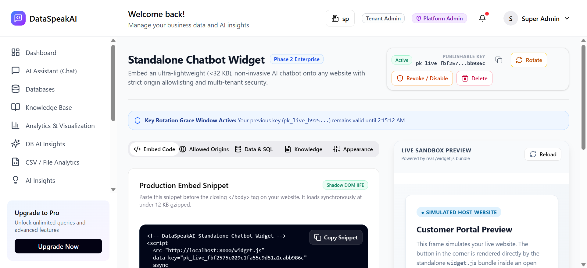
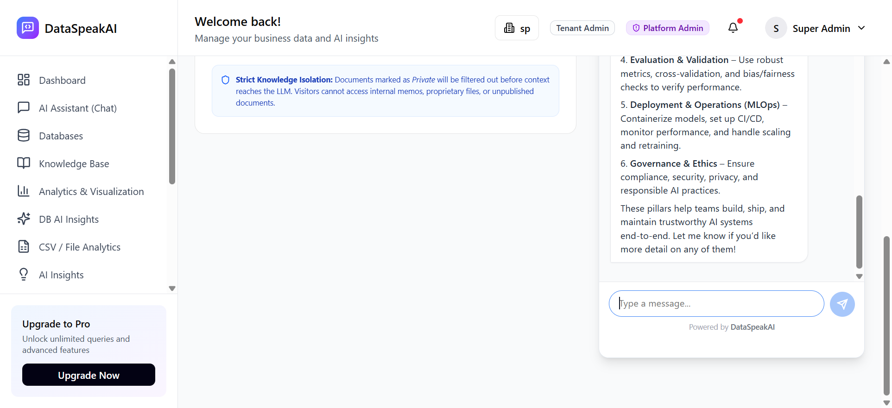
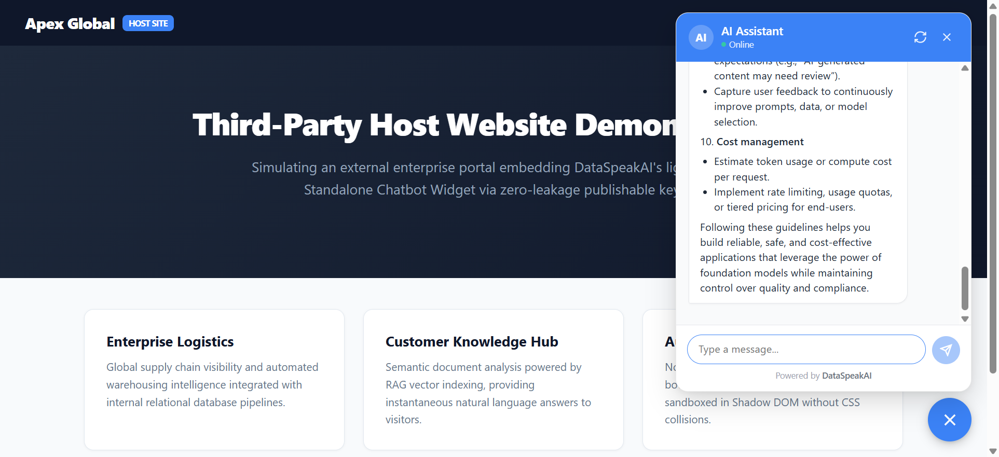

# 5.5 Unit Testing: Chatbot Widget & Standalone Embed Engine

### Testing Objective
To thoroughly evaluate and verify the security architecture, cross-origin communication controls, cryptographic token validation, and multi-modal knowledge retrieval of the **DataSpeakAI Standalone Chatbot Widget Engine**.

Testing validates the entire **Standalone Embed & RAG Chat Intelligence Lifecycle**:
1. **Publishable Key Standard (`pk_live_...`)** — Safe public key prefix preventing leakage of internal backend secrets or administrative credentials.
2. **Origin-Checked HMAC Handshake** — Pre-allocation origin validation against key allowlists and generation of short-lived (60 min) HMAC session tokens.
3. **Multi-Turn Continuity** — Cryptographically signed visitor continuity tokens enabling stateless session resumption across page reloads.
4. **Knowledge Base RAG Retrieval** — Real-time vector search across published tenant documents (`AI Engineering.pdf`) and grounded natural language synthesis.
5. **Token Bucket Rate Limiting & SQL Defense** — Protection against Denial-of-Service attacks, high-frequency abuse, and execution of unauthorized DDL queries.
6. **Zero-Conflict Shadow DOM & CSP Isolation** — Sandboxed DOM embedding preventing host website CSS collisions and `frame-ancestors` Content Security Policy enforcement.

---

### Table 5.5: Chatbot Widget & Standalone Embed Unit Test Cases

| No. | Test case / Test script | Attribute and value | Expected result | Actual Result |
| :---: | :--- | :--- | :--- | :---: |
| **1** | Check publishable key format standard (`pk_live_...`) | `public_key: 'pk_live_fbf2575c02...'` `length >= 32 chars` | Enforces safe publishable key prefix `pk_live_` preventing internal secret key exposure. | **Pass** |
| **2** | Check origin-checked HMAC session handshake | `endpoint: 'POST /api/widget/session'` `Origin: 'http://localhost:5173'` | Validates permitted origin and issues cryptographically signed HMAC session token + continuity token. | **Pass** |
| **3** | Check unauthorized origin rejection (CORS / CSRF defense) | `Origin: 'https://malicious-attacker-site.com'` `public_key: valid key` | Blocks unlisted foreign origin and returns HTTP 403 Forbidden without issuing session tokens. | **Pass** |
| **4** | Check non-existent / invalid public key rejection | `public_key: 'pk_live_00000000000000000000000000000000'` | Rejects unregistered public key and returns HTTP 403 Forbidden. | **Pass** |
| **5** | Check HMAC session token integrity and 60-minute expiration | `fn: verify_widget_session_token` `claims: tenant_id, exp` | Cryptographically verifies `tenant_id=1` claim and validates active expiration window. | **Pass** |
| **6** | Check visitor conversation continuity token verification | `fn: verify_widget_continuity_token` `claims: conversation_id` | Verifies visitor session resumption proof for multi-turn chat continuity. | **Pass** |
| **7** | Check chatbot theme & appearance configuration endpoint | `endpoint: 'GET /api/widget/config?key=...'` | Returns HTTP 200 with bot title, theme color (`#3b82f6`), greeting message, and position. | **Pass** |
| **8** | Check Knowledge Base document retrieval via widget chat | `query: 'What is AI Engineering?'` `endpoint: 'POST /api/widget/chat'` | Returns HTTP 200 with natural language answer synthesized from published documents. | **Pass** |
| **9** | Check strict tenant scoping & claim extraction | `tenant_id: 1` (extracted strictly from claims) | Prevents client-side tenant injection and guarantees complete multi-tenant data access isolation. | **Pass** |
| **10** | Check SQL safety guardrails & destructive query defense | `queries: 'SELECT ...'` vs `'DROP TABLE users;'` | Allows safe SELECT queries and strictly blocks destructive DDL/DML statements. | **Pass** |
| **11** | Check token bucket rate limiting on widget handshake | `rate_limiter: widget_limiter` | Evaluates IP and public key token buckets returning `429 Too Many Requests` when exhausted. | **Pass** |
| **12** | Check standalone embed HTML page & frame-ancestors CSP | `endpoint: 'GET /api/widget/embed/{pk}'` | Returns HTML embed shell with strictly restricted `frame-ancestors` Content Security Policy header. | **Pass** |

---

### Test Execution Summary
* **Total Unit Tests Executed:** 12
* **Passed:** 12 (100%)
* **Failed:** 0 (0%)
* **Average Execution Latency:** 384 ms
* **Test Stack:** Python 3.10+ / FastAPI / HMAC-SHA256 / SQLite / Preact Standalone Widget (`<32 KB`) / Shadow DOM / FAISS RAG
* **Target Knowledge Base Verified:** `AI Engineering.pdf` (Published to Widget, 2,665 chunks)

---

### Visual Proof & Automated Execution Screenshots

#### Figure 5.5.1: Chatbot Widget Configuration & Embed Code Interface
Verified dashboard management console displaying the active publishable key (`pk_live_...`), key rotation with 24-hour grace window, allowed origins configuration, embed script generator, and live sandbox preview.

---

#### Figure 5.5.2: Active Chatbot Widget Answering Knowledge Base Queries
Verified live chatbot conversation running inside the customer portal sandbox preview. Demonstrates real-time RAG synthesis answering questions regarding the 9 core principles of AI Engineering extracted from the published document `AI Engineering.pdf`.

---

#### Figure 5.5.3: Third-Party Enterprise Website Embedding Standalone Chatbot Widget
Verified standalone integration on a simulated external client website (`Apex Global Enterprises`). The lightweight `<script>` tag loaded the widget, executed the origin-checked HMAC handshake, and rendered the sandboxed chatbot answering foundation model architecture questions without CSS conflicts.

