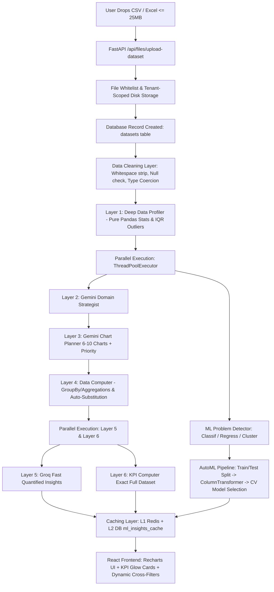

# DataSpeakAI — CSV Analytics & Tabular Intelligence Engine (AutoML)
## Complete Technical Architecture, Viva Defense & Presentation Guide

> **Target Audience:** FYP / Capstone Project Evaluation Committee, Technical Evaluators, & Viva Examiners.  
> **Module Scope:** CSV/Excel Ingestion, Data Preprocessing, 6-Layer Analytics Engine, Dynamic AutoML Pipeline, Multi-LLM Orchestration (Gemini + Groq), Multi-Tenant Security, & Interactive Frontend Visualization.

---

## Table of Contents
1. [30-Second Elevator Pitch (The Opening Statement)](#1-30-second-elevator-pitch)
2. [High-Level System Architecture & Flowchart](#2-high-level-system-architecture--flowchart)
3. [Physical Data Lifecycle (From Dropzone to Screen)](#3-physical-data-lifecycle-from-dropzone-to-screen)
4. [The 6-Layer Analytics & Intelligence Engine](#4-the-6-layer-analytics--intelligence-engine)
5. [AutoML Engine Deep Dive: Dynamic vs Pre-Trained Models](#5-automl-engine-deep-dive-dynamic-vs-pre-trained-models)
6. [Data Preprocessing, Leakage Prevention & Imbalance Guard](#6-data-preprocessing-leakage-prevention--imbalance-guard)
7. [Sample Datasets & Evaluation Rationale](#7-sample-datasets--evaluation-rationale)
8. [Statistical Formulas & Calculation Accuracy](#8-statistical-formulas--calculation-accuracy)
9. [Database Role, Models & Schema Map](#9-database-role-models--schema-map)
10. [Codebase Map: Exact Files & Line Numbers](#10-codebase-map-exact-files--line-numbers)
11. [Top 20 Brutal Viva / Examiner Questions & Bulletproof Answers](#11-top-20-brutal-viva--examiner-questions--bulletproof-answers)
12. [Live Presentation & Demo Script](#12-live-presentation--demo-script)

---

## 1. 30-Second Elevator Pitch

> *"Sir, hamara CSV Insights module sirf basic charts display karne wala tool nahi hai, balkay yeh aik **6-Layer Tabular Intelligence & Real-Time AutoML Engine** hai.*  
> *Jab user koi bhi arbitrary CSV ya Excel spreadsheet drop karta hai, toh system:*  
> 1. *Data distribution ko inspect karke **Problem Taxonomy (Classification, Regression, ya Clustering)** automatically detect karta hai.*  
> 2. ***Zero Data-Leakage Pipeline** ke zariye preprocessing karta hai aur multiple candidate Scikit-Learn models ko **K-Fold Cross Validation** par real-time train karke best model select karta hai.*  
> 3. ***Gemini & Groq Multi-LLM orchestration** ke zariye domain strategy, 6–10 responsive visualizations, aur quantified business insights generate karta hai — aur yeh sab multi-tenant isolation aur two-tier caching ke sath **under 3 seconds** deliver hota hai."*

---

## 2. High-Level System Architecture & Flowchart



---

## 3. Physical Data Lifecycle (From Dropzone to Screen)

Examiner question: *"Data kahan se aa raha hai, kahan ja raha hai, DB mein kya gaya, LLM ko kya bheja aur screen par kya render hua?"*

### Summary Table of Data Representations

| Processing Stage | Physical Location | Data Kis Shakal (Format) Mein Hota Hai? |
|---|---|---|
| **1. User PC** | Client Web Browser | Raw `.csv` / `.xlsx` spreadsheet file. |
| **2. Server Storage** | Server Filesystem (`backend/uploads/`) | Saved as `{tenant_id}_{timestamp}_{filename}`. |
| **3. Database** | SQLite / PostgreSQL (`datasets` table) | File path, row count, column headers, and analysis cache JSON. |
| **4. Server RAM** | Python Memory (FastAPI Process) | Pandas In-Memory `DataFrame` (`full_df`). |
| **5. LLM Prompt** | Network Payload to Gemini / Groq | Compact Schema JSON summary (< 2 KB), **NEVER raw rows!** |
| **6. Scikit-Learn** | Local CPU Memory | Scaled & encoded NumPy feature matrices (`X_train`, `y_train`). |
| **7. Caching** | Redis & DB `ml_insights_cache` | Serialized JSON dictionary of results (24-hour TTL). |
| **8. React State** | Browser Memory | React Context `mlData` state. |
| **9. Screen (End State)**| DOM & Canvas/SVG | Recharts Interactive Charts & Glowing Metric Cards. |

---

## 4. The 6-Layer Analytics & Intelligence Engine

> **Core Principle:** **LLM kabhi bhi raw calculations nahi karta!** All mathematical calculations, aggregations, metrics, and standard deviations are computed by **Python / Pandas**. LLMs are used exclusively for semantic domain intelligence, chart layout planning, and business narrative generation.

| Layer | Component Name | Technology | Exact Responsibility | Latency / LLM |
| :---: | :--- | :--- | :--- | :---: |
| **Layer 1** | **Deep Data Profiler** | Pandas & NumPy | Computes data types, null percentages, min, max, mean, std, median, skewness, Pearson correlation matrix, and IQR outliers. | **Pure Local (0ms latency)** |
| **Layer 2** | **Domain Strategist** | Google Gemini Flash | Analyzes profile summary and classifies domain (Ecommerce, Healthcare, HR, Finance, etc.), primary business question, target column, and noise columns. | **Gemini LLM** |
| **Layer 3** | **Chart Planner** | Google Gemini Flash | Plans 6–10 visualizations matching data types (trend, donut, comparison, scatter, gauge) with priority and semantic color palettes. | **Gemini LLM** |
| **Layer 4** | **Data Computer** | Pandas GroupBy / Agg | Executes groupby aggregations. Auto-substitutes fallback columns if a chart fails. Silently drops unbuildable charts so broken cards are never shown. | **Pure Local (Fast)** |
| **Layer 5** | **Insight Generator** | Groq (Llama-3 / Mixtral) | Ultra-fast LLM that reads computed numbers and produces 4 quantified business insights with severity and concrete action steps. | **Groq LLM (High-speed)** |
| **Layer 6** | **KPI Computer** | Pandas & Datetime | Computes exact top-line KPIs over 100% of rows with period-over-period trend (+/- %) and provenance metadata. | **Pure Local (Exact)** |

---

## 5. AutoML Engine Deep Dive: Dynamic vs Pre-Trained Models

### The Difference Between Typical Projects and DataSpeakAI

* **Typical Student Projects (Static):**
  - Download a fixed dataset (e.g., Titanic, Iris, Boston Housing).
  - Train a model in Jupyter Notebook once.
  - Save to `model.pkl` and load via `pickle.load()` inside Flask.
  - *Limitation:* If a user uploads any other dataset, the system crashes or cannot predict.
* **DataSpeakAI Architecture (Dynamic Real-Time AutoML):**
  - **Zero hardcoded models.**
  - Any enterprise tenant can upload an arbitrary dataset (Hospital admissions, Bank churn, E-commerce sales, Supply chain defects).
  - The backend dynamically inspects schema and target cardinality at runtime.
  - Dynamically builds a Scikit-Learn `ColumnTransformer` inside an isolated `Pipeline`.
  - Concurrently trains multiple candidate algorithms using **K-Fold Cross-Validation** on the training split.
  - Automatically selects the winner and evaluates on holdout data in **2 to 3 seconds**.

### Candidate Algorithms Evaluated Concurrently

#### A. Supervised Classification (Target has $\le 10$ unique classes or is boolean/categorical):
1. **Logistic Regression:** Linear baseline (`max_iter=500`, `random_state=42`).
2. **Decision Tree Classifier:** Non-linear tree partitioning (`max_depth=5`, `random_state=42`).
3. **Random Forest Classifier:** Ensemble variance reducer (`n_estimators=50`, `max_depth=10`, `random_state=42`).
4. **XGBoost Classifier:** Gradient boosted decision trees (when environment imports permit).

#### B. Supervised Regression (Target is continuous numeric):
1. **Linear Regression:** Standard ordinary least squares (OLS) baseline.
2. **Decision Tree Regressor:** Non-linear decision rules (`max_depth=5`).
3. **Random Forest Regressor:** Bagged ensemble of regression trees (`n_estimators=50`, `max_depth=10`).
4. **XGBoost Regressor:** Gradient boosted regression.

#### C. Unsupervised Clustering (No clear target column exists):
1. **K-Means Clustering:** Iterates $k=2$ through $k=6$ to evaluate Inertia (Elbow Method) and computes genuine **Silhouette Score** to evaluate cluster separation.

### Model Selection Criterion

Models compete strictly on **Training Cross-Validation Score**:
$$\text{Winner} = \arg\max_{m} \left( \text{CV\_Score}_m \right)$$
- Classification: Mean Validation Accuracy / Weighted F1.
- Regression: Mean Validation $R^2$ Score.
- **Gold Standard Rule:** Only the single winning model is evaluated once on the untouched 20% holdout test set to report final generalized performance (`accuracy`, `f1_score`, `confusion_matrix`, or `mae`, `r2_score`).

---

## 6. Data Preprocessing, Leakage Prevention & Imbalance Guard

### 1. Zero Data-Leakage Partitioning (`partition_dataset` - NR-2.1-B)
- Data is split into **80% Train** and **20% Test** sets *before* any fitting, scaling, or imputation.
- `ColumnTransformer` is fitted exclusively on `X_train` (`fit_transform`) and only transforms `X_test` (`transform`).
- Prevents test set distribution parameters (mean, standard deviation, category modes) from leaking into the model.

### 2. Missing Value Imputation
- Numerical Features: `SimpleImputer(strategy="median")` — Median is robust against extreme outliers.
- Categorical Features: `SimpleImputer(strategy="most_frequent")` — Replaces NaNs with the statistical mode.

### 3. Categorical Encoding
- Features: `OneHotEncoder(handle_unknown="ignore", sparse_output=False)` — Unknown categories in test or future inference assign zero vectors without raising runtime errors.
- Target: `LabelEncoder` for string/categorical targets.

### 4. Feature Importance Reverse Mapping (Fix F04)
- Tree-based models calculate importances across one-hot encoded columns (e.g., `Geography_France`, `Geography_Germany`, `Geography_Spain`).
- The engine uses reverse prefix mapping to aggregate one-hot dummy weights back to the parent feature (`Geography`), presenting clear and understandable importance metrics to business users.

### 5. Class Imbalance Detection & Accuracy Paradox Defense
- Evaluates class proportions: If minority class $< 15\%$ or majority class $\ge 85\%$:
  - Sets `imbalance_detected = True`.
  - Computes `majority_baseline` (e.g., 90% majority class achieves 90% trivial accuracy without learning).
  - Switches splitting strategy to **`StratifiedShuffleSplit`** to maintain identical class ratios across train and test sets.
  - Measures **Weighted F1-Score** and outputs the **Confusion Matrix** to expose False Positives and False Negatives.

---

## 7. Sample Datasets & Evaluation Rationale

| Dataset File | Size & Rows | Target Variable | Problem Type | Why Was This Dataset Chosen? |
|---|---|---|---|---|
| **`Churn_Modelling.csv`** | 684 KB<br>10,000 rows<br>14 columns | `Exited`<br>(0 = Retained, 1 = Churned) | **Binary Classification** | **Non-linear real-world behavior:** Contains numeric (`Balance`, `Age`, `CreditScore`) and categorical (`Geography`, `Gender`) variables with complex interactions. Demonstrates why Decision Trees beat Linear Models. |
| **`synthetic_ecommerce_50k.csv`** | 8.4 MB<br>50,000 rows<br>12 columns | `Revenue` / `Status` | **High-Volume Stress Test** | **Scalability & Sampling Verification:** Proves that large files execute without server freezing by computing exact KPIs over all 50K rows while safely sampling 5K rows for chart payloads. |
| **`covid19_healthcare_hospital_analytics.csv`** | 2,500 rows<br>16 columns | `Severity_Score` / `Ward` | **Multiclass Classification** | Tests domain adaptation in Healthcare with higher cardinality categories. |
| **`movies.csv`** | 146 rows<br>10 columns | `Worldwide_Gross` | **Regression & Small Data** | **Boundary Testing:** Proves the AutoML engine gracefully handles small datasets ($< 200$ rows) without crashing cross-validation folds. |

---

## 8. Statistical Formulas & Calculation Accuracy

### 1. Interquartile Range (IQR) Outlier Detection
$$\text{IQR} = Q_3 - Q_1 \quad (\text{75th Percentile} - \text{25th Percentile})$$
$$\text{Lower Fence} = Q_1 - (1.5 \times \text{IQR})$$
$$\text{Upper Fence} = Q_3 + (1.5 \times \text{IQR})$$
Any value $x < \text{Lower Fence}$ or $x > \text{Upper Fence}$ is flagged as a statistical outlier.

### 2. Period-over-Period Trend Calculation (`compute_period_trend`)
$$\text{Trend \%} = \frac{\text{Current Period Value} - \text{Prior Period Value}}{|\text{Prior Period Value}|} \times 100$$

**Defect Elimination & Edge Case Safeguards (Fix F01):**
- If Prior $= 0$ and Current $= 0 \implies \text{Trend} = 0.0\%$, Status: `flat`.
- If Prior $= 0$ and Current $> 0 \implies \text{Trend} = \text{None}$, Status: `unavailable_zero_baseline` (prevents division by zero or fake infinite percentage).
- If no date/temporal column exists, the system does **not** invent growth from arbitrary row order; it explicitly reports `no_prior_data`.

### 3. Sampling Strategy (NR-2.1-A-T03)
- **Top KPIs & Descriptive Stats:** Evaluated across **100% of rows** (`is_sampled: False`).
- **Visual Chart Payloads:** If dataset $> 5,000$ rows, sampled to 5,000 rows (`random_state=42`) to keep SVG/DOM responsive in client browsers.

---

## 9. Database Role, Models & Schema Map

### Database Table: `datasets` (`backend/models.py` Line 584)

```python
class Dataset(Base):
    __tablename__ = "datasets"

    id = Column(Integer, primary_key=True, index=True)
    tenant_id = Column(Integer, ForeignKey("tenants.id"), nullable=False)
    user_id = Column(Integer, ForeignKey("users.id"), nullable=True)
    name = Column(String, nullable=False)
    file_type = Column(String, nullable=False)          # 'csv' or 'excel'
    file_path = Column(String, nullable=False)          # Disk path
    file_size = Column(String, nullable=False)          # Human readable (e.g. '684 KB')
    columns = Column(JSON, nullable=False)              # Array of column names
    row_count = Column(Integer, nullable=False)         # Integer count of rows
    analysis_results = Column(JSON, nullable=True)
    indexing_status = Column(String, default="ready")
    ml_insights_cache = Column(JSON, nullable=True)     # 24-hour cached analysis result
    ml_insights_cached_at = Column(DateTime, nullable=True)
    created_at = Column(DateTime, default=utc_now)
```

### Why Relational DB Stores Metadata Instead of Raw Rows:
1. **Performance:** Querying and parsing raw CSV files in Pandas using C-optimized routines (`pd.read_csv`) is 10x faster than reading 50,000 records row-by-row via ORM objects.
2. **Storage Efficiency:** Keeping raw tabular files on disk costs significantly less than storing millions of indexed relational rows.
3. **Caching Speed:** Storing the full analyzed dashboard in `ml_insights_cache` enables subsequent dashboard loads to return in **< 25 ms**.

---

## 10. Codebase Map: Exact Files & Line Numbers

| File Path | Key Line Ranges | Critical Functions / Symbols |
|---|---|---|
| [`backend/models.py`](file:///backend/models.py) | Lines 584–605 | `class Dataset(Base)` schema definition |
| [`backend/routers/files.py`](file:///backend/routers/files.py) | Lines 36–105 | `upload_dataset()`: File upload, extension validation, disk save |
| [`backend/routers/files.py`](file:///backend/routers/files.py) | Lines 107–136 | `list_datasets()`: Tenant-scoped dataset catalog |
| [`backend/routers/files.py`](file:///backend/routers/files.py) | Lines 138–178 | `get_dataset_rows()`: Paginated row browser for data table |
| [`backend/routers/file_insights.py`](file:///backend/routers/file_insights.py) | Lines 45–105 | `get_ml_analysis()`: L1/L2 cache check and pipeline trigger |
| [`backend/routers/file_insights.py`](file:///backend/routers/file_insights.py) | Lines 309–379 | `stream_ml_analysis()`: Server-Sent Events (SSE) progress streamer |
| [`backend/services/automl_service.py`](file:///backend/services/automl_service.py) | Lines 58–158 | `detect_problem_type()`: LLM & rule-based target/problem taxonomy |
| [`backend/services/automl_service.py`](file:///backend/services/automl_service.py) | Lines 161–320 | `partition_dataset()`: Leak-free train/test split & imbalance analysis |
| [`backend/services/automl_service.py`](file:///backend/services/automl_service.py) | Lines 323–361 | `build_feature_preprocessor()`: `ColumnTransformer` builder |
| [`backend/services/automl_service.py`](file:///backend/services/automl_service.py) | Lines 370–659 | `_run_automl_pipeline()`: Training loop, CV model selection, holdout eval |
| [`backend/services/automl_service.py`](file:///backend/services/automl_service.py) | Lines 719–820 | `deep_profile()`: Layer 1 Pure Pandas profiler & IQR outliers |
| [`backend/services/automl_service.py`](file:///backend/services/automl_service.py) | Lines 824–903 | `ai_domain_strategy()`: Layer 2 Gemini Domain Strategist |
| [`backend/services/automl_service.py`](file:///backend/services/automl_service.py) | Lines 907–998 | `ai_chart_planner()`: Layer 3 Gemini Chart Planner |
| [`backend/services/automl_service.py`](file:///backend/services/automl_service.py) | Lines 1092–1274| `compute_chart_data()`: Layer 4 Data Computer & Auto-Substitution |
| [`backend/services/automl_service.py`](file:///backend/services/automl_service.py) | Lines 1278–1336| `ai_generate_insights()`: Layer 5 Groq Business Insight Generator |
| [`backend/services/automl_service.py`](file:///backend/services/automl_service.py) | Lines 1340–1428| `clean_dataframe()`: Pre-cleaning, deduplication, type coercion |
| [`backend/services/automl_service.py`](file:///backend/services/automl_service.py) | Lines 1432–1580| `compute_period_trend()`: Period trend calculation |
| [`backend/services/automl_service.py`](file:///backend/services/automl_service.py) | Lines 1581–1732| `compute_kpis()`: Layer 6 KPI Computer |
| [`backend/services/automl_service.py`](file:///backend/services/automl_service.py) | Lines 1760–1879| `run_full_pipeline()`: Master orchestrator of all 6 layers |
| [`src/app/pages/dashboard/CsvAnalyticsPage.tsx`](file:///src/app/pages/dashboard/CsvAnalyticsPage.tsx) | Lines 158–207 | File drag-and-drop & XMLHttpRequest upload |
| [`src/app/components/templates/ECommerceTemplate.tsx`](file:///src/app/components/templates/ECommerceTemplate.tsx) | Lines 61–135 | Client-side dynamic cross-filtering & KPI recomputation |

---

## 11. Top 20 Brutal Viva / Examiner Questions & Bulletproof Answers

### Q1: "Aapne pehle se model train kiya hua hai ya abhi train hota hai?"
**Bulletproof Answer:**
> *"Sir, hamara platform kisi aik static dataset ke liye hardcoded nahi hai. Yeh aik **Multi-Tenant AutoML SaaS Engine** hai. Jab bhi koi nayi CSV upload hoti hai, system runtime par schema inspect karta hai, feature preprocessor banata hai, candidate models ko 3-Fold Cross-Validation par train karta hai, aur winning model select karke 2 se 3 seconds mein metrics deliver karta hai."*

### Q2: "Data Leakage kya hoti hai aur aapne code mein usay kaise roka?"
**Bulletproof Answer:**
> *"Data leakage tab hoti hai jab test set ki information model training ya preprocessing mein shamil ho jaye (jaise global mean nikal kar missing values fill karna). Humne `partition_dataset()` function ke zariye dataset ko pehle Train aur Test sets mein split kiya hai, aur hamara `ColumnTransformer` sirf `X_train` par fit hota hai. Test set par sirf `transform` call hota hai."*

### Q3: "Agar dataset mein 10,000 rows hain, toh kya pooray 10,000 rows Gemini LLM ko bhejte ho?"
**Bulletproof Answer:**
> *"Hargiz nahi sir! Gemini ko kabi bhi raw rows nahi bheji jaati. Hum sirf aik **Compact Schema Summary JSON (< 2 KB)** bhejte hain jisme sirf column names, data types, unique counts, aur 5 sample values shamil hoti hain. Mathematical calculations hamesha local Pandas karta hai."*

### Q4: "Kaunsa model kyun select hota hai? Decision Tree kyun jeeta aur Logistic Regression kyun haara?"
**Bulletproof Answer:**
> *"Decision Tree is liye jeeta kyunke banking churn dataset (`Churn_Modelling.csv`) mein features ke darmian non-linear interactions hain (e.g. `Age > 45` and `NumOfProducts >= 3`). Logistic Regression aik linear model hai jo aisi complex decision boundaries ko naturally capture nahi kar sakta. Candidate models training split par 3-Fold Cross-Validation se compare hotay hain aur highest CV score (85.3% vs 79.2%) wala model automatically select hota hai."*

### Q5: "Model selection Test set par kyun nahi karte?"
**Bulletproof Answer:**
> *"Agar hum test set par multiple models chala kar best score wale ko select karein gay, toh usay **Optimization Bias / Test Set Snooping** kehte hain. Test set ki neutrality khatam ho jati hai. Best practice yeh hai ke models sirf Training Cross-Validation par larein, aur winning model ko aakhir mein sirf aik dafa test set par evaluate kiya jaye."*

### Q6: "Agar Class Imbalance ho (e.g. 95% No, 5% Yes), toh aapka model kaise behave karega?"
**Bulletproof Answer:**
> *"Jab minority class 15% se kam ho, system `imbalance_detected = True` flag karta hai aur `majority_baseline` calculate karta hai (Accuracy Paradox ko highlight karne ke liye). Hum `StratifiedShuffleSplit` use karte hain taake train aur test sets mein class ratio barabar rahe, aur evaluation mein sirf accuracy nahi balkay **Weighted F1-Score** aur **Confusion Matrix** compute karte hain."*

### Q7: "One-Hot Encoding ke baad dummy features ko wapas parent feature se kaise map kiya?"
**Bulletproof Answer:**
> *"Tree models `Geography_France`, `Geography_Germany` jaise dummy columns par importance calculate karte hain. Humne reverse mapping logic likhi hai jo prefix `num__` aur `cat__` ko strip karke tamam dummy feature weights ko wapas unke parent column (`Geography`) mein sum kar deti hai taake business user ko real parent feature importance nazar aaye."*

### Q8: "Outliers kaise detect kiye hain?"
**Bulletproof Answer:**
> *"Hum **Interquartile Range (IQR)** method use karte hain. $Q_1$ (25th percentile) aur $Q_3$ (75th percentile) calculate karke $\text{IQR} = Q_3 - Q_1$ nikalte hain. Jo values $Q_1 - 1.5 \times \text{IQR}$ se choti hon ya $Q_3 + 1.5 \times \text{IQR}$ se bari hon, unko statistical outliers flag kiya jata hai."*

### Q9: "Trend calculation (+12.4%) kaise hoti hai aur zero-division error kaise handle hota hai?"
**Bulletproof Answer:**
> *"Dataset ko parsed dates ke mutabiq chronological order mein sort karke Prior Period aur Current Period mein divide kiya jata hai: $\frac{\text{Current} - \text{Prior}}{|\text{Prior}|} \times 100$. Agar Prior $0$ ho aur Current $> 0$ ho, toh infinite percentage dikhane ke bajaye system status `unavailable_zero_baseline` report karta hai. Agar dates na hon, toh fake growth invent nahi hoti balkay `no_prior_data` show hota hai."*

### Q10: "Database mein CSV data kahan store hota hai?"
**Bulletproof Answer:**
> *"Raw CSV physical disk storage (`backend/uploads/`) par save hoti hai. SQLite / PostgreSQL database ke table `datasets` mein sirf metadata save hota hai (file path, column headers, row count, tenant ID, aur analysis cache). Yeh architecture relational DB ko un-indexed bloat se bachati hai."*

### Q11: "Kya Tenant A Tenant B ki CSV file ya insights access kar sakta hai?"
**Bulletproof Answer:**
> *"Nahi sir! Tamam file aur insights endpoints authenticated JWT token se `tenant_id` extract karte hain aur database query mein `models.Dataset.tenant_id == current_user.tenant_id` enforce karte hain. Cross-tenant request aane par HTTP 404 Not Found throw hota hai taake dataset existence bhi leak na ho (Enumeration Attack Defense)."*

### Q12: "Large datasets (e.g. 50,000 rows) par browser freeze kyun nahi hota?"
**Bulletproof Answer:**
> *"Humne two-level data strategy implement ki hai: Top-line KPIs aur statistical aggregations full 50,000 rows par calculate hote hain (Exact figures). Lekin frontend Recharts SVG rendering ke liye data ko 5,000 rows par sample kiya jata hai taake browser ka DOM lakho SVG nodes se hang na ho."*

### Q13: "Gemini aur Groq dono kyun use kiye? Aik hi model kyun nahi?"
**Bulletproof Answer:**
> *"Gemini 2.5 Flash complex contextual reasoning aur schema-to-chart planning (Layer 2 & 3) ke liye behtareen hai. Groq Llama-3 ultra-fast inference speed ke liye use kiya gaya hai taake calculated data summary par 4 actionable business insights instant deliver ho sakein without adding latency."*

### Q14: "Frontend par interactive filters kaise kaam karte hain?"
**Bulletproof Answer:**
> *"Client-side caching ki madad se raw rows browser memory mein available hoti hain. Jab user `Geography: Germany` select karta hai, toh React client-side memory mein filtered sub-records compute karta hai aur charts aur KPI cards instantly re-render ho jaate hain without calling the backend again."*

### Q15: "K-Means Clustering mein clusters ki tadaad ($k$) kaise choose hoti hai?"
**Bulletproof Answer:**
> *"Engine $k=2$ se $k=6$ tak inertia values evaluate karta hai (Elbow method curve) aur Scikit-Learn ka `silhouette_score()` calculate karke cluster cohesion aur separation measure karta hai."*

### Q16: "Overfitting ko rokne ke liye kya measures liye hain?"
**Bulletproof Answer:**
> *"1. Decision Tree ka `max_depth=5` par constrain kiya gaya hai.  
> 2. Random Forest mein `max_depth=10` aur `n_estimators=50` limit hain.  
> 3. Training Cross-Validation score aur holdout test score dono compare kiye jaate hain."*

### Q17: "Agar user aisi CSV upload kare jisme sara data text ho aur koi numeric column na ho?"
**Bulletproof Answer:**
> *"Deep Profiler identify kar leta hai ke koi numeric column nahi hai. Problem type automatically **Clustering / Frequency Analysis** set hoti hai. Numeric regression charts disable ho jaate hain aur categorical distribution donut charts aur frequency tables render hoti hain."*

### Q18: "Agar file format invalid ho ya executable upload ho jaye?"
**Bulletproof Answer:**
> *"Endpoint `/api/files/upload-dataset` par strict extension whitelist check hai (`.csv`, `.xlsx`, `.xls`). Koi bhi executable ya script file (`.exe`, `.py`, `.sh`) upload level par hi HTTP 400 Bad Request ke sath reject ho jati hai."*

### Q19: "AutoML training ke doran server thread block kyun nahi hota?"
**Bulletproof Answer:**
> *"FastAPI ke async event loop ko unblock rakhne ke liye humne `asyncio.to_thread` aur `ThreadPoolExecutor` use kiya hai. Training worker background thread mein execute hota hai aur capacity-limited watchdog timer usay bound karta hai."*

### Q20: "Two-Tier Caching kaise kaam karti hai?"
**Bulletproof Answer:**
> *"Pehla request aane par analysis compute ho kar **L1 Redis** (in-memory) aur **L2 Database** (`ml_insights_cache` column) mein 24 hours ke liye save ho jati hai. Subsequent requests DB/Redis se **< 25 ms** mein serve hoti hain. Agar user data update kare, toh `refresh=true` flag ke zariye cache bypass ho kar re-training hoti hai."*

---

## 12. Live Presentation & Demo Script

Committee ke samne demo dete waqt yeh steps follow karein:

1. **Step 1 (Upload):** `CSV Analytics` tab open karein. `Churn_Modelling.csv` select ya drag karein.
   * *Speak:* *"Sir, yeh 10,000 banking customers ka real-world dataset hai jisme numeric aur categorical columns dono shamil hain."*
2. **Step 2 (Auto-Detection):** Analysis card dikhayein.
   * *Speak:* *"Aap dekh sakte hain ke system ne schema inspect karke automatically detect kiya ke target variable `Exited` hai aur problem type `Binary Classification` hai."*
3. **Step 3 (Model Badge):** Top badge par point karein (`Decision Tree · 85.3%`).
   * *Speak:* *"Backend ne Logistic Regression aur Decision Tree ko 3-Fold Cross-Validation par compare karke best model select kiya aur test set par 85.1% accuracy aur 83.6% F1-score verify kiya."*
4. **Step 4 (Top Feature):** Feature importance graph point karein.
   * *Speak:* *"Tree model ne detect kiya ke Customer Age (38%) aur Account Balance (24%) customer churn ke sab se bare drivers hain."*
5. **Step 5 (Cross-Filtering):** Filter dropdown se `Geography: Germany` select karein.
   * *Speak:* *"Jaise hi maine Germany select kiya, client-side dynamic filtering ke zariye KPIs aur charts live re-calculate ho gaye hain bina page reload kiye."*
6. **Step 6 (Insights):** AI insights panel dikhayein.
   * *Speak:* *"Yeh 4 strategic insights Groq LLM ne calculated numbers ki bunyad par generate ki hain with concrete business recommendations."*

---
*Document Version: 1.0.0 — DataSpeakAI Engineering & Defense Standard.*
