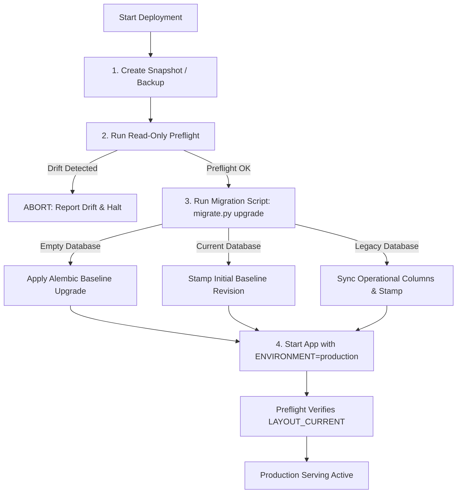

# DataSpeakAI — Database Migration & Recovery Runbook (Phase NR-0)

**Document Version:** 1.0.0  
**Phase:** NR-0 Foundation  
**Milestone:** NR-0.1  
**Sprint:** NR-0.1-B (Establish Versioned Migrations)  
**Standard Authority:** [`AGENTS.md`](file:///AGENTS.md) Section 4.5 & [`docs/next_release_implementation_pathway.md`](file:///docs/next_release_implementation_pathway.md) Section 6  

---

## 1. Overview & Architectural Principles

DataSpeakAI employs an audited, version-controlled migration lifecycle powered by **Alembic** and the DataSpeakAI **Schema Preflight & Adoption Controller** (`backend/scripts/migrate.py`).

### 1.1 Core Safety Mandates
1. **Decoupled Application Startup:** `models.Base.metadata.create_all` and unversioned runtime mutation functions are strictly prohibited during production application startup (`ENVIRONMENT=production`). Application startup performs read-only compatibility inspection and aborts if schema drift is detected.
2. **Explicit Migration Gate:** All schema upgrades, adoptions, and migrations must be explicitly executed via `backend/scripts/migrate.py` or `alembic upgrade head` before application instances boot.
3. **Drift Rejection:** Any database containing unrecognized tables or rogue columns is classified as `LAYOUT_UNSUPPORTED` and rejected without applying DDL.
4. **Mandatory Backup Before Migration:** A verified backup must be captured and verified before executing migrations in staging or production.

---

## 2. Standard Deployment & Migration Lifecycle



### 2.1 Pre-Deployment Backup

Before executing any migration command, capture a complete database snapshot:

#### SQLite Deployment
```bash
# Atomic SQLite copy / vacuum into backup
sqlite3 /data/app.db ".backup /data/backups/app_pre_deploy_$(date +%Y%m%d_%H%M%S).db"
```

#### PostgreSQL Deployment
```bash
# Compressed binary dump with custom format
pg_dump -Fc -h "$DB_HOST" -U "$DB_USER" -d "$DB_NAME" -f "/backups/dataspeak_pre_deploy_$(date +%Y%m%d_%H%M%S).dump"
```

---

## 3. Execution Commands

### 3.1 Step 1: Read-Only Preflight Inspection
Run preflight to verify dialect, existing tables, fingerprint, and revision state without modifying the database:

```bash
# Using default environment DATABASE_URL
python backend/scripts/migrate.py check

# Or specifying explicit connection URL
python backend/scripts/migrate.py check --database-url "$DATABASE_URL"
```

**Expected Output (Healthy Current):**
```
INFO: Running read-only schema preflight on: sqlite:////data/app.db
INFO: Layout Classification: LAYOUT_CURRENT (Status: valid)
INFO: Dialect: sqlite | Tables: 46 | Fingerprint: 0a93c7d6978680c2
INFO: Alembic Revision: 001_initial_baseline
INFO: Details: Full 46-table reconciled schema is present.
```

### 3.2 Step 2: Controlled Migration / Schema Adoption
Execute the controlled migration runner:

```bash
python backend/scripts/migrate.py upgrade
```

**Supported Pathways:**
| Detected Layout | Action Taken | Result |
|---|---|---|
| `LAYOUT_EMPTY` | Runs `alembic upgrade head` | Provisions 46 tables + `alembic_version` stamped `001_initial_baseline` |
| `LAYOUT_CURRENT` (no revision) | Runs `alembic stamp 001_initial_baseline` | Brings existing 46-table database under version control without modifying data |
| `LAYOUT_CURRENT` (versioned) | Runs `alembic upgrade head` | Applies pending incremental revisions |
| `LAYOUT_LEGACY` | Runs transitional column synchronizer and stamps `001_initial_baseline` | Safely adds missing operational tables and stamps baseline |
| `LAYOUT_UNSUPPORTED` | **Aborts with exit code 1** | Leaves database untouched; logs rogue table/column list |

### 3.3 Step 3: Application Startup
Start the FastAPI server:

```bash
# In production (Render / Cloud environment)
uvicorn backend.main:app --host 0.0.0.0 --port "$PORT"
```
During startup, `backend/main.py` executes `inspect_database_layout(engine)`. If `report["layout"] != "LAYOUT_CURRENT"`, startup raises a `RuntimeError` and halts to prevent serving against an incomplete schema.

---

## 4. Additive Migrations, Backfill & Constraint Enforcement Pattern

When modifying persistent schema fields in future sprints, follow the 4-phase **Expand -> Backfill -> Validate -> Constrain** protocol:

1. **Expand (Phase 1):** Add the column with `nullable=True` (or safe default) in Alembic revision.
2. **Backfill (Phase 2):** Use `backend/scripts/backfill_validator.bounded_backfill` to populate values in bounded batches (e.g., 500 rows/batch) using cursor-based pagination (`key_col > last_key`).
3. **Validate (Phase 3):** Run `backend/scripts/backfill_validator.validate_column_invariants` to verify:
   - `null_count == 0` (for `NOT NULL` constraints)
   - `duplicate_count == 0` (for `UNIQUE` constraints)
   - `orphan_count == 0` (for `FOREIGN KEY` constraints)
4. **Constrain (Phase 4):** Apply `NOT NULL` / `UNIQUE` / `FOREIGN KEY` constraints via `enforce_column_constraints`. If validation fails, constraint enforcement is immediately blocked, raising `BackfillValidationError` with detailed diagnostics without credential leakage.

---

## 5. Rollback & Disaster Recovery Procedures

### 5.1 Scenario A: Migration Interruption or Failure
If a migration is interrupted (e.g. process terminated):
1. Alembic transactions on PostgreSQL automatically roll back upon failure.
2. On SQLite, inspect table state with `python backend/scripts/migrate.py check`.
3. If partial state occurred, restore the pre-migration backup before re-attempting.

### 5.2 Scenario B: Application Downgrade / Rollback
If a deployed application release must be rolled back to a previous code revision:
1. Stop application traffic.
2. If the schema revision was additive (backward-compatible columns added), no database downgrade is required; previous application code can safely query the database ignoring the extra columns.
3. If an explicit schema rollback is required:
   ```bash
   python -m alembic -c backend/alembic.ini downgrade -1
   ```
4. Start the previous application release.

### 5.3 Scenario C: Complete Database Restore
In the event of catastrophic data corruption:
1. Terminate all running backend instances.
2. Restore the database from the pre-deployment backup:
   - **SQLite:** Copy the backup file over the active `app.db`.
   - **PostgreSQL:**
     ```bash
     dropdb -h "$DB_HOST" -U "$DB_USER" "$DB_NAME"
     createdb -h "$DB_HOST" -U "$DB_USER" "$DB_NAME"
     pg_restore -h "$DB_HOST" -U "$DB_USER" -d "$DB_NAME" "/backups/dataspeak_pre_deploy.dump"
     ```
3. Run `python backend/scripts/migrate.py check` to verify preflight sanity.
4. Restart application instances.

---

## 6. Audit & Verification Record
- **Initial Baseline Revision ID:** `001_initial_baseline`
- **Reconciled Spec Table Count:** 46 tables
- **Fingerprint Specification:** SHA-256 truncated hex of sorted tables and column types
- **CI / Local Dual-Dialect Support:** Option B verified (SQLite exhaustive local verification with PostgreSQL gated in CI workflow).
